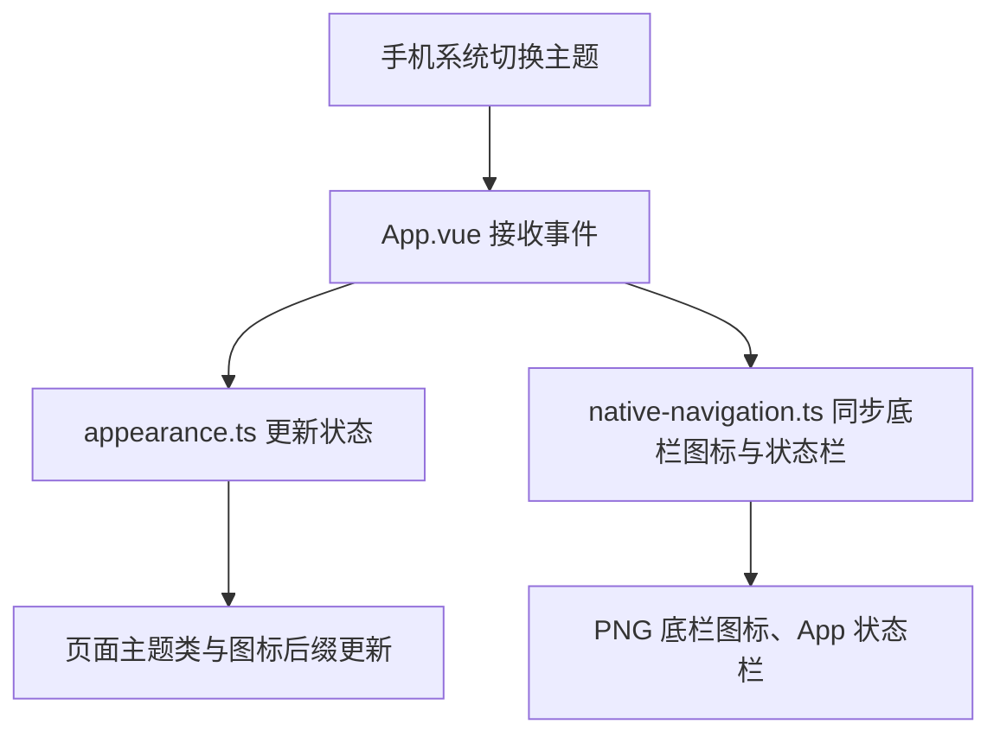

# 工程文件关系速览

记住一句话：**tokens 定规则，App 接事件，Store 存状态，页面画内容，native-navigation 改原生栏。**

## 1. 样式从哪里来

```text
src/styles/tokens.css（唯一数值来源）
├─ 样式文件 → 页面、TDesign 控件
└─ generate-native-theme.ts → src/theme.json → 原生导航栏、底栏
```

- **页面层**用 CSS 变量，可以直接读取 tokens。
- **原生层**不能读取页面 CSS，所以通过生成脚本取得同一套颜色。
- 脚本在构建时由 vite.config.ts 调用；theme.json 自动生成，不手改。

## 2. 暗色切换时谁调用谁



| 文件                                                                  | 你可以把它理解为                                          |
| --------------------------------------------------------------------- | --------------------------------------------------------- |
| [App.vue](../../../src/App.vue)                                       | 总入口：开启自动跟随、监听变化、组织同步                  |
| [utils/theme.ts](../../../src/utils/theme.ts)                         | 读取和校验主题值，只输出有效的 light / dark               |
| [stores/appearance.ts](../../../src/stores/appearance.ts)             | 共享状态：保存 isDark，派生 theme、themeClass、iconSuffix |
| [common/native-navigation.ts](../../../src/components/common/native-navigation.ts)                       | 切换 PNG 底栏图标，并设置 App 状态栏                      |
| [tokens.css](../../../src/styles/tokens.css)                          | 定义明暗颜色、字号、间距和尺寸                            |
| [generate-native-theme.ts](../../../scripts/generate-native-theme.ts) | 构建时把颜色令牌转换成原生配置                            |

**关键前置条件：**App.vue 的 onLaunch 中，先开启自动跟随，再注册 uni.onThemeChange。

```ts
// #ifdef APP-PLUS
plus.nativeUI.setUIStyle('auto')
// #endif
```

之前缺少这一步，才会出现“重启能变暗，运行中切换没有反应”。当前通过系统事件同步，没有主题轮询。

## 3. 开发页面时怎么接入

页面只需要从 Store 读取 themeClass，绑定到根节点。

```vue
<script setup lang="ts">
import { useAppearanceStore } from '@/stores/appearance'

const appearance = useAppearanceStore()
</script>

<template>
  <view class="min-h-screen bg-canvas text-ink" :class="appearance.themeClass">
    <!-- 页面内容 -->
  </view>
</template>
```

原生标题栏和底栏配色由 pages.json 的 `@变量` 与 theme.json 交给原生 darkmode 自动切换，页面不需要再同步原生栏。

## 4. 想改东西，直接找这里

| 想修改什么                   | 找哪个文件                                           |
| ---------------------------- | ---------------------------------------------------- |
| 配色、字号、间距的数值       | src/styles/tokens.css                                |
| TDesign 公共主题映射         | src/styles/tdesign-theme.css                         |
| 按钮／输入框／字体 class     | src/styles/buttons.css / inputs.css / typography.css |
| gap-space-16 等布局类        | src/styles/tailwind.css                              |
| 底栏入口、标题和原生尺寸配置 | src/pages.json                                       |
| 是否启用平台暗色能力         | src/manifest.json                                    |
| 首页数据和交互               | src/pages/index/index.vue                            |
| 首页顶部／卡片结构           | components/common/AppNavbar.vue / pages/index/FeedCard.vue |
| 原生栏动态配色和图标         | src/components/common/native-navigation.ts                                  |

首页仍使用本地预览数据；消息角标暂未实现。详细样式编号见[样式说明](../../../src/styles/styles%20说明.md)。

**通用排查顺序：**先确认平台与前置条件 → 看事件有没有到 → 看 Store 有没有变 → 分别检查页面和原生栏。构建成功不能替代真机验证。

主题回归检查：`npm run test:theme`。本项目是普通 uni-app（app-plus），不要直接套用 uni-app x 的配置。
