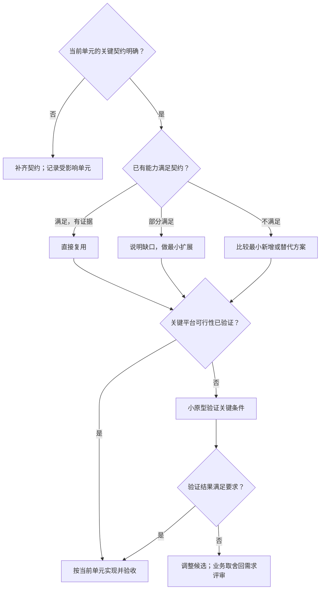

# 【模块名】前端方案

> A2 技术决策：只维护**状态归属 → 模块数据流 → 实现选择 → 可行性证据**。业务定义、运行规则、行为验收与业务未决项只引用[需求评审](需求评审模板.md)。
>
> 对应最小单元：【填写】；方案状态：【草案／待验证／已验证】；实现状态：【未实现／部分实现／已实现】。每项结论以第 4 节证据为准。

## 1. 数据放哪里（状态归属表）

“状态”是功能需要记住且会变化的信息。本表明确谁持有、保留多久与何时清理，没有执行先后。按当前需求删改下表。

| 需要记住的信息 | 由谁管理 | 保留范围与清理时机 |
| --- | --- | --- |
| 【当前选中项、临时输入等】 | 【页面局部状态】 | 【页面实例／操作结束】 |
| 【可复用流程中的数据、进度与错误】 | 【已有 composable 或待验证候选】 | 【实例范围与重置条件】 |
| 【跨页共享的业务变化】 | 【已有 Store；不足时说明最小扩展】 | 【按业务 ID、账号隔离及清理条件】 |
| 【需要跨重启保留的快照，按需保留】 | 【已有存储封装】 | 【保留内容、有效期、版本与失效条件；未确认项引用 Q 编号】 |

同一业务事实明确唯一持有者；派生数据说明由什么计算，不无依据复制一份业务对象。

## 2. 模块之间传什么（数据链路）

主链路：【操作／接口输入】 → 【API 模块】 → 【状态或流程管理】 → 【派生／布局数据】 → 【页面或组件展示】。

按需补充：【本地快照如何初始化】；【跨页变化如何合并或失效】；【新结果何时生效，失败时保留什么】。

| 交接边界 | 输入 → 输出 | 已知契约与证据／缺口 |
| --- | --- | --- |
| 【接口 → API 模块】 | 【请求语义 → 业务数据】 | 【已确认接口来源；缺失语义引用 Q 编号】 |
| 【流程管理 → 展示】 | 【业务对象与状态 → 展示数据与动作】 | 【实际类型、ID、状态和更新责任】 |

字段示意必须标为“所需数据示意，非已存在 API”；未确认的字段、权限、排序或结束语义不能当事实使用。

## 3. 开发时怎么选（技术决策）

本节回答“满足什么条件，就采用什么实现”。分支是开发选择，普通处理步骤用文字说明。

### 3.1 【当前最小单元】技术选择（怎么实现）

以下为条件分支骨架，使用时按源码证据改写；已由证据确定的分支写成确定动作，不反复假设。

| 决策点 | 当前选择与原因 | 依据与适用边界 | 未选方案及原因（有真实取舍时填写） |
| --- | --- | --- | --- |
| 【复用／扩展／新增】 | 【选择什么，解决哪个缺口】 | 【源码、契约或验证记录】 | 【实际比较过的候选】 |

真实接口不可用但关键契约明确时，可使用同契约 Mock 验证前端；契约仍缺失时不能通过 Mock 自行确定业务规则。

### 3.2 【关键机制或算法】说明（按需保留）

只展开当前单元最难或最不确定的一处，不为每个组件写实现教程。

| 数据 | 来源与用途 |
| --- | --- |
| 【业务对象、唯一标识和顺序】 | 【谁提供，前端可否修改或重新排序】 |
| 【计算必需的元数据】 | 【来源；缺失处理引用已确认规则或 Q 编号】 |
| 【前端派生记录】 | 【计算结果及关联 ID，避免复制业务对象】 |

处理步骤：

1. 【输入校验或读取前置状态】。
2. 【关键转换／计算；公式中的变量和单位明确】。
3. 【提交结果的条件、顺序与一致性边界】。
4. 【失败恢复、重置或资源释放】。

特殊场景：【普通更新与刷新／删除／尺寸变化等是否需要不同处理】。

当前源码缺口：【文件路径、已有能力、缺少什么；没有证据则写待核实】。

### 3.3 一致性、缓存与资源边界（按需保留）

| 实现对象 | 技术处理 | 对应规则／验收 |
| --- | --- | --- |
| 【异步请求与提交】 | 【重复触发、旧响应、取消或批次如何处理】 | 【RR／AC 编号】 |
| 【跨页共享变化】 | 【按 ID 合并、失效与清理边界】 | 【BR／AC 编号】 |
| 【本地快照】 | 【读写、校验与提交时机；业务策略引用需求评审】 | 【BR／AC 编号】 |
| 【内存／挂载／资源】 | 【分别说明容量或释放边界；参数待测则标待测】 | 【AC 编号或验证项】 |

平台与版本边界：【目标平台、当前版本、官方依据及尚未验证之处】。不要把其他渲染模式或平台的能力直接当作当前方案能力。

## 4. 方案是否可行（技术验证）

| 编号 | 技术选择 | 需要证明什么 | 最小验证方法与环境 | 当前状态／证据 |
| --- | --- | --- | --- | --- |
| TV-01 | 【复用或扩展】 | 【现有输入输出能否满足当前契约】 | 【直接依赖源码核对／关键测试】 | 【待核实／源码缺口已确认；附路径】 |
| TV-02 | 【关键机制或兼容候选】 | 【最可能失败的一处能否成立】 | 【小原型、目标平台与复现步骤】 | 【未验证／已验证／不满足；附记录】 |
| TV-03 | 【确有需求的性能或容量选择】 | 【真实场景下是否达到已确认目标】 | 【设备、版本、数据规模、同条件测量】 | 【待测；不先编造参数或收益】 |

功能是否达标只使用[需求评审第 8 节的 AC 用例](需求评审模板.md#8-验收表)，此处不重列。源码核对、检查通过、平台可运行和业务行为通过分别记录，不能互相替代。

若验证引出新的业务取舍，回需求评审第 1、9 节更新；不在方案中新增业务默认值。

## 5. A3 文件关系与输入输出（最小闭环确定后按需补充）

尚未进入 A3 时保留一句“当前不展开”，删除空表；不要为填满模板预设文件或架构。

| 文件／模块 | 复用／修改／新增及理由 | 输入 → 输出 | 直接影响与验证 |
| --- | --- | --- | --- |
| 【源码路径】 | 【当前单元需要的最小变化】 | 【类型、状态、调用或事件】 | 【直接使用方、TV／AC 编号及检查】 |

实施顺序：【当前闭环必要步骤】；完成依据：【对应技术验证、行为验收及项目要求的检查记录】。
