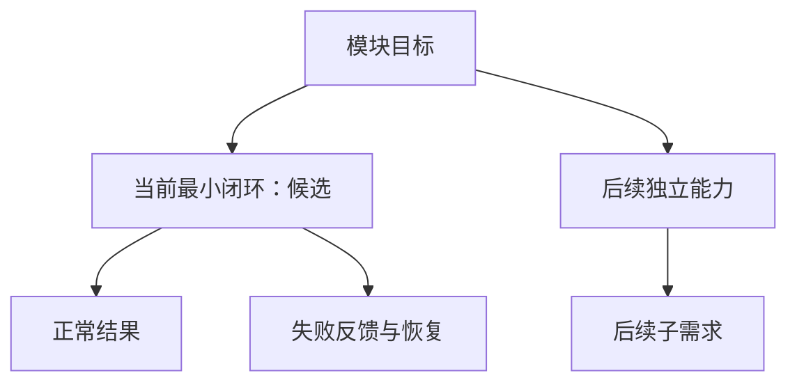

# 【模块名】需求评审与最小决策树

> A1 评审与 A2 需求拆分：唯一维护业务规则、用户已确认约束、运行规则、行为验收与业务未决项。实现选择与可行性证据见[前端方案](前端方案模板.md)。
>
> 当前阶段：【填写】；AI 评审建议：【通过／附条件通过／需补充／暂缓及理由】；人工评审结论：【未评审或实际结论与依据】。
> 实现状态：【未编码／进行中／已实现】；行为验收：【未执行／部分执行／已完成，附记录】。不同状态分别填写。

## 1. 依据与决策记录

依据：【原始诉求、设计稿、用户确认记录、接口约定、相关源码或计划的路径／链接】。借用参考资料的方法时，说明哪些范围、数字或排期不沿用。

| 状态 | 决定或事实 | 依据 |
| --- | --- | --- |
| 已确认 | 【用户已决定的业务约束】 | 【确认来源】 |
| 已核实 | 【现有能力或真实缺口，不等同于已运行验证】 | 【源码或复现记录】 |
| 建议 | 【推荐的当前闭环或候选取舍】 | 【理由及影响】 |

尚无确认依据的内容移到第 9 节，不作为默认业务规则。

## 2. 需求卡

| 项目 | 内容 |
| --- | --- |
| 问题与用户 | 【谁在什么条件下遇到什么问题】 |
| 目标 | 【希望观察到的变化及其价值】 |
| 本期范围 | 【本轮包含的能力】 |
| 后续范围 | 【明确后置的能力，防止本轮不断扩张】 |
| 当前最小单元 | 【起点 → 成功结果 → 失败反馈与恢复】 |
| 输入 → 输出 | 【用户操作／业务数据 → 可观察结果】 |
| 前提与平台 | 【接口、权限、前置功能、目标运行平台】 |

## 3. 业务规则与前端责任

| 编号 | 能力 | 已确认业务规则 | 前端责任与边界 |
| --- | --- | --- | --- |
| BR-01 | 【核心能力】 | 【触发条件、处理规则、结果】 | 【服务端提供什么，前端负责什么】 |
| BR-02 | 【状态／权限／跨页变化，按需保留】 | 【哪些身份或状态可操作，变化如何可见】 | 【展示、反馈与同步边界】 |

规则写用户结果和责任，不在这里决定 store、composable、算法或组件参数。未确认规则放第 9 节。

## 4. 可复用组件（按需保留）

| 展示或交互职责 | 已有组件与依据 | 适配判断 |
| --- | --- | --- |
| 【所需能力】 | 【源码路径；未核实则明确写待核实】 | 【直接复用／需扩展／候选，说明缺口】 |

这里只记录复用线索；参数、类型和具体改法在核对源码后进入方案。单页结构先留页内，不为了填表提前抽公共组件。

## 5. 最小需求拆分树

### 5.1 【模块名】需求拆分（做什么）

当前单元：【填写】；选择理由：【价值、依赖、风险与验证成本】；依赖：【前置条件】。优先级未经确认时保留“建议”，不自行写成已排期。

## 6. 方案决策树入口

技术决策统一维护在[前端方案第 3 节](前端方案模板.md#3-开发时怎么选技术决策)。此处仅作入口；若方案引出新的业务取舍，回到本页第 1、9 节更新。

## 7. 运行与异常判断规则

按当前场景改写下表，删除不适用项，不把示例当成已确认需求。

| 编号 | 条件 | 用户可见动作与恢复结果 |
| --- | --- | --- |
| RR-01 | 【首次进入／正常触发】 | 【加载反馈及成功后的结果】 |
| RR-02 | 【成功但无业务内容】 | 【空态及下一步入口，与请求失败区分】 |
| RR-03 | 【已有内容时再次加载失败】 | 【原内容如何保留、反馈位置与重试方式】 |
| RR-04 | 【连续触发／重复操作】 | 【是否允许重复，用户看到什么】 |
| RR-05 | 【切换、刷新或离开后旧结果返回】 | 【应显示哪次结果，避免状态串入】 |
| RR-06 | 【资源失败／权限变化／数据失效，按需保留】 | 【局部反馈、恢复入口和一致性要求】 |

## 8. 验收表

仅为当前已明确规则的单元写可执行用例；后续单元在规则明确后补充。以下状态初始均为“未执行”。

| 编号 | 关联规则 | 给定条件与执行操作 | 预期结果 | 执行状态／证据 |
| --- | --- | --- | --- | --- |
| AC-01 | 【BR／RR 编号】 | 【正常路径的前提和操作】 | 【可观察的成功结果】 | 未执行 |
| AC-02 | 【BR／RR 编号】 | 【人为制造失败，再执行重试】 | 【失败反馈、保留内容与恢复结果】 | 未执行 |
| AC-03 | 【BR／RR 编号】 | 【业务空结果或边界条件】 | 【与失败状态不同的正确反馈】 | 未执行 |
| AC-04 | 【BR／RR 编号】 | 【重复操作或旧响应晚到，按需保留】 | 【无重复结果或旧状态覆盖】 | 未执行 |

只写与实际需求有关的用例；性能、容量、兼容指标须有场景、目标与来源，不能先编造阈值。

## 9. 待确认事项与评审结论

| 编号 | 待确认问题 | 影响范围 | 需要谁／什么证据确认 | 状态与处理 |
| --- | --- | --- | --- | --- |
| Q-01 | 【目标、关键业务规则或接口语义】 | 【是否阻塞当前最小单元及原因】 | 【负责人／设计／接口记录】 | 【待确认；不设默认值】 |
| Q-02 | 【后续能力的细节】 | 【仅影响哪个后续单元】 | 【确认来源】 | 【后置】 |

AI 建议：【当前是否具备推进条件、依据、还缺什么】。

人工评审结论：【未评审／通过／附条件通过／需补充／暂缓】；依据：【实际确认来源】；附带条件：【如有】。已有确认继续沿用，仅对新增取舍补充确认。

## 10. 记录边界

- 本轮范围：【仅文档／原型验证／实现与验收，按实际填写】。
- 工程约束见 [AGENTS.md](../../AGENTS.md)；组件参数、类型与样式令牌以当前源码为准。
- 当前最小单元确定后，再按需补 A3 文件关系与输入输出；不提前搭工具替代需求理解。

### 10.1 AI 上下文读取规则

当前任务 → 本文相关决定与验收 → 前端方案对应章节 → 源码直接依赖。有证据再扩大读取；任务结束只记增量。
