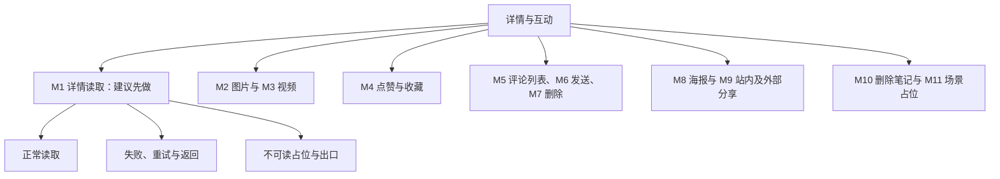

# 详情与互动需求评审与最小决策树

> A1 评审与 A2 需求拆分：唯一维护业务规则、用户已确认约束、运行规则、行为验收与业务未决项。状态归属、实现选择与可行性证据见[详情前端方案](详情前端方案.md)及六份子方案。
>
> 当前实施范围：用户已确认先接 note.http 的详情读取与媒体（M1–M3）。其余互动、评论、删除和分享写操作按对应接口后续推进。
> 实现与验收：已登记详情页、接入读取接口及媒体组件；真实详情读取与自动化逻辑检查通过。App 真机手势、播放和 1 秒起播目标尚未验收，不能将代码存在视为全部用例通过。

## 1. 依据与决策记录

依据：原文引用的设计稿 `docs/社区App设计稿v1.0.html`（当前工作区缺失，本轮未重新核对设计稿）、原详情文档记录的用户确认、[首页需求评审](../首页/首页需求评审.md)及其引用的主计划第四章。借用评审工作流，不沿用其他模块的范围、排期或参数。

| 状态 | 决定或事实 | 依据 |
| --- | --- | --- |
| 已确认 | 单击图片全屏；也可页内双指持续放大并进入全屏 | 原详情文档记录的用户确认 |
| 已确认 | 图片全屏采用等比完整显示、允许留白；双指松手至少补足全屏适配大小，超过则保留倍率；放大态独立单击缩回当前图的 swiper 位置 | 2026-11-09 用户确认；完整交互见第 3.2 节 |
| 已确认 | 视频默认静音，进入详情后 1 秒内起播为性能目标 | 原详情文档记录的用户确认；测量条件见 Q-06 |
| 已确认 | 评论／回复删除入口仅向该条作者或笔记作者显示，固定右侧 | 原详情文档记录的用户确认 |
| 已明确 | 本期不做删除后恢复入口或流程 | 原详情文档已明确范围 |
| 已确认 | 客户端范围仅 App-Plus，不开发 H5 端或微信小程序端 | 本轮用户确认；仅增加分享预览网页作为外链承接，不扩展完整 H5 客户端 |
| 已确认 | 分享面板新增“App 好友”，通过站内消息发送笔记卡片 | 本轮用户确认；收件人范围和单选／多选仍待确认 |
| 已确认 | 主面板外部分享发送笔记链接卡片；海报生成后另有分享目标面板，向微信／朋友圈发送的仅为海报图片 | 本轮用户确认；链接卡片与纯图片分别验收 |
| 已确认 | 微信外链可预览笔记部分内容，点击“查看更多”引导打开／下载 App | 用户对外链承接的本轮补充；预览范围、下载渠道与唤起效果仍需细化 |
| 已核实 | 当前已有公共导航、统一请求层与分页；本轮新增 AppImage、pages/note/index 及详情 API，尚无笔记互动共享 Store | 当前源码与 scripts/check-note.mjs；真实 GET /api/note/5 成功，不代表 App 真机媒体验收通过 |
| 建议 | 首个闭环选择详情读取 M1，再分别推进媒体与互动 | 先明确内容状态与权限，给后续能力提供基础；优先级尚未确认 |

原方案和设计稿的规则在下文保留其来源或候选状态，不因本次调整格式升级为用户确认。

## 2. 需求卡

| 项目 | 内容 |
| --- | --- |
| 问题与用户 | 用户从列表或链接进入笔记，需要阅读、互动，并在加载失败或内容失效时获得准确反馈 |
| 目标 | 内容可读，互动可恢复，失效后不露出旧内容 |
| 本期评审范围 | 详情读取、图片与视频、点赞收藏、评论回复、分享海报、删除及占位；不是全部已批准实施 |
| 后续／排除范围 | 本期无删除后恢复入口或流程；各子能力的实施顺序与平台范围待确认 |
| 当前最小单元建议 | M1：详情读取 → 正常／不可读／失败 → 返回或重试 |
| 输入 → 输出 | 笔记标识、权限与状态 → 对应笔记详情或准确占位与出口 |
| 前提与平台 | 状态、权限与聚合字段契约明确；真实接口未完成但契约明确时可使用同契约 Mock；客户端仅 App-Plus，设备与系统版本另行验证 |

## 3. 业务规则与前端责任

“原文规则”保留既有需求口径，不等同新增用户确认；未定的参数和冲突统一见第 9 节。

| 编号 | 能力 | 业务规则与来源状态 | 前端责任与边界 |
| --- | --- | --- | --- |
| BR-01 | 详情读取 | 原文规则：作者、正文、媒体、互动初态必须属于同一笔记；不可读与请求失败区分 | 展示对应结果，切换笔记时不混入旧内容；服务端提供状态和权限 |
| BR-02 | 图片 | 已确认：单击全屏、双指连续放大到全屏；中心跟手、松手补足或保留倍率、单击缩回按第 3.2 节执行 | 缩放中心、位置与当前索引连续；详情全部图片不套用首页 3:4／1:1 封面约束 |
| BR-03 | 视频 | 已确认：默认静音，进入详情 1 秒内实际起播为目标；超时加载不自动算播放失败 | 区分加载、受限和失败，隐藏或离开暂停；测量条件见 Q-06 |
| BR-04 | 点赞收藏 | 原方案候选：乐观更新与计数动画，明确失败回滚，未知结果先核实，跨页同步 | 动画只表现状态；权威状态和计数由服务端给出；连点策略见 Q-08 |
| BR-05 | 评论回复 | 原文规则：一级与各楼回复独立分页；失败保留草稿；提交成功后读取失败不重复发送 | 保证列表、回复目标、输入和计数一致；排序、长度与楼层删除规则见 Q-09 |
| BR-06 | 评论删除 | 已确认：该条作者或笔记作者可见右侧删除入口，其他用户不显示 | 按权限展示并二次确认；最终权限由接口校验，失败不提前丢失条目 |
| BR-07 | 分享海报 | 已确认：外部主入口发送笔记链接卡片；生成海报后通过第二个目标面板分享纯图片；新增 App 内好友分享 | 微信／朋友圈、App 内消息、复制、海报和收藏分别处理；发送、保存、唤起和送达分开，详细边界见第 3.1 节及 Q-10 |
| BR-08 | 删除笔记 | 原文规则：作者二次确认，成功后停止媒体、返回并同步相关缓存；本期无恢复流程 | 服务端校验权限；旧读取或互动结果不得复活已删内容；说明和出口见 Q-04、Q-11 |
| BR-09 | 内容占位 | 原文规则：详情、喜欢收藏、评论引用、消息与提及按状态和场景占位或移除 | 隐藏不可读正文、媒体与有效互动；清理由服务端驱动，不按本地时钟推断 30 天到期 |
| BR-10 | 统计与历史 | 设计稿要求：已删内容不计入点赞收藏统计；30 天范围、历史保留和统计回写未定 | 依赖状态与统计契约，不由前端猜测或擅自改写历史 |

### 3.1 分享模块边界

| 编号 | 入口或场景 | 规则与状态 | 前后端责任 |
| --- | --- | --- | --- |
| SH-01 | 主分享面板 | 已确认在原设计五个入口上增加“App 好友”；建议以好友区＋操作区排布，具体布局待评审 | 自建站内面板，取消／遮罩关闭；内容准备失败不阻塞详情 |
| SH-02 | 主面板微信好友／朋友圈 | 已确认分享笔记链接卡片，含标题、封面和可打开的笔记链接 | 后端提供受控链接与可分享元信息；App 调微信 SDK；链接目标由 Q-10a 确认 |
| SH-03 | App 好友 | 已确认新增，发送可在站内聊天中打开的笔记卡片 | 复用私信消息链路；服务端校验收件人、笔记可见性与发送权限；成功以消息持久化确认，非对方已读 |
| SH-04 | 站内发送恢复 | 建议：客户端消息 ID 去重，同一发送重试不重复落消息；失败保留选择与重发入口 | 接收端展示卡片，点开时读取最新状态；已删／无权限采用 BR-09，不展示旧正文 |
| SH-05 | 海报预览与第二目标面板 | 已确认生成分享图后再选目标；首期候选为“微信好友／朋友圈／保存相册／取消”，暂不新增其他渠道 | 生成成功后才允许发送图片；渠道失败或取消不丢失本次预览 |
| SH-06 | 海报输出 | 已确认外发为纯图片，不附带链接卡片；海报上的二维码或口令是图片中的可选内容，版式与扫码目标待确认 | 本地生成、保存、图片分享分步处理；已外发静态图片无法通过删除笔记远程撤回；若有二维码，扫码仍须读取当前状态，不能直接当成内容授权 |
| SH-07 | 复制口令 | 沿用设计稿：复制成功后显示面板内反馈；只含标题不足以定位笔记，需可解析的标识 | 口令生成、复制与接收端解析分开；有效期与解析入口待确认 |
| SH-08 | 收藏 | 沿用原方案：复用详情底栏同一收藏状态与接口 | 不新增另一份收藏状态；具体并发策略仍见 Q-08 |
| SH-09 | 外部结果反馈 | 原文规则继续适用：只记录能证明的调用事件，不将唤起或通用回调标为真实送达／取消 | 微信无法可靠返回实际分享成功或取消，统计不能依赖该回调推断 |
| SH-10 | 外链预览与查看更多 | 已确认：外部链接先展示内容预览，“查看更多”引导打开／下载 App；完整 H5 客户端仍不在范围 | 分享预览页仅获取服务端允许公开的预览字段；Android 提供 APK 测试下载，iOS 分发入口另定；不使用 EXE，也不承诺微信内必然自动唤起 |
| SH-11 | 预览可见性 | 建议：只返回可公开的封面、作者、标题与正文摘要，视频先显示封面；不在网页响应中藏完整正文再用样式截断 | 分享链接与二维码不授予额外阅读权限；状态变更后撤掉预览，具体失效与缓存策略待契约确认 |

站内消息链路依据当前[在线设计稿](http://10.18.55.35:8080/design-simplified.html#s-im)的“8.1 单聊消息／8.2 笔记卡片分享”文字：会话可发送笔记卡片，按客户端消息 ID 去重，失败可重发；陌生人私信规则仍需消息模块评审，本轮不另设豁免。当前源码消息页仅有导航，不能把设计要求写成已实现。

收件人建议先提供“最近会话＋互关好友”、单人发送；这是候选交互，不代表用户已确认好友定义、消息服务或群发范围。

### 3.2 图片手势与全屏交互（2026-11-09 已确认）

“全屏适配大小”指图片在全屏查看区域中按原比例完整显示的大小，允许上下或左右留白；不拉伸，也不以裁切图片来铺满屏幕。全屏展示状态与图片缩放倍率分别判断，不能只用是否铺满屏幕判断全屏。

| 编号 | 操作或阶段 | 已确认行为 |
| --- | --- | --- |
| IMG-01 | 在页内 swiper 中单击图片 | 进入全屏，以全屏适配大小完整显示当前图片 |
| IMG-02 | 在 swiper 内双指拉开放大 | 以两指中点对应的图片内容为缩放中心；中点移动时图片跟随，保持内容与触点的对应关系 |
| IMG-03 | 同一次双指手势从页内进入全屏 | 持续操作同一张图片；中心、倍率、位移与索引连续，不突然重置或要求重新捏合；进入全屏后可以继续放大 |
| IMG-04 | 有效缩放手势结束，图片小于全屏适配大小 | 自动动画补足到全屏适配大小；松手后保持全屏查看 |
| IMG-05 | 缩放手势结束，图片达到或超过全屏适配大小 | 保留当前倍率；允许拖动查看放大的局部，位移边界修正不重置倍率；最大倍率仍见 Q-05 |
| IMG-06 | 放大／全屏态下，后续独立单击 | 动画缩回当前图片在 swiper 中的原始展示位置和大小，保持当前索引及详情页原滚动位置；不是切回第一张图片 |
| IMG-07 | 缩放、拖动结束，或双指先松开一根 | 不把本次手势的松手识别为单击退出；单指继续拖动不误触 swiper 切图，退出必须来自后续独立轻点 |

全屏适配及松手规则已确认；有效手势识别阈值、最大倍率、具体边界阻尼和动画参数等剩余事项见 Q-05。状态管理与手势、滚动限制的释放机制见[媒体方案第 3.2 节](详情方案/01-详情与媒体.md#32-图片连续手势与全屏)。

## 4. 可复用组件

| 展示或交互职责 | 已有组件与依据 | 适配判断 |
| --- | --- | --- |
| 页面层导航与返回动作 | [AppNavbar 使用说明](../../src/components/common/README.md) | 当前源码存在；详情接入及返回行为待验证，组件仅抛出动作 |
| 二次确认等控件 | [pages.json](../../src/pages.json) 已配置 TDesign easycom | 按工程规范直接使用 t-*；具体控件能力与目标平台待验证 |
| 图片渲染与分页 | 当前已存在 AppImage 与 usePagination | 本轮详情媒体消费 AppImage；评论分页仍待对应接口接入 |

组件参数、类型、令牌以源码为准；本轮不为了格式抽取公共组件。

## 5. 最小需求拆分树

### 5.1 详情与互动需求拆分（做什么）

### 5.2 最小单元与依赖

| 单元 | 输入 → 输出 | 关键前提 |
| --- | --- | --- |
| M1（建议先做） | 笔记标识 → 正常、不可读或错误详情 | 内容状态、权限与字段契约 |
| M2 | 图片与触点 → 切图、连续缩放、全屏与退出 | 图片规格、阈值和退出规则 |
| M3 | 视频与页面状态 → 静音播放或局部反馈 | 起播目标测量条件 |
| M4 | 选中态与计数 → 操作确认、回滚或核实 | 目标状态、权威计数与连点策略 |
| M5 | 笔记、排序、父评论 → 独立列表与二级展开 | 排序、分页与预览契约 |
| M6 | 文本、回复对象 → 成功条目或保留草稿 | 字符计数、真实标识与未知结果核实 |
| M7 | 权限、评论标识 → 删除结果与计数 | 楼层移除／占位和计数规则 |
| M8 | 参数与素材 → 海报预览 → 选择目标 → 图片分享／保存 | 模板、素材、导出与相册／微信能力 |
| M9 | 笔记 → 外部链接卡片／站内消息卡片／可复制口令 | 链接承接、消息权限、可观测事件与回传契约 |
| M10 | 作者确认 → 删除结果、返回与缓存同步 | 删除说明、状态与来源出口 |
| M11 | 内容状态与场景 → 占位或移除 | 场景矩阵、保留期限与统计契约 |

建议先完成 M1 的正常、异常和恢复，再逐项推进。当前最小单元仍由 Q-01 确认；客户端范围已确认为 App-Plus，未给出排期。

## 6. 方案决策树入口

通用技术选择见[详情前端方案第 3 节](详情前端方案.md#3-开发时怎么选技术决策)，具体选择按单元进入：

| 单元 | 实现选择与可行性证据 |
| --- | --- |
| M1–M3 | [详情与媒体](详情方案/01-详情与媒体.md) |
| M4 | [点赞与收藏](详情方案/02-点赞与收藏.md) |
| M5–M7 | [评论与二级回复](详情方案/03-评论与二级回复.md) |
| M8–M9 | [分享与海报](详情方案/04-分享与海报.md) |
| M10 | [删除笔记](详情方案/05-删除笔记.md) |
| M11 | [删除后占位](详情方案/06-删除后占位.md) |

技术验证产生新的业务取舍时更新本页第 1、9 节，不在子方案中维护第二份业务规则。

## 7. 运行与异常判断规则

### 7.1 状态与场景

| 编号 | 条件 | 用户可见动作与恢复结果 |
| --- | --- | --- |
| RR-01 | 无可用详情且首屏请求失败 | 整页错误与重试，返回入口始终可用；网络错误不伪装成已删 |
| RR-02 | 已有内容时刷新失败或仅资源／评论失败 | 保留可用内容，仅失败区域提供反馈与恢复入口 |
| RR-03 | 请求成功并确认无业务内容 | 插画、场景文案与业务出口；不提供网络重试；无评论时引导写评论 |
| RR-04 | 明确已删、不存在或链接失效 | 隐藏原标题、作者、正文、媒体和计数；仅主动出口去首页，系统返回可用；无恢复入口 |
| RR-05 | 下架、审核或私密 | 按权限与明确状态提示，关闭旧正文、媒体与有效互动；审核态可知范围和申诉待定 |
| RR-06 | 图片或头像加载失败 | 图片按原比例占位并手动重试；头像用昵称首字，缺昵称用“用户”；尺寸稳定，样式使用令牌 |
| RR-07 | 视频加载、受限或明确失败 | 分别反馈；播放区保持尺寸，正文和互动可用；超过 1 秒仍加载不误判失败，反馈入口待定 |
| RR-08 | 评论读取失败或提交成功后刷新失败 | 局部失败，输入仍可用；已成功提交只重试读取，不重复发送；提交／删除失败保留内容 |
| RR-09 | 切换笔记、刷新、重复操作或旧响应晚到 | 只展示当前有效结果；旧响应不能覆盖当前笔记、最新互动或已删状态 |
| RR-10 | 用户不存在或注销 | 不展示旧资料和列表，只保留返回，不提供关注或私信 |
| RR-11 | 已删内容在喜欢收藏、评论引用、消息或提及中出现 | 按最终确认的场景规则占位或移除，阻止跳转旧内容；保留期限和统计口径见 Q-04、Q-12 |

文案说明现象和下一步；原因必须有依据。已删除、无权限和请求失败不能由任意 HTTP 404 或本地推断互相替代。

### 7.2 重试预算：保留原口径，尚未统一

| 来源 | 原文口径 | 尚待确认 |
| --- | --- | --- |
| 图片 | 不自动轮询，手动重试 | 手动入口形式 |
| 视频 | 连续失败 2 次后转手动 | 是否包含首次，计数何时重置 |
| 整页网络异常 | 自动重试最多 2 次，网络恢复可重试 1 次 | 恢复重试是否计入同一预算 |
| 同页加载 | 连续失败 3 次后转手动 | 是否等于首次加 2 次重试，如何划分同页范围 |

这些口径不能同时当作已定实现。统一问题见 Q-13；所有触发需共享各自作用域的进行中锁和最终确认预算，不能通过重复事件绕过上限。

## 8. 验收表

沿用 DT-01–DT-40 编号，按已确认图片规则细化 DT-04、DT-31–DT-32，并新增 DT-41–DT-44；以下均未执行。含未决条件的用例须先补齐对应规则，不能提前记为通过。

| 编号 | 条件与操作 | 预期结果 | 执行状态／证据 |
| --- | --- | --- | --- |
| DT-01 | 合法笔记标识，详情正常返回 | 作者、正文、媒体和互动初态对应同一笔记 | 未执行 |
| DT-02 | 首屏无数据时请求超时，或已有数据后刷新失败，再点击重试 | 前者整页异常，后者保留已有内容并局部提示；恢复后正常展示，返回入口始终可用 | 未执行 |
| DT-03 | 详情返回明确已删、不存在或链接失效 | 不展示旧标题、作者、正文、媒体及互动数；仅主动出口去首页，系统返回可用，不显示恢复入口 | 未执行 |
| DT-04 | 单击图片全屏；或从页内双指持续放大到全屏，再独立单击退出 | 全屏基准按原比例完整显示、允许留白；连续手势中当前图片、索引、中心和位置不断；退出动画回当前图的 swiper 展示位置和大小，详情滚动位置保持 | 未执行 |
| DT-05 | 在约定设备、网络与缓存条件下进入视频详情，随后进入后台或离开 | 默认静音，测量从进入详情到实际开始播放是否在 1 秒内；隐藏后暂停，失效回调不再触发播放 | 未执行 |
| DT-06 | 点赞与收藏分别成功或明确失败 | 成功校准服务端结果；失败回滚对应操作，另一按钮不受污染 | 未执行 |
| DT-07 | 同类按钮连点、旧响应晚到 | 按已确认并发策略提交，旧响应不覆盖最新有效状态 | 未执行 |
| DT-08 | 写入超时但可能已在服务端成功 | 不把超时等同未写入；读取权威状态后恢复一致，不盲目重复切换 | 未执行 |
| DT-09 | 评论首屏空、翻页失败、切换排序时旧响应晚到 | 空态与错误区分，旧内容保留，旧排序响应不串入新列表 | 未执行 |
| DT-10 | 展开两条不同父评论的回复 | 回复、剩余数量和分页互不污染，预览与追加不重复 | 未执行 |
| DT-11 | 评论发送失败、成功或结果未知 | 失败保留草稿；成功按真实标识只出现一条；未知先核实 | 未执行 |
| DT-12 | 键盘弹起收起、切换回复对象 | 输入可见，无二次顶起，草稿与目标正确，收起后布局恢复 | 未执行 |
| DT-13 | 有权用户删除评论，或权限中途改变 | 确认后按规则移除／占位及校准计数；无权失败不提前丢失条目 | 未执行 |
| DT-14 | 海报素材失败后重试，或用户拒绝相册权限 | 错误与取消分开，预览可恢复，不显示其他笔记的旧海报 | 未执行 |
| DT-15 | 分享成功回调、取消、失败、无可确认回调 | 只反馈和回传平台实际能证明的事件，不统一计为成功 | 未执行 |
| DT-16 | 删除笔记时取消、连点确认、明确失败 | 取消和失败保留详情，提交不重复 | 未执行 |
| DT-17 | 删除成功或明确已删除，来源有或没有历史页面 | 停止媒体、同步相关场景；按来源返回或进入已约定安全出口 | 未执行 |
| DT-18 | 删除后旧分页或旧互动请求返回 | 不恢复已删内容，不覆盖已确认状态 | 未执行 |
| DT-19 | 已删笔记出现在喜欢收藏、评论引用、消息与 @ | 各场景按已确认规则占位、阻止旧内容跳转、同步统计 | 未执行 |
| DT-20 | 服务端从保留占位变为已清理 | 对应区域按契约更新；不由本地时钟擅自推断清理完成 | 未执行 |
| DT-21 | 详情返回窗口化首页，期间笔记被删除或计数变化 | 对应卡片更新或移除，滚动恢复符合首页规则 | 未执行 |
| DT-22 | 分别以该条评论／回复作者、笔记作者和其他用户查看同一条内容 | 前两类用户在操作行右侧看到删除入口；其他用户不显示；最终权限仍由接口校验 | 未执行 |
| DT-23 | 一张详情图片失败，其他数据正常 | 按原展示比例局部占位，可手动重试；正文、其他图片和互动不受影响 | 未执行 |
| DT-24 | 头像地址失败，分别有或没有昵称 | 有昵称时以昵称首字降级，缺失时显示“用户”；尺寸稳定且颜色来自现有令牌 | 未执行 |
| DT-25 | 视频明确失败，或仅加载超过 1 秒 | 明确失败时仅播放区展示失败与恢复出口；超过性能目标仍在加载时保持加载反馈，不误判为播放错误 | 未执行 |
| DT-26 | 评论首屏失败后提交一条有效评论，提交成功但刷新仍失败 | 输入和其他内容可用；记录提交成功，只重试列表读取，不重复发送评论 | 未执行 |
| DT-27 | 成功确认没有评论，与评论请求失败分别发生 | 前者为评论空态与写评论引导，后者为失败图标、说明与重试；二者不混用 | 未执行 |
| DT-28 | 下架、审核中或私密状态由服务端明确返回 | 不展示旧正文、媒体与有效互动；按可见权限展示对应说明，不混入不存在或网络错误态 | 未执行 |
| DT-29 | 通过作者入口访问不存在或已注销的用户 | 目标页不保留旧资料、数据和笔记列表；仅保留返回，不提供关注或私信 | 未执行 |
| DT-30 | 连续失败、重复触底或重复网络恢复事件 | 按最终确认的分场景预算与进行中锁触发，不无限自动重试；手动恢复入口仍可用 | 未执行 |
| DT-31 | 双指持续缩放时进入全屏，或触摸被系统取消 | 图片、缩放中心和位置连续；取消清理失效触点与手势归属，不残留失效遮罩或滚动锁；仍处于全屏时保留必要的底页滚动限制，退出后解除 | 未执行 |
| DT-32 | 图片放大后单指拖动，再独立单击缩回并切图 | 放大时拖动查看局部，不误切到另一张；缩回当前图后可正常切图，序号与实际图片一致 | 未执行 |
| DT-33 | 从主分享面板分别点击微信好友与朋友圈 | 提交笔记链接卡片；标题、封面和链接属于当前笔记，不因曾生成海报改为纯图片 | 未执行 |
| DT-34 | 生成海报后在第二目标面板分别选择微信好友与朋友圈 | 提交当前海报纯图片，不发送笔记链接卡片；失败或返回后预览仍可恢复 | 未执行 |
| DT-35 | 生成海报、保存相册分别成功、失败或被拒绝 | 生成与保存结果分开；未导出有效图片时不能发送；保存失败保留预览 | 未执行 |
| DT-36 | 选择 App 好友并发送一条笔记卡片，对方接收后点击 | 消息服务确认成功后出现同一条卡片；接收方进入对应笔记，发送确认不等于已读 | 未执行 |
| DT-37 | 站内发送响应丢失，随后重试同一次发送 | 按最终消息幂等契约核实或重发，不产生重复消息；选择和可重发状态可恢复 | 未执行 |
| DT-38 | 收件人无接收权限、被拉黑，或笔记在发送前／打开前变为不可读 | 服务端校验并拒绝或显示相应失效占位，不绕过私信限制，不露出旧正文 | 未执行 |
| DT-39 | 分别复制口令成功／失败，或收藏状态在详情底栏变化 | 仅成功复制显示行内成功反馈；失败不显示已复制；面板与底栏收藏保持同一状态 | 未执行 |
| DT-40 | 微信中打开外部链接预览，再点“查看更多”，分别验证已安装、未安装及笔记失效 | 按确认范围展示预览；查看更多按环境引导打开／下载；失效不露出旧内容，不宣称微信中必然自动打开 App | 未执行 |
| DT-41 | 有效双指放大后，在未达到全屏适配大小时松手 | 自动动画补足到全屏适配大小，图片完整显示且允许留白，保持全屏，不触发单击退出 | 未执行 |
| DT-42 | 同一次手势跨入全屏后继续放大，超过全屏适配大小再松手 | 进入全屏不打断缩放；在最大倍率范围内保持松手倍率，位移边界修正不重置倍率 | 未执行 |
| DT-43 | 在图片不同位置双指放大，并在缩放中移动两指中点 | 对应图片内容随中点保持跟手，进入全屏时不突然跳到图片中心或重置位置 | 未执行 |
| DT-44 | 双指缩放先松一根、剩余单指拖动、全部松开，之后再独立轻点 | 前面的松手与拖动不误切图或退出；全屏时底页不滚动；独立轻点才缩回当前图，返回动画完成后详情滚动与 swiper 切图恢复 | 未执行 |

## 9. 待确认事项与评审结论

| 编号 | 待确认问题 | 影响范围 | 需要谁／什么证据确认 | 当前处理 |
| --- | --- | --- | --- | --- |
| Q-01 | 是否选择 M1、优先设备／系统版本、人工评审结论 | 当前最小单元与验证范围 | 用户确认 | 客户端仅 App-Plus 已确认；其他项待确认，后续方案不视为批准或排期 |
| Q-02 | 已删／下架／审核／私密的完整错误契约与操作权限 | M1 及依赖内容状态的单元 | 接口约定与示例响应 | 正常详情字段已从真实接口与 OpenAPI 核实；不存在样例为 HTTP 404＋“笔记不存在”；不把任意 404 称为已删除，剩余状态仍需服务端证据 |
| Q-03 | 写操作的目标状态、真实标识、权威计数、超时核实与幂等语义 | M4、M6、M7、M10 及回传写入 | 接口约定 | 阻塞相应写操作，不阻塞独立读取验证 |
| Q-04 | 删除说明文案、各场景 30 天适用范围 | M10–M11 | 用户／设计与接口约定 | 本期无恢复能力；不自行设置期限 |
| Q-05 | 图片资源规格、有效手势识别阈值、最大倍率、边界阻尼与动画参数；系统返回及取消后的展示恢复细节 | M2 | 用户／设计及目标平台手势验证 | 部分已确认：第 3.2 节的完整显示留白、连续缩放、松手补足／保留倍率、拖动及独立单击缩回；仅剩本行事项待定，首页封面比例不自动套用 |
| Q-06 | 视频测量设备、网络、冷热缓存、起播事件、达标统计；再次显示是否自动恢复；失败反馈入口 | M3 | 用户确认测量条件与目标设备实测 | 保留默认静音与 1 秒目标，不宣称已达标 |
| Q-07 | 正文图文 8 行／视频 1 行折叠、作者浮层与底栏是否纳入 | 详情展示扩展 | 设计评审 | 后续待评审；指示器随实际图片数变化 |
| Q-08 | 点赞收藏连点体验：锁同类请求，或保留最终意图并串行合并 | M4 | 用户确认交互策略、接口并发语义 | 锁定为原方案建议；防抖不足以处理已发送请求或乱序 |
| Q-09 | 默认热度与切最新是否本期做；新评论位置；二级预览前 2 条和作者标记；预览分页衔接；回复中的回复；500 字计数；删一级连带回复后的移除／占位与计数 | M5–M7 | 设计与接口约定 | 保留原设计稿待评审项；排序由服务端完成，楼层删除不等于原笔记删除引用占位 |
| Q-10 | 分享剩余参数、契约与技术候选，拆分见 Q-10a–Q-10d | M8–M9 | 用户／设计、接口与 App 真机证据 | App-Plus、App 好友、外部链接卡片与海报纯图片已确认，不再重复评审 |
| Q-10a | 预览字段与截断范围、视频预览方式、公开域名；查看更多的 App 唤起、微信内浏览器引导、安装包／测试分发入口；失效与缓存策略 | 外部卡片点击与海报扫码 | 用户／设计＋服务端预览接口、App 链接配置及真机验证 | 分享预览＋查看更多打开／下载的方向已确认；细节待定，Android 应为 APK，iOS 测试分发另定，不承诺微信内必然自动唤起 |
| Q-10b | App 好友定义、最近会话／互关范围、单选或多选、确认流程；私信限制、消息类型与幂等结果契约 | 站内好友分享 | 用户／设计及消息服务接口 | 建议最近会话＋互关、单人确认后发送；不能另造绕过私信权限的分享通道 |
| Q-10c | 海报版式、二维码／口令内容、图片规格、库版本与许可；第二面板具体入口是否为微信／朋友圈／保存相册 | 海报生成与纯图分享 | 设计与候选库在当前 App-vue 工具链的原型 | 优先验证 lime-poster；保留原生截图、服务端生成候选，尚未安装或定型 |
| Q-10d | 短链／口令生成、有效期与解析入口；外部事件上报、去重和计数触发点 | 链接、复制与统计 | 服务端契约及用户规则 | 微信真实成功／取消不可可靠获知；不将调用回调统一算成功 |
| Q-11 | 多端并发如何区分已删与其他失败；深链无上一页时的安全出口 | M10 | 接口状态与导航规则 | 待确认，不能提前固定为某个跳转 |
| Q-12 | 消息历史保留、统计回写与清理结果、审核可知范围、申诉／反馈承接 | M11 及相关引用页 | 产品／设计、服务端契约 | 待确认；已删不计点赞收藏统计来自设计稿 |
| Q-13 | 分场景重试预算、首次与恢复重试计数、重置时机和手动入口 | 相关读取和资源恢复单元 | 统一第 7.2 节原口径 | 阻塞对应自动重试策略，不自行合并为新默认值 |

AI 建议：补齐当前最小单元的关键条件后推进；后续未决项仅阻塞其对应单元。

人工评审结论：尚未给出；本轮格式整理不代替确认范围、优先级、接口语义或验收通过。

## 10. 记录边界

- 本轮按用户确认实施详情读取与媒体；逻辑与组件宿主检查已运行，App 真机行为验收仍待执行。
- 工程约束见 [AGENTS.md](../../AGENTS.md)；组件参数、类型与样式令牌以当前源码为准。
- AppImage、usePagination 已有源码；笔记互动共享状态及其他写操作仍按后续单元设计，不从 Git 历史恢复旧能力。
- 最小单元确认后再补 A3 文件关系与输入输出；不提前搭 AST、MCP 或 CI。

### 10.1 AI 上下文读取规则

当前任务 → 本文相关决定、未决项与验收 → 前端方案总览及对应子方案 → 源码直接依赖。有证据再扩大读取；任务结束只记增量，不默认读取全部模块。
