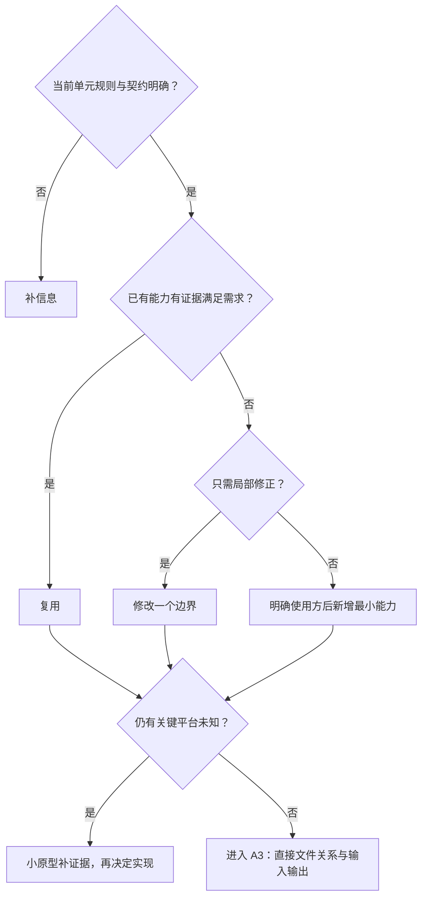

# 详情与互动前端方案

> A2 技术决策：只维护**状态归属 → 模块数据流 → 实现选择 → 可行性证据**。业务规则、运行规则、行为验收与业务未决项唯一维护在[需求评审](详情与互动需求评审与最小决策树.md)。
>
> 客户端仅 App-Plus（当前 App-vue），外部链接另有分享预览网页；当前最小单元建议：M1 详情读取；方案状态：候选、待验证；本轮仅整理文档，未实施或验收详情功能。

## 1. 数据放哪里（状态归属表）

下表为候选归属，不代表对应模块已经存在。当前源码核对结果见第 4 节。

| 需要记住的信息 | 由谁管理 | 保留范围与清理时机 |
| --- | --- | --- |
| 当前笔记详情、读取进度、错误与请求批次 | 详情页面局部 ref／computed | 页面实例；切换笔记时重置，旧批次不得提交 |
| 图片索引、缩放、位移、全屏与视频控制 | 局部媒体状态与平台适配层 | 当前媒体；取消手势、退出、隐藏或卸载时释放对应资源 |
| 一级评论、每楼回复、排序与分页 | 独立分页实例候选 | 笔记、排序与父评论隔离；切换时失效旧批次 |
| 评论草稿、回复对象、提交状态与键盘适配 | 评论区域局部状态 | 当前输入流程；成功才清成功输入，离开清理页面监听 |
| 点赞、收藏、计数、评论数与删除状态 | 按笔记 ID 的最小共享状态候选 | 跨页同步；按账号、操作版本和内容状态隔离，容量与清理边界需定义 |
| 海报素材、导出结果、预览和分享目标 | 页面局部状态 | 笔记、输出类型和生成批次隔离；链接卡片与纯图片不串用 |
| App 好友选择、发送进度与客户端消息 ID | 分享流程局部状态；消息结果归消息模块 | 私信服务持有会话与消息，不在分享页另存整套聊天数据 |
| 不可读状态与场景展示 | 权威内容状态 + computed 派生 | 服务端状态生效后，旧读取和旧互动不能恢复正文 |

不把页面局部状态搬入 Store；不保存整页副本来同步一个计数。持久化和缓存只处理相关数据，不新增详情长期缓存策略。

## 2. 模块之间传什么（数据链路）

读取主链路：笔记标识 → API 模块 → 统一请求层 → 详情局部状态与权限派生 → 正文、媒体与操作入口。

写入主链路：用户操作 → 局部进行中状态／候选乐观覆盖 → API 模块 → 权威结果或未知结果核实 → 按 ID 更新共享状态与相关页面。

| 交接边界 | 输入 → 输出 | 契约与缺口 |
| --- | --- | --- |
| 详情 API → 页面 | 笔记标识 → 聚合详情、内容状态、权限 | Q-02 未确认；不预设真实接口字段或 URL |
| 评论 API → 分页实例 | 笔记、排序、父评论与分页参数 → 条目、真实标识与后续状态 | Q-09；一级与各楼回复分别管理 |
| 写 API → 共享变化 | 目标状态／真实标识 → 确认状态、计数或待核实结果 | Q-03；超时不等于服务端未写入 |
| 分享预览接口 → 外部网页 | 笔记分享链接 → 允许公开的预览数据、查看更多与下载引导 | Q-10a；独立预览契约，服务端裁减数据，不返回受限完整内容 |
| 分享准备 → 微信渠道 | 笔记链接卡片／海报本地图片 → 对应渠道调用事件 | Q-10a、Q-10c、Q-10d；输出类型固定，唤起、保存、送达分别判断 |
| App 好友选择 → 私信模块 | 笔记 ID、收件人和客户端消息 ID → 站内笔记卡片消息 | Q-10b；复用消息权限、幂等与离线补拉，不调用 uni.share |
| 内容状态 → 来源与引用页 | 笔记 ID 与权威失效状态 → 更新、失效、占位或移除 | Q-04、Q-11、Q-12；不按本地时钟驱动清理 |

页面只调 API 函数；通用请求层不承接详情业务状态。本表描述所需语义，不是已存在的接口声明。

## 3. 开发时怎么选（技术决策）

### 3.1 通用选择条件

当前核对已确定：不能把 AppImage、usePagination 或笔记互动 Store 当作现成实现。继续实施时按当时源码复核；确实缺失再依据使用方决定最小新增，不从历史恢复旧全局样式或能力。

关键契约明确而真实接口不可用时，可用同契约 Mock；关键语义缺失时先回需求评审，不用 Mock 自行决定。

### 3.2 子方案入口

| 单元 | 技术选择与具体机制 | 对应行为验收编号 |
| --- | --- | --- |
| M1–M3 | [详情与媒体](详情方案/01-详情与媒体.md) | DT-01–05、DT-23–25、DT-31–32 |
| M4 | [点赞与收藏](详情方案/02-点赞与收藏.md) | DT-06–08 |
| M5–M7 | [评论与二级回复](详情方案/03-评论与二级回复.md) | DT-09–13、DT-22、DT-26–27 |
| M8–M9 | [分享与海报](详情方案/04-分享与海报.md) | DT-14–15、DT-33–40 |
| M10 | [删除笔记](详情方案/05-删除笔记.md) | DT-16–18、DT-21 |
| M11 | [删除后占位](详情方案/06-删除后占位.md) | DT-19–20、DT-28–29 |
| 跨模块恢复 | 本页的一致性边界及各子方案的锁、批次与重试处理 | DT-30 |

### 3.3 一致性与平台边界

- 请求校验当前笔记、账号、批次与操作版本；只有有效结果才能提交。已确认删除或不可读状态不能被旧成功响应覆盖。
- 写操作明确失败与结果未知分开处理；未知先核实权威结果，读取重试与写入重试分开。
- 读取和资源重试统一消费对应作用域的锁与最终确认预算，具体次数只引用需求评审 Q-13。
- 当前只验证 App-Plus／App-vue：按实际 Android／iOS 设备和系统版本验证媒体、键盘、海报导出与微信分享；不规划 H5 或微信小程序客户端分支。
- 工程规范统一见 [AGENTS.md](../../AGENTS.md)，不在方案中另建主题来源或原生导航同步入口。

## 4. 方案是否可行（技术验证）

| 编号 | 技术选择 | 需要证明什么 | 最小验证方法 | 当前状态／证据 |
| --- | --- | --- | --- | --- |
| TV-G01 | 公共导航与统一请求边界 | 源码入口是否存在，详情能否按约定接入 | 核对直接文件，再按最小单元验证 | [AppNavbar 说明](../../src/components/common/README.md)、[request.ts](../../src/api/request.ts) 存在；只做源码核对，未验证完整调用链 |
| TV-G02 | 图片、分页与互动共享能力 | 原方案命名是否对应当前可复用实现 | 检索 src 的文件名与引用 | AppImage、usePagination 已有源码；笔记互动 Store 尚未实施 |
| TV-G03 | 详情页面与业务 API 接入 | 路由、接口和权限契约能否形成 M1 闭环 | 核对 pages.json、业务模块及同契约原型 | 已登记 pages/note/index，getNoteDetail 已接真实 GET /note/{id}；成功读取与脚本异常流程通过，App 真机待验 |
| TV-G04 | 各子方案的平台与一致性能力 | 局部机制是否满足目标平台与已定契约 | 按子方案第 4 节逐项验证 | 本轮仅实施 M1–M3，详情与媒体逻辑检查已执行；其余模块及 App 真机性能未验收 |

行为验收唯一见[需求评审第 8 节](详情与互动需求评审与最小决策树.md#8-验收表)，均未执行。业务未决项统一见其第 9 节；技术验证若产生新取舍，回该处更新。

## 5. A3 文件关系与输入输出

本轮 M1–M3 的文件输入输出见[详情与媒体第 5 节](详情方案/01-详情与媒体.md#5-a3-文件关系与输入输出)。用户已确认先接 note.http 的读取与媒体，互动和评论写操作仍按后续接口推进。
