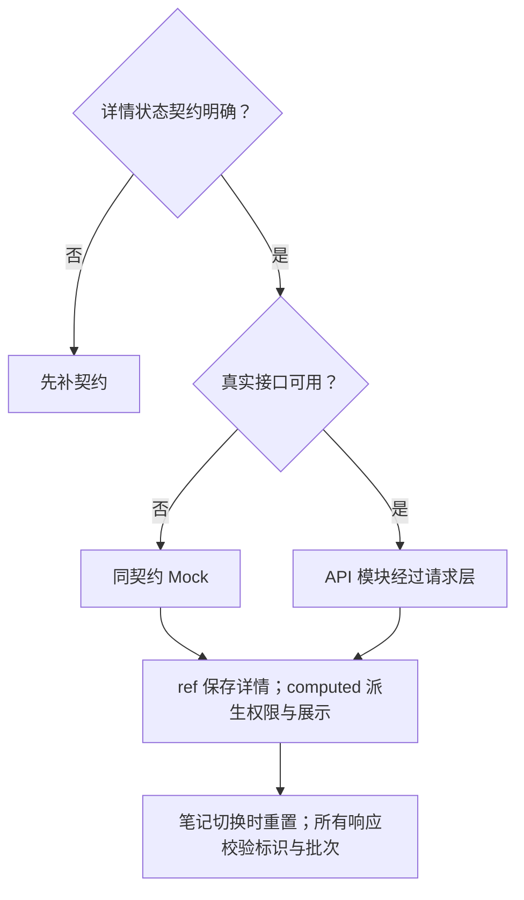
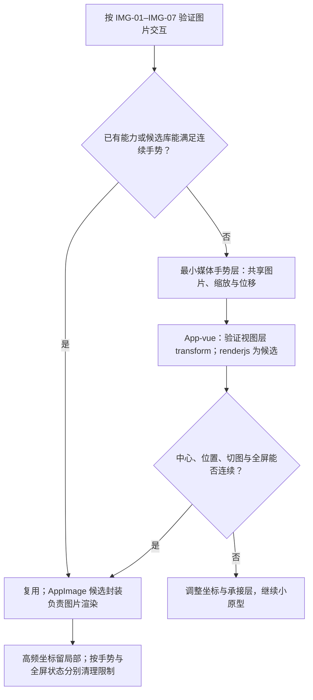

# 详情与媒体前端方案

> A2 技术决策：维护状态归属、数据链路、实现选择与可行性证据。业务规则、运行规则、行为验收及业务未决项只引用[需求评审](../详情与互动需求评审与最小决策树.md)；整体边界见[方案总览](../详情前端方案.md)。
>
> 对应单元：M1 读取、M2 图片、M3 视频；用户已确认本轮实施。已完成源码接入、真实详情读取和自动化逻辑检查；App 真机验收与起播性能仍待执行。

## 1. 数据放哪里（状态归属表）

| 需要记住的信息 | 由谁管理 | 保留范围与清理时机 |
| --- | --- | --- |
| 详情对象、读取状态、错误与批次 | 页面局部 ref；computed 派生权限与展示 | 切换笔记重置；响应校验笔记标识与当前批次 |
| 当前图片索引、缩放中心、比例、位移与全屏态 | 局部媒体手势层候选 | 同一手势跨页内与全屏承接；手势结束／取消清理触点与归属，全屏期间保留底页滚动限制，缩回完成或页面离开后解除 |
| 视频加载、受限、起播时间与播放控制 | 页面局部状态与视频实例 | 隐藏／离开暂停，旧回调不得再次起播 |

## 2. 模块之间传什么（数据链路）

笔记标识 → API 模块经过统一请求层 → 详情 ref → computed 权限与展示 → 正文及媒体。

图片数据与触点 → 局部手势坐标 → 同一图片实例的缩放／位移／全屏展示。视频资源与页面可见性 → 播放控制 → 实际起播事件与分状态反馈。

| 交接边界 | 输入 → 输出 | 契约与缺口 |
| --- | --- | --- |
| 详情接口 → 页面 | 标识 → 聚合字段、状态与权限 | 需求评审 Q-02，尚未定义真实字段结构 |
| 图片源 → 手势与渲染层 | 原图规格与当前索引 → 连续媒体展示 | Q-05；图片渲染统一经 AppImage 候选封装，不等于当前已有实现 |
| 视频事件 → 测量记录 | 进入详情、实际起播、可见性 → 耗时与控制结果 | Q-06，测量条件与事件口径待确认 |

## 3. 开发时怎么选（技术决策）

### 3.1 详情读取

### 3.2 图片连续手势与全屏

交互规则唯一见[需求评审第 3.2 节](../详情与互动需求评审与最小决策树.md#32-图片手势与全屏交互2026-11-09-已确认)的 IMG-01–IMG-07；全屏基准、松手处理和单击缩回已确认，剩余参数仅见 Q-05，不在本方案另设默认值。

全屏保留原区域占位，不重建活动手势实例。原生预览不能直接作为连续手势的已验证替代。当前未发现 AppImage，实施时先明确使用方与最小封装；高频坐标保持局部，不进入跨页 Store。

当前仅考虑 App-Plus／App-vue 的视图层 transform 与 renderjs 候选，按实际设备验证后选择，不保留其他客户端的平台分支。

2026-11-09 选库原则已确认：库只作为候选；先用小原型验证中心保持、页内到全屏的连续承接、松手规则和单击缩回。若库不适用，或接入需要大量绕过其行为，直接实现最小局部手势层，不为使用库改变已确认交互。[Panzoom](https://github.com/timmywil/panzoom) 可优先作为缩放与拖动底层候选，尚未安装、定型或验证 App-vue 接入；不要求使用该库。

手势锁指同次触摸的响应归属，用局部状态协调图片、swiper 与详情页，避免缩放／拖动同时触发切图或底页滚动，与手指数上限无关。分别管理：

- 手势结束或取消：清理触点及本次手势归属；双指减为单指时正确承接拖动，不误触切图，不把手势松手当作独立单击。
- 全屏仍在展示：保持底页滚动限制；图片操作期间限制 swiper 抢占手势，不能因为松手就解除所有限制。
- 缩回 swiper 的动画完成：解除全屏限制并恢复详情滚动与正常切图；页面隐藏／离开／卸载时清理对应监听、触点和限制，避免残留。

### 3.3 视频生命周期与起播测量

1. 从进入详情开始计时；页面不可见时不启动或暂停。
2. 资源未就绪时保持封面与加载反馈；可播放时尝试静音播放。
3. 以最终确认的实际起播事件记录耗时；超过 1 秒仍在加载只代表未达目标，不自动标记播放失败。
4. 加载、播放受限和明确失败分别处理；仅失败区域恢复。
5. 隐藏或离开时暂停，并校验笔记、批次与页面可见性，阻止旧回调起播。

原方案参考：[图片 API](https://uniapp.dcloud.net.cn/api/media/image.html)、[video](https://uniapp.dcloud.net.cn/component/video.html)、[renderjs](https://uniapp.dcloud.net.cn/tutorial/renderjs.html)。renderjs 的 Vue 3 接入方式及当前 App-vue 运行效果须验证。

## 4. 方案是否可行（技术验证）

| 编号 | 技术选择 | 需要证明什么 | 最小验证方法 | 当前状态／证据 |
| --- | --- | --- | --- | --- |
| TV-M01 | ref／computed 与响应批次 | 正常、失败与不可读能隔离；旧响应不串入当前笔记 | 同契约 Mock 控制响应顺序，覆盖切换与重试 | 真实读取成功；脚本验证了刷新失败保留、403/404 清理、账号隔离与旧响应拒绝；App 真机待验 |
| TV-M02 | 最小局部手势层与全屏承接 | IMG-01–IMG-07 可实现，中心、索引、倍率与位移连续，手势归属及底页滚动限制按展示状态清理 | App-vue 真机覆盖 DT-04、DT-31–DT-32、DT-41–DT-44 | 已有 AppImage 与 NoteImageGallery，未安装候选库；组件宿主检查验证捏合、单指承接、独立轻点退出和清理；真实 WebView 跟手与动画待验 |
| TV-M03 | 视频可见性与事件控制 | 隐藏后不播放，受限／失败与加载可区分 | 目标设备验证前后台、离开和旧回调 | 脚本验证默认静音、实例范围、隐藏／卸载暂停和旧起播拦截；真实播放与设备兼容待验 |
| TV-M04 | 1 秒实际起播目标 | 已确认测量条件下能否达标 | 记录设备、网络、冷热缓存、进入与实际起播事件及统计口径 | 待测，不宣称达标 |

行为验收使用[需求评审第 8 节](../详情与互动需求评审与最小决策树.md#8-验收表)的 DT-01–05、DT-23–25、DT-31–32、DT-41–44；规则和未决项使用其第 3、7、9 节，本方案相关问题为 Q-01、Q-02、Q-05–07、Q-13，不在此重设默认值。

## 5. A3 文件关系与输入输出

| 文件 | 输入 → 输出与责任 |
| --- | --- |
| src/api/modules/note.ts | noteId → GET /note/{noteId} → 精度保留和字段适配后的详情；沿用已有发布函数 |
| src/types/note-detail.ts、src/utils/note-detail.ts | 传输类型、ID 与详情转换、错误分类；不放模板 |
| src/pages/note/index.vue、note.css | 路由 ID → 作者／正文／话题／媒体与只读互动初态；管理批次、账号隔离与异常占位 |
| src/pages/note/components/NoteImageGallery.vue | 图片与触点 → 页内切图、全屏缩放、拖动和退出；本轮为局部实现，非候选库验证结论 |
| src/utils/image-gesture.ts | 纯几何计算：完整适配、中点缩放、松手补足与边界修正 |
| src/pages/note/components/NoteVideo.vue | 视频与页面可见性 → 默认静音、播放／失败反馈、隐藏暂停与首次起播耗时事件 |
| src/components/common/AppImage.vue | 统一 TDesign 图片与手动重试，失败不影响正文 |
| src/utils/navigation.ts、首页与个人主页入口、src/pages.json | 列表笔记标识 → 注册的详情路由；无上页时提供首页出口 |

验证：`node scripts/check-note.mjs` 执行 API、页面和真实组件 setup 的逻辑检查，原生查询及播放器由测试宿主模拟；不能代替 App 手势、原生播放器层级与性能实测。媒体阈值／最大倍率为实现初值，仍需按 Q-05 的真机结论调整，不升级为用户已确认规则。
