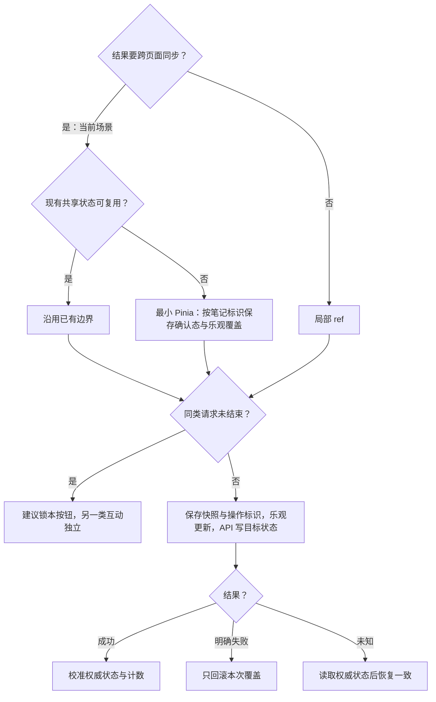

# 点赞与收藏前端方案

> A2 技术决策：维护状态归属、数据链路、实现选择与可行性证据。业务规则、运行规则、行为验收及业务未决项只引用[需求评审](../详情与互动需求评审与最小决策树.md)；整体边界见[方案总览](../详情前端方案.md)。
>
> 对应单元：M4；建议先验证点赞，再扩展收藏；方案为候选、待验证；本轮未实施或运行行为验收。

## 1. 数据放哪里（状态归属表）

| 需要记住的信息 | 由谁管理 | 保留范围与清理时机 |
| --- | --- | --- |
| 选中态、权威计数、确认态与乐观覆盖 | 按笔记 ID 的最小共享状态候选 | 账号与内容状态隔离；明确容量与清理边界，不保存整页数据 |
| 进行中请求、快照与操作版本 | 按笔记和互动类型隔离的操作状态 | 一次操作生效或核实后结束，旧版本不得提交 |
| 计数动画进度 | 按钮局部状态 | 仅表现业务状态，不作为计数来源 |

## 2. 模块之间传什么（数据链路）

选中态与计数 → 点击产生目标状态和快照 → 候选乐观覆盖 → API 写目标状态 → 权威结果校准／明确失败回滚／未知结果核实 → 共享状态同步页面。

点赞和收藏分别管理请求与覆盖；只回滚本次操作，不把另一类互动或更新后的状态一起恢复到旧快照。目标状态、权威计数与幂等语义依赖 Q-03。

## 3. 开发时怎么选（技术决策）

### 3.1 状态归属选择

当前场景需要跨页同步。先核对是否有满足边界的共享状态；本轮未发现笔记互动 Store，保留最小 Pinia 为候选。仅单页使用的场景可用局部 ref，不据此改变当前需求。

### 3.2 写入、并发与回滚机制

以下保留原候选选择与操作分支；“锁同类按钮”仍是建议，不代表连点体验已确认。

响应需校验操作版本、账号及内容状态。单靠防抖不能解决已发送请求或响应乱序；如果必须保留最终点击意图，按 Q-08 确认后选择串行合并策略。

### 3.3 动效候选：Motion JavaScript 版＋renderjs

用户已同意保留这个想法，暂不实施或安装依赖；不等同于确认库已兼容、动效参数已定或原型已通过。

- 优先候选为 Motion 的 JavaScript 包 `motion`，通过 App-vue 的 renderjs 在视图层运行；不默认将面向普通 Vue DOM 的 `motion-v` 直接接入业务页面。
- 候选效果包括按压缩小、弹簧回弹、少量粒子与计数过渡；具体视觉、时长和强度后续评审。
- 业务层负责选中态、计数、请求与回滚，只向动画层传递必要触发信息；动画实例、播放进度与逐帧变化保留在视图层，不作为业务状态来源。
- 原型需验证触摸、连续点击、动画中断、失败回滚、页面退出与组件卸载清理；初始化、跨页同步和窗口化重新挂载不能误播点击动效。
- 先验证一个红心按钮，再决定是否扩展到收藏。若适配成本或真机效果不合适，保留 CSS 动画作为替代候选，不为接入动画库改动已锁定的框架版本。

参考：[Motion JavaScript](https://motion.dev/docs/quick-start)、[DCloud renderjs](https://zh.uniapp.dcloud.io/tutorial/renderjs.html)。两者组合为待验证的接入思路，不是官方已认证的 uni-app 适配方案。

## 4. 方案是否可行（技术验证）

| 编号 | 技术选择 | 需要证明什么 | 最小验证方法 | 当前状态／证据 |
| --- | --- | --- | --- | --- |
| TV-I01 | 最小共享状态 | 同一笔记跨页一致，两类互动互不污染 | 以两个使用方和同一 ID 验证校准、清理与账号切换 | 当前未发现现成笔记互动 Store；方案待验证 |
| TV-I02 | 操作版本与局部回滚 | 连点、晚到响应和失败不能覆盖最新确认态 | 控制两类写请求顺序及失败结果 | 待验证，并发策略待确认 |
| TV-I03 | 未知结果先核实 | 超时但服务端已成功时不重复切换 | 同契约 Mock 模拟写入成功但响应丢失，再读取权威状态 | 待验证，依赖 Q-03 |
| TV-I04 | Motion JavaScript 版＋renderjs 动效候选 | 当前 App-vue 工具链与真机能正确播放、打断和清理；动画不干扰业务结果或误随挂载播放 | 后续用一个红心按钮原型验证触摸、连点、回滚、中断与卸载，再评估收藏复用 | 已记录想法；未安装依赖、未实施、未运行原型 |

行为验收使用[需求评审第 8 节](../详情与互动需求评审与最小决策树.md#8-验收表)的 DT-06–08；规则和未决项使用其第 3、7、9 节，本方案相关问题为 Q-03、Q-08，不在此重设默认值。

## 5. A3 文件关系与输入输出

当前不展开；待对应最小单元、契约与平台确认后，仅补直接文件关系和必要变更。
