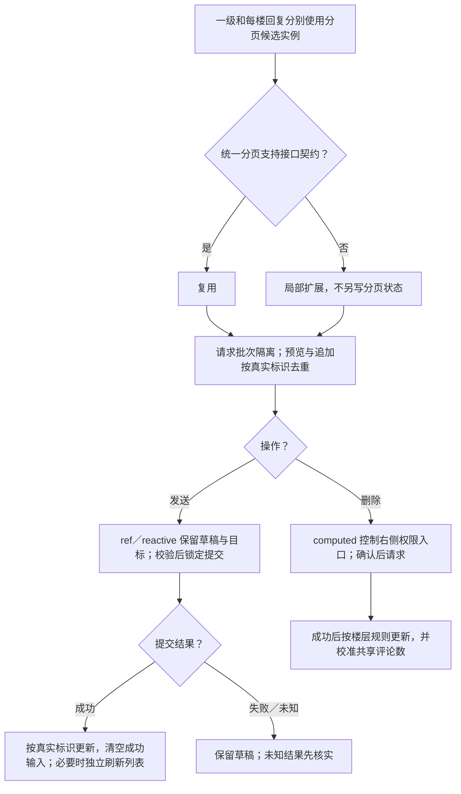
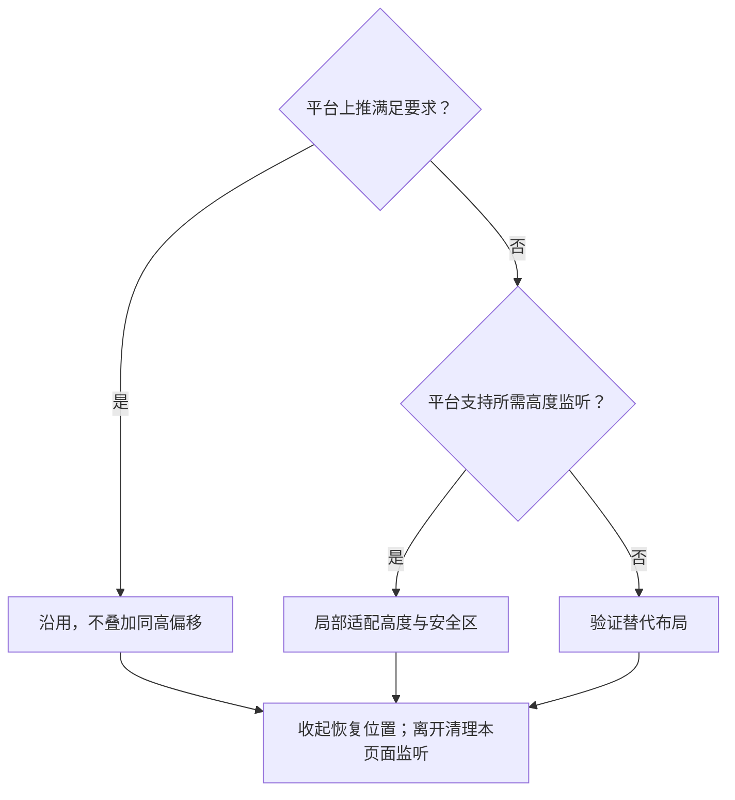

# 评论与二级回复前端方案

> A2 技术决策：维护状态归属、数据链路、实现选择与可行性证据。业务规则、运行规则、行为验收及业务未决项只引用[需求评审](../详情与互动需求评审与最小决策树.md)；整体边界见[方案总览](../详情前端方案.md)。
>
> 对应单元：M5 列表、M6 发送、M7 删除；方案为候选、待验证；本轮未实施或运行行为验收。

## 1. 数据放哪里（状态归属表）

| 需要记住的信息 | 由谁管理 | 保留范围与清理时机 |
| --- | --- | --- |
| 一级评论及其分页、错误与批次 | 独立 usePagination 候选实例 | 按笔记和排序隔离；切换时旧批次失效 |
| 每楼回复、剩余数量与分页 | 每个父评论的独立分页候选实例 | 不同楼层互不污染，预览和追加按真实 ID 去重 |
| 草稿、回复目标、提交／删除状态 | 评论区域局部 ref／reactive | 失败保留；成功只清除该次成功输入 |
| 键盘高度与页面偏移 | 页面局部适配状态 | 收起恢复，离开清理本页面监听 |
| 评论总数与跨页变化 | 按笔记 ID 的共享状态候选 | 使用权威计数校准，不复制整份列表 |

## 2. 模块之间传什么（数据链路）

笔记、排序、父评论 → API → 各自分页实例 → 一级列表与二级展开。

文本与回复目标 → 校验并锁定提交 → API → 真实标识与权威计数 → 更新列表及共享计数；列表刷新独立于写入结果。

权限与评论 ID → computed 删除入口 → 二次确认 → API 删除 → 按已确认楼层规则更新。最终权限由接口校验；参数、排序、预览及计数契约见 Q-03、Q-09。

## 3. 开发时怎么选（技术决策）

### 3.1 列表与写入

原方案拟使用 usePagination；当前未发现实现。实施时先复核：有满足契约的能力则复用，部分满足则局部扩展，仍无实现则依据多个独立列表的使用方明确最小新增边界，不另造多套分页状态。

“确认成功再插入评论”为原方案建议。提交成功后的列表刷新失败只重试读取；评论读取失败仍保留输入能力，提交或删除失败不提前丢内容。未知写入结果先核实，避免重复发送。

### 3.2 键盘适配

原方案参考：[键盘 API](https://uniapp.dcloud.net.cn/api/key.html)、[input](https://uniapp.dcloud.net.cn/component/input.html)。先验证平台原有上推，再决定是否补局部偏移，避免叠加同高偏移。

### 3.3 一致性边界

- 排序、笔记、父评论与批次共同限定响应归属；预览与后续页按真实 ID 去重。
- 输入提交锁与列表读取锁分别管理；成功写入记录不能因读取失败丢失。
- 删除一级评论的连带回复处理依赖 Q-09，不与“原笔记删除后的引用占位”混为一种规则。
- 楼层列表与共享总数分别按契约更新，不靠前端自行推算权威计数。

## 4. 方案是否可行（技术验证）

| 编号 | 技术选择 | 需要证明什么 | 最小验证方法 | 当前状态／证据 |
| --- | --- | --- | --- | --- |
| TV-C01 | 独立分页候选 | 一级、两楼回复与排序切换互不污染，预览衔接不重复 | 同契约 Mock 控制分页和响应顺序 | 未发现现成 usePagination；契约与方案待验证 |
| TV-C02 | 提交与读取分离 | 成功提交但刷新失败时不重复发送，未知先核实 | 模拟失败、成功与响应丢失，并单独制造读取失败 | 待验证 |
| TV-C03 | 右侧权限入口与删除 | UI 权限和服务端结果一致，无权失败不丢条目 | 用三类身份及操作中权限变化验证 | 待验证；入口规则已确认，楼层结果规则待确认 |
| TV-C04 | 平台上推或局部适配 | 输入可见、无二次顶起、收起和离开能恢复 | 目标平台验证弹起、收起、切回复目标及页面离开 | 未运行原型 |

行为验收使用[需求评审第 8 节](../详情与互动需求评审与最小决策树.md#8-验收表)的 DT-09–13、DT-22、DT-26–27；规则和未决项使用其第 3、7、9 节，本方案相关问题为 Q-03、Q-09、Q-13，不在此重设默认值。

## 5. A3 文件关系与输入输出

当前不展开；待对应最小单元、契约与平台确认后，仅补直接文件关系和必要变更。
