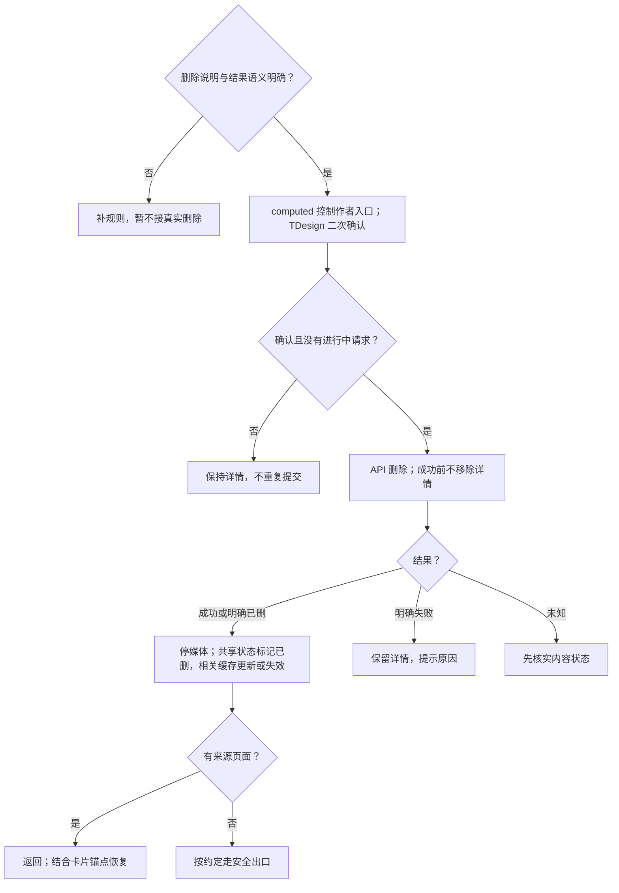

# 删除笔记前端方案

> A2 技术决策：维护状态归属、数据链路、实现选择与可行性证据。业务规则、运行规则、行为验收及业务未决项只引用[需求评审](../详情与互动需求评审与最小决策树.md)；整体边界见[方案总览](../详情前端方案.md)。
>
> 对应单元：M10 作者确认 → 删除结果 → 返回与缓存同步；方案为候选、待验证；本轮未实施或运行行为验收。

## 1. 数据放哪里（状态归属表）

| 需要记住的信息 | 由谁管理 | 保留范围与清理时机 |
| --- | --- | --- |
| 作者权限、确认框与进行中请求 | 页面局部 computed／ref | 取消、完成或离开时结束相应操作 |
| 已确认删除状态与操作版本 | 按笔记 ID 的共享状态候选 | 同步相关页面，拦截旧读取或互动结果 |
| 来源页面与恢复锚点 | 沿用来源页面的导航与位置状态 | 有来源返回；无来源按已确认规则处理 |
| 相关业务缓存 | 各自持有者按 ID 更新或失效 | 只处理相关缓存，不复制或清空全部 Feed |

## 2. 模块之间传什么（数据链路）

作者权限 → TDesign 二次确认 → API 删除 → 成功／明确已删／明确失败／未知结果 → 共享状态与相关缓存 → 停止媒体、返回或安全出口。

接口最终校验权限。未知结果先核实内容状态；删除成功前不提前移除详情。返回窗口化首页时，以笔记 ID 更新对应卡片，并服从首页锚点和位置恢复规则，具体约束见[首页需求评审](../../首页/首页需求评审.md)。

## 3. 开发时怎么选（技术决策）

### 3.1 契约前提与操作边界

删除说明、30 天范围及无历史页出口仍由需求评审维护；本方案不自行选择跳转地址。多端并发下“明确已删”必须有契约依据，不能把其他失败当作成功。

### 3.2 删除后的提交边界

1. 仅有效操作结果可提交；成功或明确已删后停止媒体，并标记共享状态。
2. 按笔记 ID 更新或失效相关缓存，避免旧分页或旧互动结果复活已删内容。
3. 各场景采用占位还是移除由需求评审 BR-09、BR-10 和 Q-04、Q-12 决定，实现衔接见[占位方案](06-删除后占位.md)。
4. 有来源页则按来源返回并恢复锚点；无来源按 Q-11 的最终规则选择出口。

## 4. 方案是否可行（技术验证）

| 编号 | 技术选择 | 需要证明什么 | 最小验证方法 | 当前状态／证据 |
| --- | --- | --- | --- | --- |
| TV-D01 | 确认框与进行中锁 | 取消、连点及明确失败不丢详情、不重复提交 | 同契约 Mock 验证取消、重复确认、失败与未知结果 | 待验证；删除语义待补 |
| TV-D02 | 删除状态优先与缓存同步 | 旧分页、旧读取和旧互动不能恢复已删内容 | 控制删除与多个旧请求的返回顺序 | 待验证；共享状态需最小设计 |
| TV-D03 | 来源返回与锚点恢复 | 有／无历史页均可到达约定出口，相关卡片正确更新 | 目标平台分别验证列表进入、深链进入、窗口化来源返回 | 待验证；首页恢复规则及安全出口待确认 |

行为验收使用[需求评审第 8 节](../详情与互动需求评审与最小决策树.md#8-验收表)的 DT-16–18、DT-21；规则和未决项使用其第 3、7、9 节，本方案相关问题为 Q-03、Q-04、Q-11、Q-12，不在此重设默认值。

## 5. A3 文件关系与输入输出

当前不展开；待对应最小单元、契约与平台确认后，仅补直接文件关系和必要变更。
