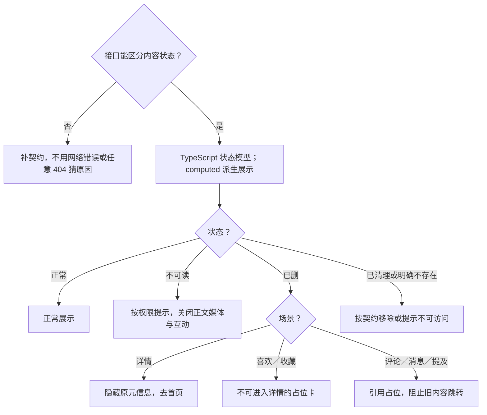

# 删除后占位前端方案

> A2 技术决策：维护状态归属、数据链路、实现选择与可行性证据。业务规则、运行规则、行为验收及业务未决项只引用[需求评审](../详情与互动需求评审与最小决策树.md)；整体边界见[方案总览](../详情前端方案.md)。
>
> 对应单元：M11 内容状态 + 使用场景 → 对应占位或移除；方案为候选、待验证；本轮未实施或运行行为验收。

## 1. 数据放哪里（状态归属表）

| 需要记住的信息 | 由谁管理 | 保留范围与清理时机 |
| --- | --- | --- |
| 权威内容状态、权限与状态版本 | 页面读取结果及按 ID 的共享失效状态候选 | 不可读或删除后使旧结果失效，账号切换隔离 |
| 场景对应的文案、可见区域与出口 | TypeScript 状态模型与 computed 派生 | 随状态和场景变化，不复制可操作旧正文 |
| 清理完成、引用保留与权威统计 | 由服务端契约返回，前端消费结果 | 不用本地时钟推断 30 天已到或清理完成 |

## 2. 模块之间传什么（数据链路）

接口内容状态与可见权限 + 使用场景 → 状态模型 → computed 展示 → 正常内容／不可读提示／引用占位／移除。

共享删除或失效变化 → 详情、喜欢收藏、评论引用、消息与提及的相关使用方 → 按已确认规则更新，并阻止旧内容跳转。用户不存在／注销的目标页也清除旧资料与列表。

状态模型只描述接口已确认语义。占位期限、历史保留、统计回写与申诉承接依赖 Q-02、Q-04、Q-12，不能由状态类型自行补全。

## 3. 开发时怎么选（技术决策）

### 3.1 状态契约与展示映射

图中的喜欢收藏占位、引用占位是原文场景规则；具体期限、移除时机与统计结果仍待契约确认。网络错误或任意 404 不能作为“已删”或“明确不存在”的证据。

### 3.2 旧数据与清理边界

- 不可读状态生效后关闭旧正文、媒体与有效互动；占位背后不保留可操作旧内容。
- 跨页失效按业务 ID 协调，不复制整页内容以实现同步。
- 清理由服务端驱动；客户端只消费保留、已清理等明确状态，不用本地计时自行删除引用。
- 统计采用权威结果；设计稿“已删不计点赞收藏统计”的要求仍需接口支持，不自行猜测计数。

## 4. 方案是否可行（技术验证）

| 编号 | 技术选择 | 需要证明什么 | 最小验证方法 | 当前状态／证据 |
| --- | --- | --- | --- | --- |
| TV-P01 | 状态模型与派生展示 | 正常、不可读、已删、清理与错误互不混用，无旧内容泄露 | 同契约 Mock 遍历明确状态与权限组合 | 待验证；状态语义未定 |
| TV-P02 | 跨页失效协调 | 多个引用场景不能进入旧内容，统计按权威结果同步 | 同一 ID 在相关使用方同时展示后切换服务端状态 | 待验证；使用方与统计契约待定 |
| TV-P03 | 服务端清理与用户失效 | 清理更新不依赖本地时钟，注销页不残留资料或操作 | 模拟清理前后状态、用户不存在与注销 | 待验证；期限和历史范围待确认 |

行为验收使用[需求评审第 8 节](../详情与互动需求评审与最小决策树.md#8-验收表)的 DT-19–20、DT-28–29；规则和未决项使用其第 3、7、9 节，本方案相关问题为 Q-02、Q-04、Q-12，不在此重设默认值。

## 5. A3 文件关系与输入输出

当前不展开；待对应最小单元、契约与平台确认后，仅补直接文件关系和必要变更。
