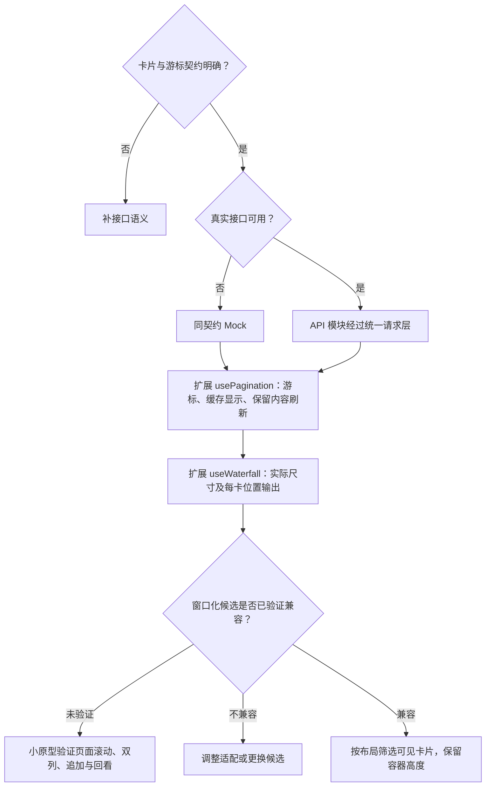
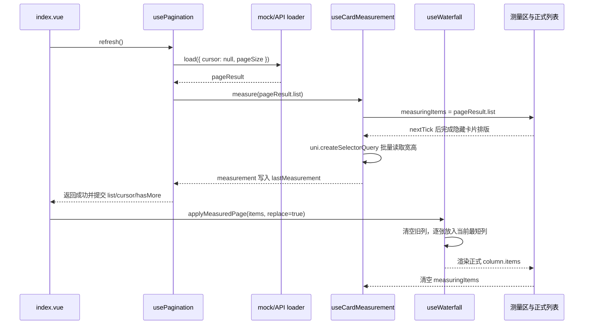

# 首页前端方案

> A2 技术决策：只维护**状态归属 → 模块数据流 → 实现选择 → 可行性证据**。业务定义、运行规则、行为验收及业务未决项只引用[需求评审](首页需求评审.md)；下方同时记录当前已落地的最小实现和仍未实现的边界。

## 1. 数据放哪里（状态归属表）

“状态”是页面需要记住并会变化的信息，包括卡片、加载进度和选中 Tab。本表只分工，没有执行先后。

| 需要记住的信息 | 由谁管理 | 保留范围 |
| --- | --- | --- |
| 发现／关注的卡片、游标、加载与错误 | 各自独立的 usePagination 实例 | 当前流的浏览进度 |
| 当前 Tab、两条流的滚动位置 | `index.vue` 局部状态 | 按流记录页面滚动像素，详情返回后恢复；切账号时清空 |
| 上次首屏快照 | `useHomeFeed` + storage.ts | 按账号和流类型跨 App 重启保留最近首屏，不累计整条 Feed |
| 详情接口确认的卡片变化 | 当前导航的事件通道、两条流各自的 `useHomeFeed` | 同账号按笔记 ID 更新已加载的卡片和有效首屏快照 |

## 2. 模块之间传什么（数据链路）

接口卡片数组 → 每流 usePagination → 按 ID 查询与布局记录 → 可见卡片渲染。

卡片点击沿组件边界向上转发：`HomeNoteCard` → `HomeFeedView` → 当前信息流组件 → `index.vue.openFeedNote`。首页通过导航事件通道接收详情接口确认后的笔记更新。

本地快照作为首屏显示的初始化输入。详情结果在返回首页时按笔记 ID 合并，见[首页目录结构与数据流向](首页目录结构与数据流向.md#详情返回与笔记更新)。

`ensureLoaded()` 是每条信息流的首屏启动门闸。它在第一次调用时先设置 `initialized`，再进入缓存恢复或首屏请求，因此挂载、Tab 激活和滑动预览的重复触发不会重复请求。`initialized` 只表示首屏流程已经启动过，不表示请求成功或数据最新。下拉刷新和错误重试分别走刷新、分页重试流程。

## 3. 开发时怎么选（技术决策）

这一节回答“满足什么条件，就采用什么实现”。图中分支是开发选择，不是用户每次操作都要做的评审。

### 3.1 首页技术选择（怎么实现）



分页与分列的扩展分支已由当前源码缺口确定，不再反复假设其已完整支持。窗口化按 3.2 的布局记录和可视筛选实现。每流的请求锁、批次及去重记录保持独立，只有有效响应才能一起提交列表与游标。

### 3.2 双列与窗口化：算法说明

#### 后端给卡片数据，前端计算位置

按“接口返回排序后的卡片对象数组”设计，每个对象对应一张卡片。以下只是所需数据的示意，字段名称和嵌套结构仍需接口确认，不是已有 API：

```json
{
  "id": "note-101",
  "title": "周末去海边散步",
  "cover": { "url": "封面资源地址", "width": 900, "height": 1200 },
  "author": { "id": "user-1", "nickname": "小岛", "avatarUrl": "头像资源地址" },
  "likeCount": 128,
  "liked": false
}
```

| 数据 | 来源与用途 |
| --- | --- |
| 卡片对象及数组顺序 | 后端提供；前端展示标题、作者、互动与封面，不重新计算热度排序 |
| 成品图片宽高 | 后端提供裁切后的宽高或等价比例；用于图片下载前预留高度 |
| 布局记录 `{ id, column, top, height }` | 前端计算；只记录笔记标识、左右列、顶部位置与卡片高度，不复制整张卡片数据 |

#### 一批对象怎样排成两列

1. usePagination 对新批次按笔记 ID 去重；卡片业务数据继续由分页列表或共享笔记状态持有。
2. 测量瀑布流内容容器，计算 `列宽 = (容器宽 - 列间距) / 2`；所有布局坐标统一为 px，rpx 令牌在边界换算。
3. 由成品比例计算 `封面高 = 实际封面宽 × 图片高 / 图片宽`。再加标题区域、作者行、内边距与边框，得到卡片高度。接口未提供有效宽高（缺失或为 0）时按 1:1 计算占位高度；拿到有效比例后才按成品比例展示，不因图片加载完成重排旧卡。
4. 按接口顺序遍历新对象，放进当前较矮列；两列相同时先左列。记录该卡片的列和 top，再把该列末端推进到“卡片底部 + 间距”。
5. 只为新对象追加布局记录，旧卡片不重新换列；容器高度取两列实际末端的最大值，排除末尾额外间距。

标题高度按需求评审第 9 节的结论处理：若固定两行区域，可直接计算；若随实际行数变化，则测量并校准。刷新、删除、容器宽度变化属于独立重排场景，结合滚动锚点恢复，不当作普通追加。

#### 窗口化怎样使用这些位置

先将页面可见区域换算到瀑布流内部坐标，计入容器位置、固定导航和安全区，再选取与“可见区域 + 上下缓冲”相交的布局记录：

```text
卡片底部 >= 可见区域顶部 - 缓冲
并且
卡片顶部 <= 可见区域底部 + 缓冲
```

容器保留完整高度；只渲染选中的卡片组件，用前端计算的列、top 和列宽定位。组件按布局记录的 id 获取最新卡片对象，封面交给 AppImage；滑远只卸载组件，回看时用同一对象和位置重新渲染。

#### 当前实现缺口

`useWaterfall` 同时保存左右列累计高度和每张卡片的 `{ top, height }`；`HomeFeedView` 只渲染可视区域及上下缓冲内的布局记录，外层容器保留两列最大高度，因此页面滚动和触底距离不受卸载卡片影响。

### 3.3 缓存、共享与内存：实现边界表

| 实现对象 | 技术处理 |
| --- | --- |
| 首屏快照 | 存储封装负责读写与校验；Pinia 只作为运行期共享状态候选 |
| 笔记变更 | 详情回写只处理命中的卡片及首屏缓存项，保留分页游标和缓存时间。文字高度变化时只调整所在列 |
| 刷新提交 | 列表、游标、去重、列布局与快照作为同一批结果更新，对应 AC-17、19 |
| 缓存游标 | 分别验证展示快照与在线游标的有效性；是否可续用服从已确认契约 |
| 资源释放 | 挂载窗口、业务数组和持久化快照分别管理容量；淘汰需配套取数与位置恢复 |

页面级滚动已选。滚动位置按发现和关注分别记录，详情返回和 Tab 切换时恢复对应位置。依据：[页面](https://uniapp.dcloud.net.cn/tutorial/page.html)。nvue／uvue 原生列表不直接套到当前 App-vue。

## 4. 方案是否可行（技术验证）

| 技术选择 | 需要的证据 | 当前状态 |
| --- | --- | --- |
| 扩展统一分页 | 游标、缓存显示、刷新批次能在同一边界管理 | 已完成游标、追加、刷新、重试、去重、首屏缓存和后台刷新 |
| 扩展列布局 | 计算位置与实际卡片尺寸一致，追加不重排旧记录 | 已接入真实卡片测量、top/height 位置记录及最短列增量追加 |
| 窗口化实现 | 页面滚动、双列不等高、占位与事件链路可衔接 | 已按布局记录筛选可视区域与缓冲区，保留完整容器高度 |
| 缓冲与更新频率 | 用目标设备测量空白、帧表现及内存，确定内部参数 | 待测，不先编造数值 |

功能达标与否只使用[需求评审第 8 节的 AC 用例](首页需求评审.md)，此处不重列；业务未决项仍由该文档第 9 节维护。若技术验证引出新的业务取舍，回评审更新，不在方案中另设业务默认值。最小闭环确认后，再补 A3 文件关系。

## 5. Mock 阶段实现记录（2026-11-05）

本节保留早期逐卡测量的历史记录；2026-11-09 固定标题区域的方案已替代该路径，当前实现见第 7 节。

### 5.1 已落地文件

| 文件 | 作用 |
| --- | --- |
| `src/composables/useCursorFeed.ts` | 导出 `usePagination<T>`，管理列表、游标、加载阶段、去重、刷新、重试和错误阶段 |
| `src/api/modules/mock.ts` | 提供首页 UI 验证用的游标分页数据；总计 45 条，按每页 20 条返回 |
| `src/pages/index/index.vue` | 调用首屏、触底加载和下拉刷新，将分页结果接入双列卡片 |
| `src/composables/useWaterfall.ts` | 维护列数据和累计高度；新批次逐条放入当前最短列，旧卡片不重新分列 |
| `src/composables/useCardMeasurement.ts` | 暂存新批次卡片，等待隐藏区渲染，通过一次节点查询返回卡片宽高和间距，单位为 px |
| `src/composables/CONVENTIONS.md` | 以 useCursorFeed.ts 为参考的文件结构、内部步骤和注释规范 |
| `src/pages/index/components/HomeNoteCard.vue` | 展示封面、标题、作者头像和点赞信息，封面按成品比例预留高度 |

### 5.2 当前分页行为

- API 模块向 composable 提供 `{ list, nextCursor, hasMore }`；后端字段映射留在 API 模块，页面不直接调用 `uni.request`。
- `nextCursor` 被视为服务端生成的不透明凭证，前端只保存并原样传回；`pageSize` 只控制本次取数，不计算游标。
- 首屏和刷新都从 `cursor: null` 开始并在成功后替换列表；翻页使用已确认的 `nextCursor` 并追加数据。
- 同一流同一时间只允许一个请求；翻页失败保留旧列表和旧游标，`retry` 根据失败阶段重新请求。
- 每批数据按 `getKey` 去重；`hasMore: false` 后停止请求；游标声明未推进时进入错误状态，避免无限请求。
- 当前已加入首屏缓存、后台拉新、按流滚动锚点恢复和窗口化渲染；页面销毁时由生命周期释放当前 composable 状态。请求锁仍保证同一流同一时刻只有一个有效请求。

### 5.3 当前布局边界

`useWaterfall` 按当前需求只遍历新批次、放入当前最短列，并为每张卡片记录 top/height；首页用相同列宽、同一卡片组件在隐藏区测量新批次。正式列表只挂载可视区域和上下缓冲内的卡片，回看时按同一布局记录重新挂载。测量完成后再确认分页结果；失败保留旧游标和旧内容。

### 5.4 验证记录

- 首页逻辑检查：短标题和两行标题均进入布局计算，新增批次按最短列追加，旧卡片列归属与列内 top 保持不变。
- 首页分页检查：首屏、追加、末页和测量区清理均已由脚本覆盖；App-Plus 真机滚动与触底验收待补。

- `npm run build:mp-weixin`：通过。
- `npm run build:app`：通过。
- 首页相关文件 lint：通过。
- `npm run type-check`：仍被既有 `src/utils/storage.ts` 缺失和 `src/types/api.ts` 不是模块两个错误阻断；本次首页新增代码未产生新的类型错误。

### 5.5 刷新时序：从请求到瀑布流



实际代码顺序如下：

1. `index.vue` 的 `refresh()` 调用 `discoverPagination.refresh()`。
2. `useCursorFeed.ts` 的分页内部调用页面传入的 `load`。
3. `load` 请求 `pageResult`，然后等待 `cardMeasurement.measure(pageResult.list)`。
4. `measure` 把本批数据放进 `measuringItems`；页面渲染隐藏测量区。
5. `nextTick` 后，`uni.createSelectorQuery().selectAll(...).boundingClientRect()` 批量读取卡片尺寸。
6. 成功后，测量结果写入 `lastMeasurement`，`load` 才返回原始 `pageResult`。
7. 分页层提交列表、游标和结束状态；页面调用 `applyMeasuredPage`。
8. `applyMeasuredPage` 从 `lastMeasurement` 取每张卡片的 px 高度，交给 `useWaterfall.replace` 或 `append`。
9. `useWaterfall` 逐张选择当前最短列并更新列高；正式模板只渲染 `column.items`。

如果测量失败，`load` 不会返回 `pageResult`，分页层不会提交新列表和新游标，旧内容仍然保留，重试会重新执行同一时序。

## 6. 真实接口接入（2026-11-09）

接口依据为用户提供的 Feed-API(3) 及本地 `http/feed.http`。该版本取代此前发现流的裸 offset／整数编码游标约定；第 5 节保留为 Mock 阶段记录。

| 边界 | 当前实现 |
| --- | --- |
| 请求 | `src/api/modules/feed.ts` 通过统一请求层访问 `/feed/discover` 和 `/feed/follow`；首次 cursor 为字符串 0，其后原样回传 nextCursor，size 为 20 |
| 标识与比例 | Feed 类型与 Mock 分离；ID 统一为字符串，原始 JSON 中的超大 long 在解析前保留精度；封面宽高未知时按 1:1 占位 |
| 两条流 | `HomeDiscoverFeed.vue` 与 `HomeFollowingFeed.vue` 各持有独立 `useHomeFeed` 实例；共用 `HomeFeedView.vue` 展示；切换保留数据，切账号通过组件 key 重建并拒绝旧结果提交 |
| 快照回退 | 仅比较发现流游标中的版本，不计算 offset；版本变更时暂存新首屏，通过已有 refresh 替换列表，按固定区域计算卡片高度后同步重建双列；新首屏为空也清除旧卡片 |
| 通用分页 | 保留 `src/composables/homepage/useCursorFeed.ts` 原文件；`useHomeFeed.ts` 协调快照重置、分页与布局提交，页面仅转发刷新／触底事件 |
| 滑动切换 | HomeFeedPager 承载跟手横滑与松手缓动吸附；`useSwipePager` 的 `preview` 在拖动和吸附期间同时传给两个流，`active` 在完成后决定当前页。按方向、距离、速度判断落点并处理边界阻尼。左滑关注、右滑发现，不循环；纵向滚动保持，多指与取消复位。两页直接衔接，按用户最终要求不显示白线或额外间隙 |
| 卡片布局 | 封面固定 3:4；标题与正文摘要最多两行、空字段不占位；`useCardMeasurement` 在组件内隐藏测量区读取动态整卡高度，`useHomeFeed` 依据实测高度分配最短列 |
| 首屏错误样式 | 发现、关注共用 `HomeFeedError.vue`：无内容且网络／超时失败时显示圆底 Wi-Fi、“网络不给力”、检查网络说明及“重新加载”；采用现有字体、颜色和尺寸令牌，在导航以下剩余区域居中。已有内容时保留双列，仅底部重试；其他错误不误报为断网 |
| 关注空态 | 展示最多 3 位 recommendedAuthors，复用关注接口，成功后刷新关注流；未登录不请求关注流 |
| 当前范围 | 默认使用真实数据源；首屏缓存、后台刷新、窗口化和详情返回位置已接入；保留独立 Mock 文件，未改现有全局登录门禁 |

验证脚本 `node scripts/check-feed.mjs` 覆盖字符串游标、大整数标识、快照版本切换、空结果重置、双流隔离、组件卸载后的旧响应、权限请求头、去重、失败重试、短空页与末页，以及左右滑动、边界、纵向滚动、多指与取消。脚本直接运行固定高度布局算法，仍不能代替 App 真机布局与触摸验收。

`npm run type-check`、本轮文件 lint、`npm run build:app` 已通过。全量 lint 的既有登录页警告另行保留；真实后端地址请求超时，当前尚无线上或 App 真机联调通过的证据。


## 7. 固定卡片区域（2026-11-09 用户确认）

标题统一预留两行，空标题和短标题保留剩余空白；作者行、内边距及间距使用固定令牌。封面消费后端返回的最终成品宽高，3:4 高度为列宽的 4/3，1:1 高度为列宽。缺失宽高继续按 1:1 占位，不再读取在线图片尺寸。发布上传尺寸与后端返回字段的契约仍须另行接入，本次未修改发布链路。

整卡高度 = 固定 3:4 封面高度 + 实际标题/摘要行数 + 作者行 + 内边距、间距和边框。`useCardMeasurement` 读取实际排版后的 px 高度，避免用固定文字高度估算；图片区域仍通过令牌保持自适应，不写死组件像素宽度。

已恢复逐批卡片测量、隐藏测量区和 `measure` 回调；图片尺寸补读仍不启用。`useHomeFeed` 继续负责分页、快照替换、组件卸载后的旧响应失效及最短列追加；同一条信息流的并发请求由 `requestLocked` 串行化，不采用旧请求被新刷新打断的 latest-wins 模型；`useWaterfall` 继续只分配新卡片。

验证：代码和布局检查覆盖 3:4 封面、短标题、长标题、空标题及隐藏测量区清理。类型检查、相关文件 lint、分页与布局检查、App 构建通过；App-Plus 真机表现仍待验证。


## 8. 首页统一 3:4（2026-11-09 最新决定）

本节替代此前支持 3:4／1:1 的显示规则。首页所有封面固定为 3:4，包括接口尺寸缺失及历史正方形、横图；使用 aspectFill 等比居中裁切填满。标题仍固定预留两行，因此所有卡片整高一致，按自适应列宽计算，不再依赖接口宽高决定布局。

比例在 tokens.css 的 --ys-home-cover-ratio-width／height 中统一定义，卡片 CSS 与 feed-layout.ts 共用。已有接口宽高校验、归一化及相关校验用例保留；它们不决定首页容器比例。本次不改详情媒体手势或发布接口。

App-Plus 验收：竖图、正方形、横图及缺失宽高均应显示为 3:4；短、长和空标题的整卡高度应保持一致，滚动窗口切换不应改变卡片位置。
