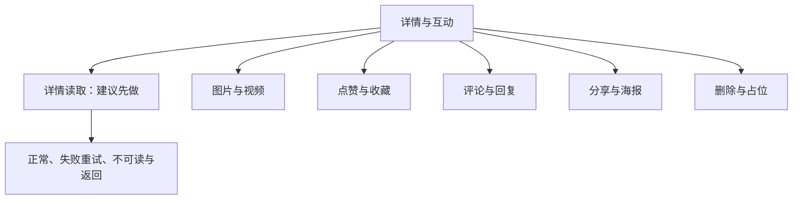
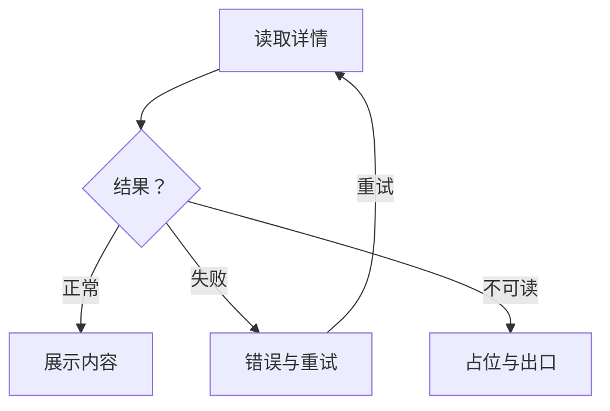
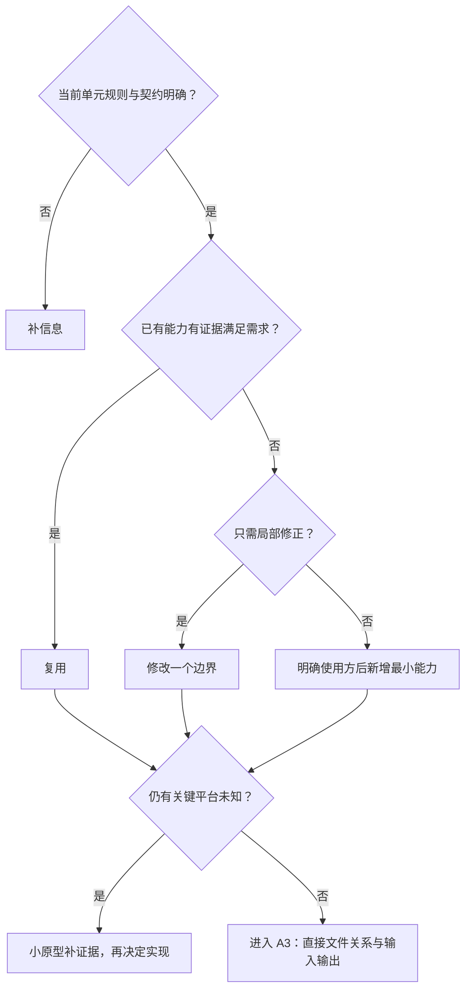

# 详情与互动需求评审与最小决策树

> 阶段 A1–A2；AI 评审建议：需补充。各方案为候选，不代表已实现。

## 1. 依据与决策记录

依据：[设计稿](../社区App设计稿v1.0.html)、用户确认及[首页文档引用的主计划第四章](../首页/首页需求评审.md)。

| 状态 | 决定 |
| --- | --- |
| 已确认 | 单击图片全屏；也可页内双指持续放大并进入全屏 |
| 已确认 | 视频默认静音，进入详情后 1 秒内起播为性能目标 |
| 已确认 | 评论／回复删除入口仅向该条作者或笔记作者显示，固定右侧 |
| 已明确 | 本期不做删除后恢复入口或流程 |
| 建议 | 先选详情读取闭环；人工评审结论尚未给出 |

## 2. 需求卡

| 项目 | 内容 |
| --- | --- |
| 目标 | 内容可读，互动可恢复，失效后不露出旧内容 |
| 最小单元建议 | 详情读取 → 正常／不可读／失败 → 返回或重试 |
| 输入 → 输出 | 笔记标识、权限与状态 → 详情或对应占位 |
| 前提 | 状态与权限契约明确；真实接口未完成可用同契约 Mock |

## 3. 业务规则与前端责任

| 模块 | 前端责任 |
| --- | --- |
| 媒体 | 切图、连续缩放、全屏、视频生命周期 |
| 互动 | 乐观更新、计数动画、回滚与跨页同步 |
| 评论 | 独立分页、二级展开、输入键盘、权限删除 |
| 分享 | 海报、保存和渠道调用分别反馈 |
| 删除 | 二次确认，成功后返回并更新相关缓存 |
| 占位 | 按内容状态与场景展示；清理由服务端负责 |

## 4. 可复用组件

## 5. 最小需求拆分树

### 5.1 能力拆分

### 5.2 首个闭环流程

## 6. 方案决策树

| 单元 | 具体方案树与完整验收 |
| --- | --- |
| 详情与媒体 | [读取、图片、视频](详情方案/01-详情与媒体.md) |
| 点赞／收藏 | [状态、并发与回滚](详情方案/02-点赞与收藏.md) |
| 评论／回复 | [分页、键盘、写操作](详情方案/03-评论与二级回复.md) |
| 分享 | [海报、保存与平台分支](详情方案/04-分享与海报.md) |
| 删除 | [确认、请求与缓存](详情方案/05-删除笔记.md) |
| 占位 | [状态与场景](详情方案/06-删除后占位.md) |

## 7. 加载与异常判断规则

| 条件 | 展示 |
| --- | --- |
| 无数据且首屏失败 | 整页错误与重试 |
| 已有内容／资源／评论局部失败 | 保留可用内容，仅失败区域给恢复入口 |
| 成功确认无内容 | 业务空态，不给网络重试 |
| 明确已删、不存在或失效链接 | 隐藏原标题、作者、媒体和计数，仅主动出口去首页 |
| 下架／审核／私密 | 按权限和状态提示 |

完整矩阵与重试口径见[异常规则](详情异常与占位规则.md)。

## 8. 验收表

当前建议闭环尚未运行；完整 32 条用例保留在模块文档和异常规则中。

| 场景 | 预期 |
| --- | --- |
| 正常 | 展示同一笔记的作者、正文与媒体 |
| 异常 | 网络错误不伪装成已删，已删不泄露旧内容 |
| 恢复 | 重试可恢复；旧响应不覆盖当前笔记；返回入口可用 |

## 9. 待确认事项与评审结论

| 关卡 | 待确认 |
| --- | --- |
| 当前最小单元 | 是否选详情读取、优先平台、人工评审结论 |
| 详情契约 | 正常／已删／不存在／无权限的语义、聚合字段与操作权限 |
| 写操作共用契约 | 目标状态、真实标识、权威计数、超时核实与幂等语义 |
| 删除与清理 | 删除说明文案、各场景 30 天范围；恢复不在本期 |
| 各模块细节 | 只在对应模块维护参数、交互和平台未决项 |

AI 建议：需补充当前单元关键条件；后续候选方案不视为批准或排期。

## 10. 记录边界

- 仅整理文档，未编码或运行行为验收；遵守 [AGENTS.md](../../AGENTS.md)。
- 已实现能力以源码为准；A3 文件级设计在最小单元确认后展开。
- 按[首页第 10.1 节](../首页/首页需求评审.md)按需取上下文；不默认读完所有模块。
