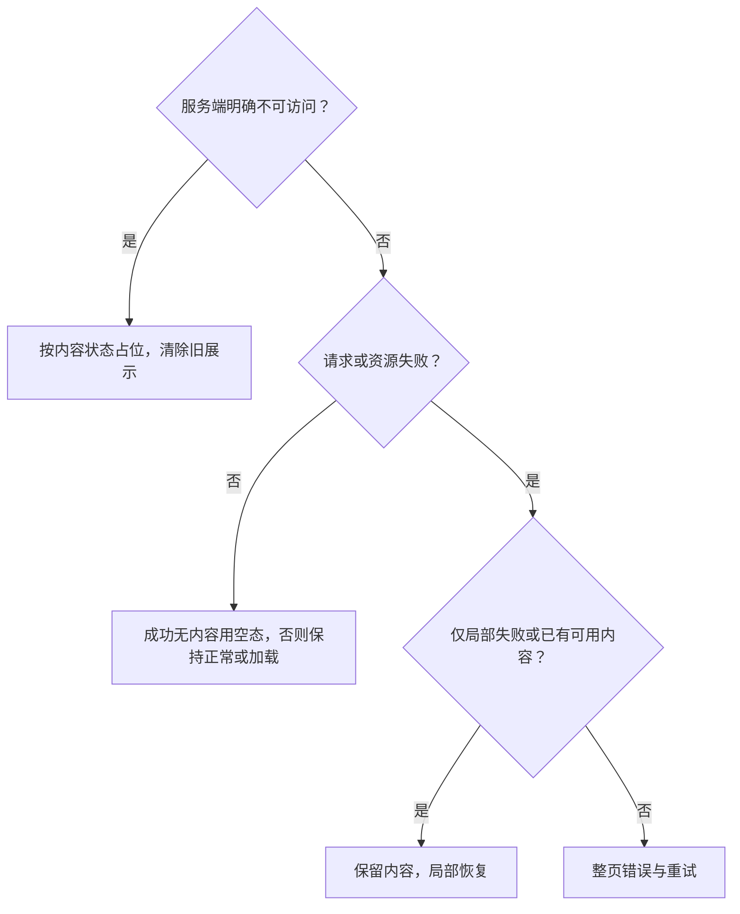

# 详情：加载与异常占位规则

[主文档](详情与互动需求评审与最小决策树.md) · 依据[设计稿](../社区App设计稿v1.0.html)

## 1. 选择树

## 2. 场景规则

| 场景 | 展示与出口 |
| --- | --- |
| 图片／头像 | 原比例占位，图片手动重试；头像降级昵称首字，缺昵称用“用户” |
| 视频 | 区分加载、受限与明确失败；播放区保尺寸，正文互动可用；反馈入口未定 |
| 评论／回复 | 局部失败；输入可用；提交成功后只重试读取，不重复发送 |
| 成功无内容 | 插画、场景文案与业务出口，不给网络重试 |
| 已删／不存在／链接失效 | 隐藏标题、作者、媒体、计数；仅主动出口去首页，系统返回可用 |
| 下架／审核／私密 | 分状态提示；审核态可知范围及申诉按权限 |
| 用户不存在／注销 | 不展示旧资料和列表，只返回，不提供关注或私信 |

文案给现象和下一步；原因须有依据。样式取令牌。占位不新增删除后恢复能力。

## 3. 重试口径

| 来源 | 原规则 | 待统一 |
| --- | --- | --- |
| 图片 | 不自动轮询 | 手动入口 |
| 视频 | 连续失败 2 次后转手动 | 是否包含首次、重置时机 |
| 整页网络异常 | 自动重试最多 2 次，网络恢复可重试 1 次 | 恢复重试是否计入预算 |
| 同页加载 | 连续失败 3 次后转手动 | 可能等于首次加 2 次重试，尚未定案 |

所有触发共享进行中锁和对应预算，不能绕过上限。

## 4. 验收表

| 编号 | 条件与操作 | 预期结果 |
| --- | --- | --- |
| DT-30 | 连续失败、重复触底或重复网络恢复事件 | 按最终确认的分场景预算与进行中锁触发，不无限自动重试；手动恢复入口仍可用 |
