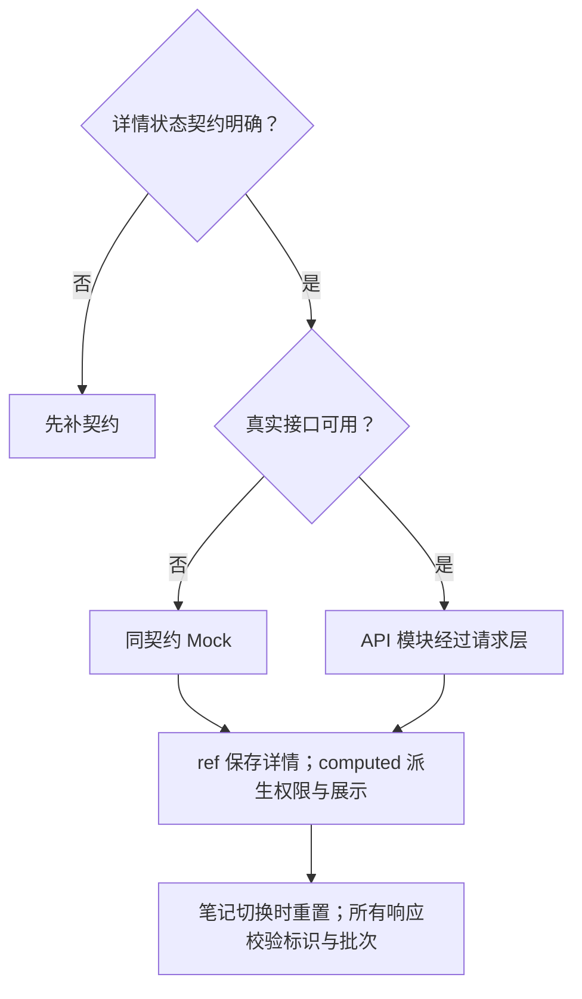
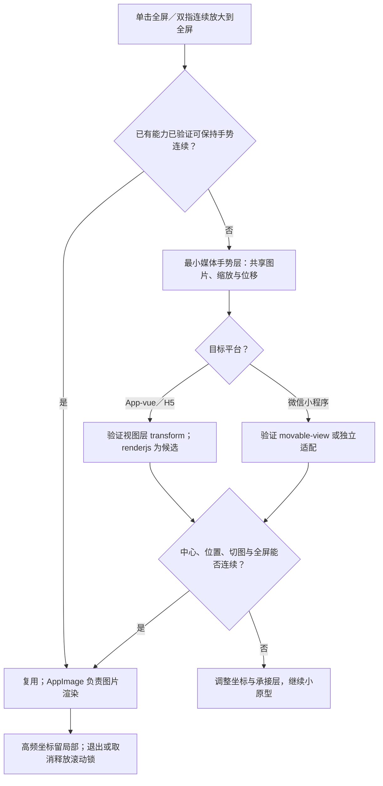
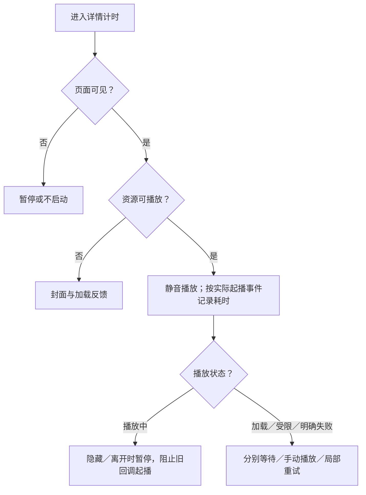

# 详情与媒体：方案决策树

[主文档](../详情与互动需求评审与最小决策树.md) · [异常规则](../详情异常与占位规则.md)

> 候选方案；先补契约或平台证据，再进入文件级设计。验收均未执行。

## 最小单元

| 单元 | 输入 → 输出 | 前提 |
| --- | --- | --- |
| M1（建议先做） | 笔记标识 → 正常、不可读或错误详情 | 状态与权限契约 |
| M2 | 图片与触点 → 切图、缩放、全屏 | 原图规格、阈值与退出规则 |
| M3 | 视频与页面状态 → 静音播放或局部反馈 | 1 秒目标的测量条件 |

## 读取方案决策树

## 图片方案决策树

全屏保留原区域占位，不重建活动手势实例。原生预览不能直接当作连续手势的已验证替代；图片只经 AppImage 渲染。

## 视频起播流程

超过 1 秒仍在加载，只说明未达目标，不自动等同播放错误。

依据：[图片 API](https://uniapp.dcloud.net.cn/api/media/image.html)、[video](https://uniapp.dcloud.net.cn/component/video.html)、[renderjs](https://uniapp.dcloud.net.cn/tutorial/renderjs.html)、[movable-view](https://uniapp.dcloud.net.cn/component/movable-view.html)。renderjs 不支持微信小程序，Vue 3 接入写法需验证。

## 验收表

| 编号 | 条件与操作 | 预期结果 |
| --- | --- | --- |
| DT-01 | 合法笔记标识，详情正常返回 | 作者、正文、媒体和互动初态对应同一笔记 |
| DT-02 | 首屏无数据时请求超时，或已有数据后刷新失败，再点击重试 | 前者整页异常，后者保留已有内容并局部提示；恢复后正常展示，返回入口始终可用 |
| DT-03 | 详情返回明确已删、不存在或链接失效 | 不展示旧标题、作者、正文、媒体及互动数；仅主动出口去首页，系统返回可用，不显示恢复入口 |
| DT-04 | 单击图片全屏；或从页内双指持续放大到全屏，再退出 | 当前图片与索引保持一致，缩放中心与位置连续，退出回原图和详情位置，不误切图或误触返回 |
| DT-05 | 在约定设备、网络与缓存条件下进入视频详情，随后进入后台或离开 | 默认静音，测量从进入详情到实际开始播放是否在 1 秒内；隐藏后暂停，失效回调不再触发播放 |
| DT-23 | 一张详情图片失败，其他数据正常 | 按原展示比例局部占位，可手动重试；正文、其他图片和互动不受影响 |
| DT-24 | 头像地址失败，分别有或没有昵称 | 有昵称时以昵称首字降级，缺失时显示“用户”；尺寸稳定且颜色来自现有令牌 |
| DT-25 | 视频明确失败，或仅加载超过 1 秒 | 明确失败时仅播放区展示失败与恢复出口；超过性能目标仍在加载时保持加载反馈，不误判为播放错误 |
| DT-31 | 双指持续缩放时进入全屏，或触摸被系统取消 | 图片、缩放中心和位置连续；取消时无残留手势、遮罩或滚动锁 |
| DT-32 | 图片放大后单指拖动，再复位并切图 | 放大时不误切到另一张；复位和切图按最终约定规则工作，序号与实际图片一致 |

## 本模块待确认

| 项目 | 待确认 |
| --- | --- |
| 图片 | 资源规格、全屏阈值、最大倍数、退出与边界拖动 |
| 视频 | 设备、网络、冷热缓存、测量事件、达标统计；再次显示是否自动恢复 |
| 设计稿补充 | 正文图文 8 行／视频 1 行折叠、作者浮层和底栏待评审；指示器随实际图片数变化 |

首页 3:4／1:1 封面约束不自动套到详情全部图片。

共用接口与评审关卡以[主文档第 9 节](../详情与互动需求评审与最小决策树.md)为准，不在此重复维护。
