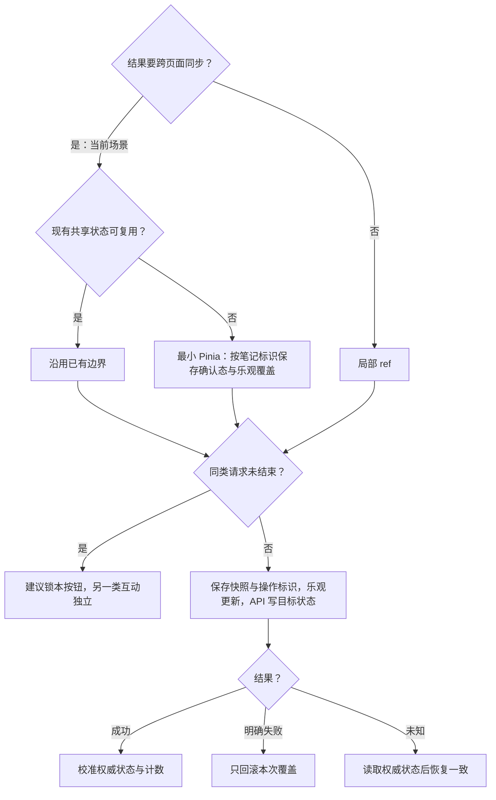

# 点赞与收藏：方案决策树

[主文档](../详情与互动需求评审与最小决策树.md) · [异常规则](../详情异常与占位规则.md)

> 候选方案；先补契约或平台证据，再进入文件级设计。验收均未执行。

## 最小单元

M4：已有选中态和计数 → 操作 → 确认或回滚。建议先验证点赞，再扩展收藏。

## 方案决策树

计数动画只表现状态；响应校验操作版本和账号／内容状态。共享状态需容量边界，不保存整页数据。

## 验收表

| 编号 | 条件与操作 | 预期结果 |
| --- | --- | --- |
| DT-06 | 点赞与收藏分别成功或明确失败 | 成功校准服务端结果；失败回滚对应操作，另一按钮不受污染 |
| DT-07 | 同类按钮连点、旧响应晚到 | 按已确认并发策略提交，旧响应不覆盖最新有效状态 |
| DT-08 | 写入超时但可能已在服务端成功 | 不把超时等同未写入；读取权威状态后恢复一致，不盲目重复切换 |

## 本模块待确认

连点体验：建议锁定同类请求；若必须保留最终点击意图，另选串行合并策略。单靠防抖不能解决已发送请求或响应乱序。

共用接口与评审关卡以[主文档第 9 节](../详情与互动需求评审与最小决策树.md)为准，不在此重复维护。
