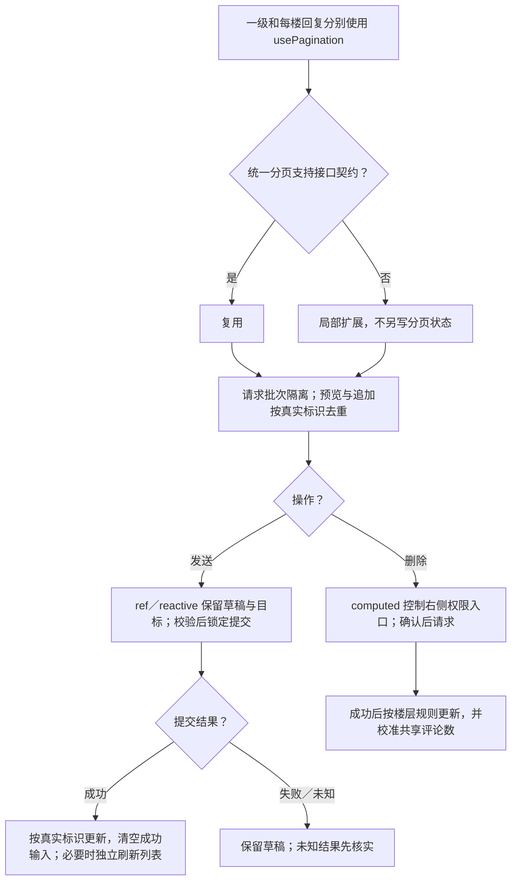
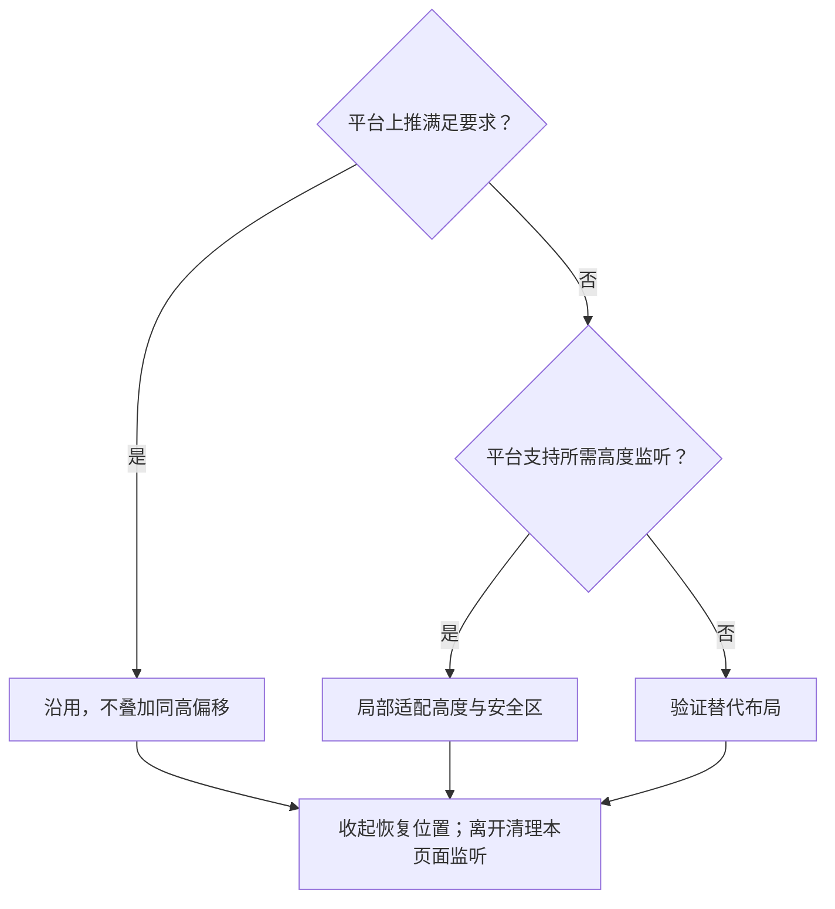

# 评论与二级回复：方案决策树

[主文档](../详情与互动需求评审与最小决策树.md) · [异常规则](../详情异常与占位规则.md)

> 候选方案；先补契约或平台证据，再进入文件级设计。验收均未执行。

## 最小单元

| 单元 | 输入 → 输出 |
| --- | --- |
| M5 | 笔记、排序、父评论 → 独立列表与二级展开 |
| M6 | 文本、回复对象 → 成功条目或保留草稿 |
| M7 | 权限、评论标识 → 删除结果与计数 |

## 列表与写入方案决策树

建议先确认成功再插入评论。列表刷新失败不重复发送已成功评论；评论读取失败时输入仍可用。提交／删除失败保留当前内容。

## 键盘方案决策树

依据：[键盘 API](https://uniapp.dcloud.net.cn/api/key.html)、[input](https://uniapp.dcloud.net.cn/component/input.html)。

## 验收表

| 编号 | 条件与操作 | 预期结果 |
| --- | --- | --- |
| DT-09 | 评论首屏空、翻页失败、切换排序时旧响应晚到 | 空态与错误区分，旧内容保留，旧排序响应不串入新列表 |
| DT-10 | 展开两条不同父评论的回复 | 回复、剩余数量和分页互不污染，预览与追加不重复 |
| DT-11 | 评论发送失败、成功或结果未知 | 失败保留草稿；成功按真实标识只出现一条；未知先核实 |
| DT-12 | 键盘弹起收起、切换回复对象 | 输入可见，无二次顶起，草稿与目标正确，收起后布局恢复 |
| DT-13 | 有权用户删除评论，或权限中途改变 | 确认后按规则移除／占位及校准计数；无权失败不提前丢失条目 |
| DT-22 | 分别以该条评论／回复作者、笔记作者和其他用户查看同一条内容 | 前两类用户在操作行右侧看到删除入口；其他用户不显示；最终权限仍由接口校验 |
| DT-26 | 评论首屏失败后提交一条有效评论，提交成功但刷新仍失败 | 输入和其他内容可用；记录提交成功，只重试列表读取，不重复发送评论 |
| DT-27 | 成功确认没有评论，与评论请求失败分别发生 | 前者为评论空态与写评论引导，后者为失败图标、说明与重试；二者不混用 |

## 本模块待确认

| 设计稿补充 | 待确认 |
| --- | --- |
| 默认热度、可切最新 | 是否本期实现；新评论位置由规则确定，排序由服务端完成 |
| 二级默认前 2 条、作者标记 | 预览衔接分页、回复中的回复如何展示 |
| 评论不超过 500 字 | 字符计数口径 |
| 删一级评论连带回复 | 移除／占位及计数规则；不等同于原笔记删除后的引用占位 |

共用接口与评审关卡以[主文档第 9 节](../详情与互动需求评审与最小决策树.md)为准，不在此重复维护。
