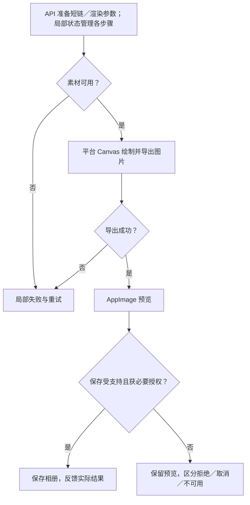
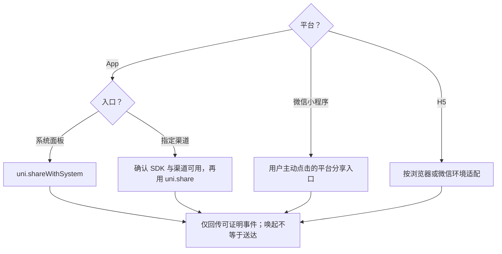

# 分享与海报：方案决策树

[主文档](../详情与互动需求评审与最小决策树.md) · [异常规则](../详情异常与占位规则.md)

> 候选方案；先补契约或平台证据，再进入文件级设计。验收均未执行。

## 最小单元

M8：参数与素材 → 海报预览／保存；M9：分享内容 → 渠道调用与真实结果。两者分别验收。

## 海报方案决策树

## 分享方案决策树

站内入口面板与系统面板分开；取消、失败、无法确认均不冒充成功。分享准备不阻塞详情，素材失败不复用其他笔记海报。

依据：[分享 API](https://uniapp.dcloud.net.cn/api/plugins/share.html)、[图片 API](https://uniapp.dcloud.net.cn/api/media/image.html)。

## 验收表

| 编号 | 条件与操作 | 预期结果 |
| --- | --- | --- |
| DT-14 | 海报素材失败后重试，或用户拒绝相册权限 | 错误与取消分开，预览可恢复，不显示其他笔记的旧海报 |
| DT-15 | 分享成功回调、取消、失败、无可确认回调 | 只反馈和回传平台实际能证明的事件，不统一计为成功 |

## 本模块待确认

| 项目 | 待确认 |
| --- | --- |
| 入口范围 | 设计稿的好友、朋友圈、复制口令、分享图、收藏是否全部本期实现 |
| 回传 | 渠道可观测性、计数触发点、去重语义 |
| 内容 | 短链／口令与渲染参数契约；口令不自动等同普通 URL |

面板内收藏如纳入，复用同一笔记互动状态。

共用接口与评审关卡以[主文档第 9 节](../详情与互动需求评审与最小决策树.md)为准，不在此重复维护。
