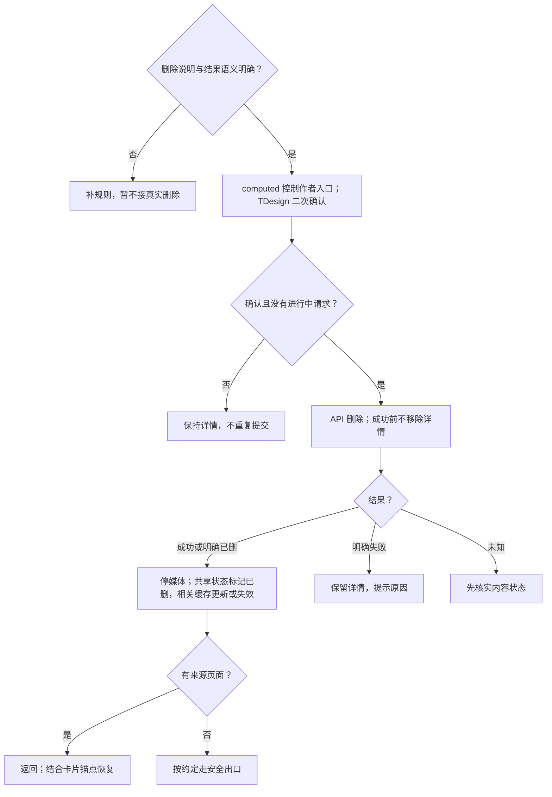

# 删除笔记：方案决策树

[主文档](../详情与互动需求评审与最小决策树.md) · [异常规则](../详情异常与占位规则.md)

> 候选方案；先补契约或平台证据，再进入文件级设计。验收均未执行。

## 最小单元

M10：作者确认 → 删除结果 → 返回与缓存同步。依赖删除说明和状态契约。

## 方案决策树

接口最终校验权限；旧读取或互动结果不得复活已删内容。只更新相关缓存；各场景显示由占位规则决定。

## 验收表

| 编号 | 条件与操作 | 预期结果 |
| --- | --- | --- |
| DT-16 | 删除笔记时取消、连点确认、明确失败 | 取消和失败保留详情，提交不重复 |
| DT-17 | 删除成功或明确已删除，来源有或没有历史页面 | 停止媒体、同步相关场景；按来源返回或进入已约定安全出口 |
| DT-18 | 删除后旧分页或旧互动请求返回 | 不恢复已删内容，不覆盖已确认状态 |
| DT-21 | 详情返回窗口化首页，期间笔记被删除或计数变化 | 对应卡片更新或移除，滚动恢复符合首页规则 |

## 本模块待确认

删除文案与 30 天范围见主文档关卡；多端并发需区分“已删除”和其他失败；深链无上一页时的安全出口尚待约定。本期不做恢复入口或流程。

共用接口与评审关卡以[主文档第 9 节](../详情与互动需求评审与最小决策树.md)为准，不在此重复维护。
