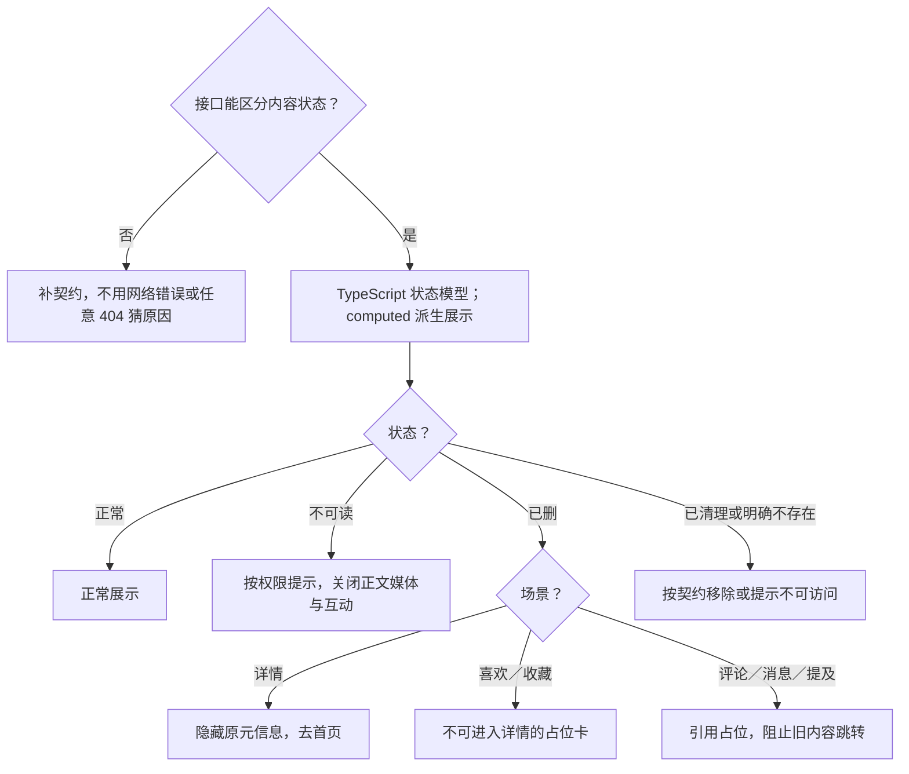

# 删除后占位：方案决策树

[主文档](../详情与互动需求评审与最小决策树.md) · [异常规则](../详情异常与占位规则.md)

> 候选方案；先补契约或平台证据，再进入文件级设计。验收均未执行。

## 最小单元

M11：内容状态 + 使用场景 → 对应占位或移除；不展示可操作的旧正文。

## 方案决策树

服务端驱动清理状态；客户端不以本地时钟推断 30 天清理完成。跨页失效通过共享状态协调；不保留可操作旧内容在占位后。

## 验收表

| 编号 | 条件与操作 | 预期结果 |
| --- | --- | --- |
| DT-19 | 已删笔记出现在喜欢收藏、评论引用、消息与 @ | 各场景按已确认规则占位、阻止旧内容跳转、同步统计 |
| DT-20 | 服务端从保留占位变为已清理 | 对应区域按契约更新；不由本地时钟擅自推断清理完成 |
| DT-28 | 下架、审核中或私密状态由服务端明确返回 | 不展示旧正文、媒体与有效互动；按可见权限展示对应说明，不混入不存在或网络错误态 |
| DT-29 | 通过作者入口访问不存在或已注销的用户 | 目标页不保留旧资料、数据和笔记列表；仅保留返回，不提供关注或私信 |

## 本模块待确认

各类占位适用的 30 天期限、消息历史保留范围、统计回写与申诉／反馈承接仍待确认。设计稿要求已删不计入点赞收藏统计；具体接口结果需契约支持。本期无恢复流程。

共用接口与评审关卡以[主文档第 9 节](../详情与互动需求评审与最小决策树.md)为准，不在此重复维护。
