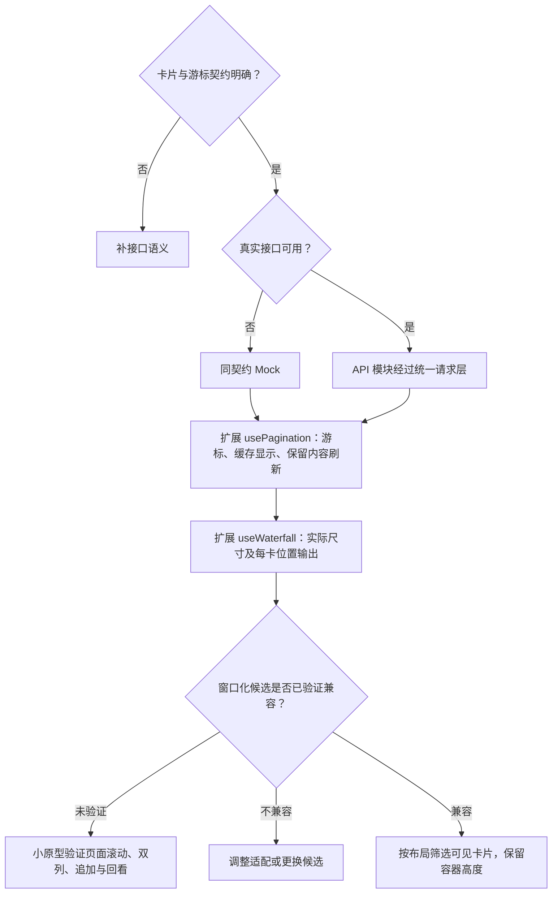

# 首页前端方案

> A2 技术决策：只维护**状态归属 → 模块数据流 → 实现选择 → 可行性证据**。业务定义、运行规则、行为验收及业务未决项只引用[需求评审](首页需求评审.md)；以下方案尚未实现。

## 1. 数据放哪里（状态归属表）

“状态”是页面需要记住并会变化的信息，包括卡片、加载进度和选中 Tab。本表只分工，没有执行先后。

| 需要记住的信息 | 由谁管理 | 保留范围 |
| --- | --- | --- |
| 发现／关注的卡片、游标、加载与错误 | 各自独立的 usePagination 实例 | 当前流的浏览进度 |
| 当前 Tab、两条流的滚动锚点 | 首页局部状态 | 首页实例存续期间；按流保存 |
| 上次首屏快照 | 现有本地存储封装 storage.ts | 跨 App 重启保留首屏，不累计整条 Feed |
| 点赞、收藏、删除等跨页变化 | 复用共享状态；缺少时考虑最小 Pinia | 按笔记 ID 同步相关页面，设置清理边界 |

## 2. 模块之间传什么（数据链路）

接口卡片数组 → 每流 usePagination → 按 ID 查询与布局记录 → 可见卡片渲染。

本地快照作为首屏显示的初始化输入；跨页变化按笔记 ID 合并或标记失效。数据归属见第 1 节，缓存恢复能力仍需扩展。

## 3. 开发时怎么选（技术决策）

这一节回答“满足什么条件，就采用什么实现”。图中分支是开发选择，不是用户每次操作都要做的评审。

### 3.1 首页技术选择（怎么实现）



分页与分列的扩展分支已由当前源码缺口确定，不再反复假设其已完整支持。窗口化实现仍需证据；具体布局计算见 3.2。每流的请求锁、批次及去重记录保持独立，只有有效响应才能一起提交列表与游标。

### 3.2 双列与窗口化：算法说明

#### 后端给卡片数据，前端计算位置

按“接口返回排序后的卡片对象数组”设计，每个对象对应一张卡片。以下只是所需数据的示意，字段名称和嵌套结构仍需接口确认，不是已有 API：

```json
{
  "id": "note-101",
  "title": "周末去海边散步",
  "cover": { "url": "封面资源地址", "width": 900, "height": 1200 },
  "author": { "id": "user-1", "nickname": "小岛", "avatarUrl": "头像资源地址" },
  "likeCount": 128,
  "liked": false
}
```

| 数据 | 来源与用途 |
| --- | --- |
| 卡片对象及数组顺序 | 后端提供；前端展示标题、作者、互动与封面，不重新计算热度排序 |
| 成品图片宽高 | 后端提供裁切后的宽高或等价比例；用于图片下载前预留高度 |
| 布局记录 `{ id, column, top, height }` | 前端计算；只记录笔记标识、左右列、顶部位置与卡片高度，不复制整张卡片数据 |

#### 一批对象怎样排成两列

1. usePagination 对新批次按笔记 ID 去重；卡片业务数据继续由分页列表或共享笔记状态持有。
2. 测量瀑布流内容容器，计算 `列宽 = (容器宽 - 列间距) / 2`；所有布局坐标统一为 px，rpx 令牌在边界换算。
3. 由成品比例计算 `封面高 = 实际封面宽 × 图片高 / 图片宽`。再加标题区域、作者行、内边距与边框，得到卡片高度。比例缺失的兜底仍待评审。
4. 按接口顺序遍历新对象，放进当前较矮列；两列相同时先左列。记录该卡片的列和 top，再把该列末端推进到“卡片底部 + 间距”。
5. 只为新对象追加布局记录，旧卡片不重新换列；容器高度取两列实际末端的最大值，排除末尾额外间距。

标题高度按需求评审第 9 节的结论处理：若固定两行区域，可直接计算；若随实际行数变化，则测量并校准。刷新、删除、容器宽度变化属于独立重排场景，结合滚动锚点恢复，不当作普通追加。

#### 窗口化怎样使用这些位置

先将页面可见区域换算到瀑布流内部坐标，计入容器位置、固定导航和安全区，再选取与“可见区域 + 上下缓冲”相交的布局记录：

```text
卡片底部 >= 可见区域顶部 - 缓冲
并且
卡片顶部 <= 可见区域底部 + 缓冲
```

容器保留完整高度；只渲染选中的卡片组件，用前端计算的列、top 和列宽定位。组件按布局记录的 id 获取最新卡片对象，封面交给 AppImage；滑远只卸载组件，回看时用同一对象和位置重新渲染。

#### 当前实现缺口

当前 useWaterfall 可作为分列基础，但主要保存左右数组与估算高度，尚未提供这里的 top 位置和窗口筛选；固定列宽估算也需适配实际容器，不能直接当作完整窗口化实现。最短列与严格视觉排名是否兼容，仍由需求评审确定。

### 3.3 缓存、共享与内存：实现边界表

| 实现对象 | 技术处理 |
| --- | --- |
| 首屏快照 | 存储封装负责读写与校验；Pinia 只作为运行期共享状态候选 |
| 笔记变更 | 按 ID 合并到对应列表或标记失效，不复制全部 Feed |
| 刷新提交 | 列表、游标、去重、列布局与快照作为同一批结果更新，对应 AC-17、19 |
| 缓存游标 | 分别验证展示快照与在线游标的有效性；是否可续用服从已确认契约 |
| 资源释放 | 挂载窗口、业务数组和持久化快照分别管理容量；淘汰需配套取数与位置恢复 |

页面级滚动已选；高频 onPageScroll 更新需关注通信开销。依据：[scroll-view](https://uniapp.dcloud.net.cn/component/scroll-view.html)、[页面](https://uniapp.dcloud.net.cn/tutorial/page.html)。nvue／uvue 原生列表不直接套到当前 App-vue。

## 4. 方案是否可行（技术验证）

| 技术选择 | 需要的证据 | 当前状态 |
| --- | --- | --- |
| 扩展统一分页 | 游标、缓存显示、刷新批次能在同一边界管理 | 源码缺口已确认，扩展未实施 |
| 扩展列布局 | 计算位置与实际卡片尺寸一致，追加不重排旧记录 | 有估算基础，未完成尺寸及位置验证 |
| 窗口化实现 | 页面滚动、双列不等高、占位与事件链路可衔接 | 未选具体实现，未运行原型 |
| 缓冲与更新频率 | 用目标设备测量空白、帧表现及内存，确定内部参数 | 待测，不先编造数值 |

功能达标与否只使用[需求评审第 8 节的 AC 用例](首页需求评审.md)，此处不重列；业务未决项仍由该文档第 9 节维护。若技术验证引出新的业务取舍，回评审更新，不在方案中另设业务默认值。最小闭环确认后，再补 A3 文件关系。
