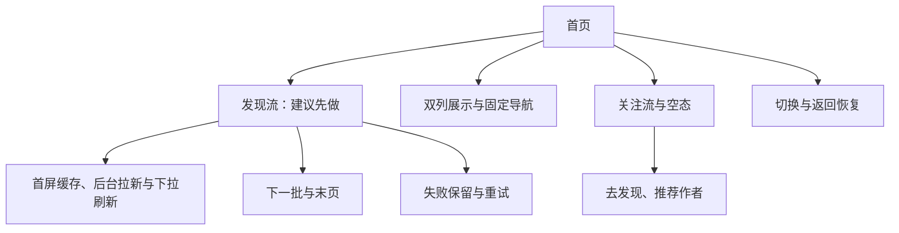

# 首页需求评审与最小决策树

> A1 评审与 A2 需求拆分：唯一维护业务规则、用户已确认约束、运行规则、验收与业务未决项。实现选择与可行性证据见[首页前端方案](首页前端方案.md)。
>
> 阶段 A1–A2；AI 评审建议：需补充。尚未编码或完成行为验收。

## 1. 依据与决策记录

依据：[设计稿](../社区App设计稿v1.0.html)、用户确认、[主计划第四章](C:/software/notes/allNotes1/ObsidianNoteForCoding2026/01RedDotImatate/社区App工程化与性能实践计划.md)。借用其工作流，不沿用原教学案例的范围和工时。

| 状态 | 决定 |
| --- | --- |
| 已确认 | 封面在选图时裁切为 3:4 或 1:1；首页按成品比例展示 |
| 已确认 | 固定顶部导航 + 页面级滚动 + 双列窗口化 |
| 已确认 | 分页等待保留旧内容并显示 loading；成功后立即追加 |
| 已确认 | 本地持久化上一次首屏 Feed；冷启动优先显示缓存避免白屏，后台异步拉取最新首屏覆盖并更新缓存，支持下拉刷新 |
| 已确认 | 左右滑动切换、关注空态推荐 3 位作者，安排在发现流闭环之后 |
| 建议 | 首个闭环选发现流加载；优先级与人工评审结论尚未确定 |

## 2. 需求卡

| 项目 | 内容 |
| --- | --- |
| 目标 | 连续浏览，失败可恢复，追加不打乱旧卡片 |
| 最小单元建议 | 发现流首屏 → 下一批 → 失败重试 |
| 输入 → 输出 | 流类型、游标、排序卡片 → 双列内容与加载状态 |
| 前提 | 卡片字段、游标与内容可见性契约明确 |

## 3. 业务规则与前端责任

| 能力 | 规则与责任 |
| --- | --- |
| 发现流 | 服务端排序近 7 天公开笔记；前 10 条同作者最多 1 条；前端不二次排序或按作者过滤 |
| 关注流 | 服务端返回已关注用户近 30 天笔记并过滤不可见内容；前端与发现流隔离状态 |
| 分页 | 每批 20 条、距底 200px；同一笔记不重复展示，末页有明确提示 |
| 展示 | 两列首卡顶边对齐，标题最多两行；图片加载不改变占位高度，追加时旧卡不跳动 |
| 切换与返回 | 切换后显示对应流；详情返回后对应笔记的互动／删除结果可见；位置恢复时机待确认 |

## 4. 可复用组件

## 5. 最小需求拆分树

### 5.1 首页需求拆分（做什么）

## 6. 方案决策树

技术决策树统一维护在[首页前端方案第 3 节](首页前端方案.md)。此处仅作入口；若方案产生新的业务取舍，回到本页第 1、9 节确认。

## 7. 加载与异常判断规则

| 条件 | 动作 |
| --- | --- |
| 连续触底／已结束 | 同一批次不重复加载；结束后不再加载更多 |
| 首屏无可用缓存且失败／成功无内容 | 分别展示错误重试／业务空态 |
| 缓存已展示，后台刷新失败 | 保留缓存内容，提供刷新反馈与重试，不清成白屏 |
| 翻页失败 | 保留已展示内容，允许重试失败批次 |
| 快速切换或刷新 | 不串入其他流内容，也不被旧结果覆盖 |
| 后续批次包含同一笔记 | 不重复展示 |
| 短页或空页 | 不因条数不足误判末页；有后续的空页不显示业务空态 |
| 游标不推进却声明有更多 | 不持续循环加载，给出可恢复错误 |
| 图片慢载或失败 | 局部占位，不改变封面高度 |

## 8. 验收表

以下均未执行，后续单元的验收在规则明确后补充。

| 编号 | 条件与操作 | 预期结果 |
| --- | --- | --- |
| AC-01 | 首屏请求成功，图片尚未加载完成 | 立即渲染卡片及按成品比例预留的封面区域，两列首卡顶边对齐 |
| AC-02 | 首屏请求失败，再点击重试 | 展示错误入口，恢复后正常展示 |
| AC-03 | 首次请求成功且确认无内容、无后续页 | 展示业务空态，不展示网络错误 |
| AC-04 | 连续多次触发距底加载 | 同一条流只有一个有效分页请求 |
| AC-05 | 下一页含重复 ID | 不重复展示，旧卡片不换列、不因追加跳动 |
| AC-06 | 翻页失败后重试 | 原内容保留，使用失败前的已确认游标 |
| AC-07 | 图片慢载或失败 | 占位尺寸保持稳定，不因图片完成加载而重排旧卡 |
| AC-08 | 服务端明确结束 | 展示“没有更多了”，停止分页 |
| AC-09 | 新刷新批次已经生效，旧请求随后返回 | 旧响应不覆盖新批次数据或游标 |
| AC-10 | 游标未推进却声明还有更多 | 停止重复请求并展示可恢复错误 |
| AC-11 | 分别展示选图阶段已裁切的 3:4 和 1:1 封面 | 各自按成品比例预留高度并展示，首页不再二次裁切 |
| AC-12 | 在首页上下滚动 | 顶部导航保持固定，卡片不被导航遮挡 |
| AC-13 | 持续翻页，使数据量明显超过渲染窗口 | 实际挂载的卡片数量随可视与缓冲范围变化，不随累计数据量无限增长 |
| AC-14 | 卡片滑出缓冲区后再向上回看，期间数据未被淘汰 | 卡片重新挂载，内容、列归属和位置保持一致，滚动不跳动 |
| AC-15 | 启用窗口化后滚动到距完整已加载列表底部 200px | 正确触发分页，窗口切换不误触发重复请求 |
| AC-16 | 已持久化上一次首屏，冷启动且网络响应未返回 | 优先显示可用首屏缓存，同时异步请求最新首屏 |
| AC-17 | 缓存已展示，后台成功返回最新首屏 | 最新结果替换首屏并更新本地缓存；成功空结果也不能残留旧首屏 |
| AC-18 | 缓存已展示，后台刷新失败 | 缓存仍可浏览，展示刷新反馈和重试入口 |
| AC-19 | 用户下拉刷新 | 请求最新首屏；成功覆盖并更新缓存，失败保留已有内容，结束下拉加载状态 |

## 9. 待确认事项与评审结论

| 关卡 | 待确认 |
| --- | --- |
| 当前最小单元 | 是否选发现流闭环、优先验证平台、人工评审结论 |
| 接口 | 游标、结束、失效、空页；卡片字段及成品比例缺失处理 |
| 布局 | 视觉阅读顺序是否必须严格对应服务端排名；单行标题是否仍预留两行高度 |
| 缓存 | Feed 类型／账号隔离、有效期、切换／返回位置、保留上限与淘汰后回看；冷启动首屏持久化不再待定 |
| 后续关注空态 | 推荐数据源、关注操作反馈 |

AI 建议：补齐当前单元的关键条件后推进；未决的后续规则只阻塞对应单元。

## 10. 记录边界

- 本轮仅修文档；组件参数、类型与令牌以源码为准，约束见 [AGENTS.md](../../AGENTS.md)。
- A3 的文件关系与输入输出，等最小单元确认后再展开；未搭 AST／MCP／CI。

### 10.1 AI 上下文读取规则

当前任务卡 → 本文相关决定与验收 → 前端方案对应章节 → 源码直接依赖。有证据再扩大读取，任务结束只记增量；重复定位困难后再评估工具。
