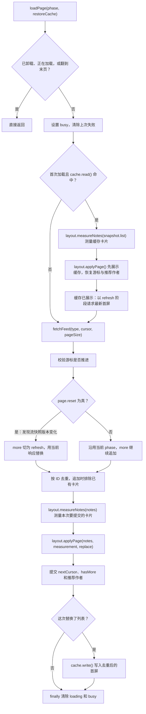
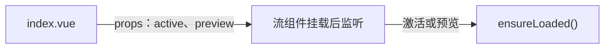
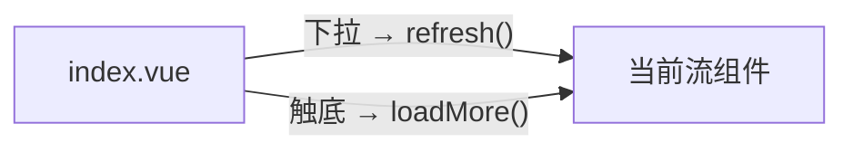
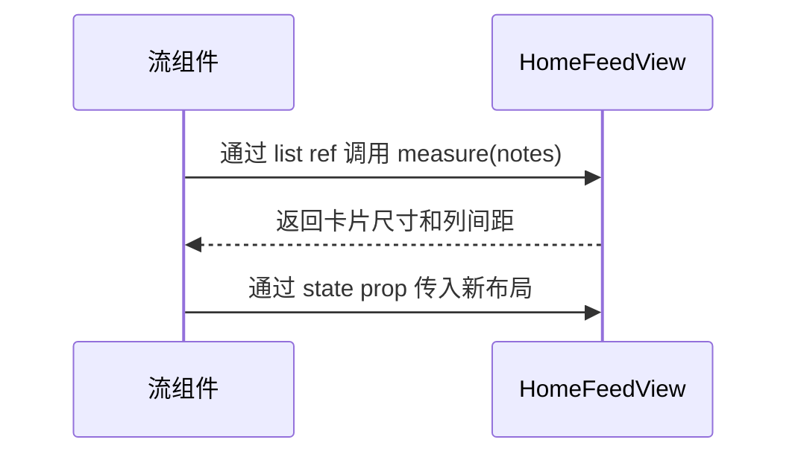

# 首页目录结构与数据流向

首页加载主线在 [`useHomeFeed.ts`](../feed/composables/useHomeFeed.ts)。首屏、翻页、下拉刷新和重试都调用同一个 `loadPage()`。从这里往下读，可以看到缓存怎么先展示、接口数据什么时候测量、瀑布流和游标在哪一步提交。

## 1. 目录结构

```text
src/pages/index/
├── index.vue                         页面壳、Tab、滚动和账号切换
├── pager/HomeFeedPager.vue            横向切页与吸附
├── common/HomeFeedPlaceholder.vue     登录和空态占位
├── feed/
│   ├── HomeDiscoverFeed.vue           发现流入口，允许游客
│   ├── HomeFollowingFeed.vue          关注流入口、登录判断和推荐作者
│   ├── HomeFeedError.vue              错误提示与重试入口
│   ├── components/
│   │   ├── HomeFeedView.vue            卡片实测、窗口化渲染和事件转发
│   │   └── HomeNoteCard.vue            单张卡片
│   ├── composables/
│   │   ├── useHomeFeed.ts              请求顺序、分页状态和提交
│   │   ├── useHomeFeedLayout.ts        对接实测，应用尺寸并计算内容高度
│   │   └── useWaterfall.ts             双列分配、整页替换和追加
│   └── utils/
│       ├── cache.ts                   首屏快照读写与过期检查
│       └── cardSize.ts                按样式令牌估算卡片高度和间距
└── docs/
```

## 2. 入口怎样进入 `loadPage()`

| 触发 | 实际调用 | 游标与提交方式 |
| --- | --- | --- |
| 首次激活或滑动预览 | 流组件挂载后的 `watch` → `ensureLoaded()` → `loadPage('initial', true)` | 先尝试恢复缓存，再用 `cursor: null` 请求首屏，成功后替换。命中缓存时，请求阶段标记为 `refresh`，已有卡片继续展示。 |
| 触底或点「继续加载」 | 首页 `onReachBottom()` 或视图的 `more` 事件 → `loadMore()` → `loadPage('more')` | 使用已提交的 `nextCursor`。发现流收到后端新快照时，切到 `refresh` 并用当前响应替换列表；其余成功翻页按 ID 去重后追加。尚未初始化时直接加载首屏。 |
| 下拉刷新 | 首页 `onPullDownRefresh()` → 当前流 `refresh()` → `loadPage('refresh')` | 使用 `cursor: null`，成功后替换。首页在 `finally` 结束下拉动画。 |
| 点击重试 | 视图的 `retry` 事件 → `retry()` → `loadPage(failure.phase)` | 重走失败的阶段。翻页失败时游标未推进，重试使用原游标。 |

[发现流](../feed/HomeDiscoverFeed.vue)允许游客加载。[关注流](../feed/HomeFollowingFeed.vue)在登录后才启动，未登录展示登录占位。关注流无内容时可以展示接口给出的推荐作者，`followAuthor()` 成功后调用 `refresh()`。两个流各自创建一个 `useHomeFeed()` 实例，并传入本流的缓存键和 `HomeFeedView.measure()`。

## 3. 一次加载的数据流



- [`fetchFeed()`](../../../api/modules/feed.ts) 根据流类型请求 `/feed/discover` 或 `/feed/follow`，返回 `list`、`nextCursor`、`hasMore`、`recommendedAuthors` 和 `reset`。首屏的 `null` 游标在 API 层转成 `'0'`，翻页游标沿用服务端返回的字符串。
- **发现流翻页时，只有后端快照版本发生变化才从 `more` 切到 `refresh`。** API 层比较本次请求游标和后端响应游标里的版本。例如 `5:20` → `5:40` 只推进了位置，继续追加；`5:20` → `6:20` 则返回 `reset: true`，直接用这次响应替换列表并更新首屏缓存，无需再发请求。缓存恢复后的 `initial → refresh` 发生在请求前，由缓存已展示触发。
- `snapshot`、`page`、去重后的 `notes` 和测量结果都在本次 `loadPage()` 内。长期留在实例上的只有已提交的游标、布局、推荐作者和加载状态。每条流用一个 `busy` 覆盖缓存恢复到最终提交，期间重复触发直接返回。
- 请求或新卡片测量失败时记录 `failure.phase` 和错误，已有布局、游标和缓存保留。接口成功返回空页时仍按 `hasMore` 和游标判断能否继续翻页。请求和测量返回后会检查 `disposed`，卸载后的旧结果停止提交。

## 4. 缓存为什么可能测量两次

| 批次 | 调用 | 结果 |
| --- | --- | --- |
| 缓存旧卡片 | `layout.measureNotes(snapshot.list)` | 先把缓存卡片排出来。已有缓存实测失败时用估算尺寸展示，随后仍请求最新首屏。 |
| 接口新卡片 | `layout.measureNotes(notes)` | 去重后测量要提交的卡片。测量成功后才更新瀑布流。 |

**命中有效缓存且请求成功走到测量时，会对两批数据各调用一次。** 无有效缓存时跳过旧卡片测量。空批次由 `measure()` 直接返回空结果，无需渲染测量节点。

[`cache.ts`](../feed/utils/cache.ts) 按账号和流类型读写，键为 `ys:home-feed-cache:<账号>:<流类型>`。快照保存 `savedAt`、`list`、`nextCursor`、`hasMore` 和推荐作者，有效期 30 分钟。旧快照缺少推荐作者时按空数组读取。成功替换首屏后写入新快照，普通翻页只更新内存布局和游标。

## 5. 卡片尺寸怎样变成屏幕上的双列

```text
layout.measureNotes(notes)
→ HomeFeedView.measure() 把卡片放入隐藏测量区
→ nextTick() 后查询卡片宽高与列间距
→ 返回 { cards, gap }
→ layout.applyPage() 按笔记 ID 取高度
→ useWaterfall.replace() 重建双列，或 append() 追加到较矮列
→ view.columns 和 view.contentHeight
→ HomeFeedView 根据 scrollTop、窗口高度和缓冲区渲染可见卡片
```

[`HomeFeedView.vue`](../feed/components/HomeFeedView.vue) 的测量区复用正式卡片，标题换行也计入实测高度。[`useWaterfall.ts`](../feed/composables/useWaterfall.ts) 在两列同高时优先放左列，追加时沿用旧卡片位置。视图外层保留完整内容高度，所以屏幕外卡片卸载后，滚动范围仍然稳定。

`view` 同时给模板提供首屏加载、刷新、翻页、错误、空态和末页状态。有旧卡片时，刷新或翻页失败会在列表区域提供重试。关注流的未登录和空态，以及发现流的空态由各自的插槽展示。

## 6. 切页、滚动和账号切换

- [`index.vue`](../index.vue) 按发现、关注分别保存 `scrollTopByFeed`。切 Tab 或首页重新显示时，`restoreScroll()` 等页面更新后恢复对应位置；恢复期间忽略归零事件和触底触发。
- [`HomeFeedPager.vue`](../pager/HomeFeedPager.vue) 通过 `useSwipePager` 管理横向拖动和吸附。拖动时的 `preview` 可以触发相邻流首次加载；页面隐藏时取消拖动。
- 登录账号变化会改变两个流组件的 `key`，清零保存的滚动位置，并用新账号的缓存键重建实例。旧实例卸载后会拦截晚到的请求或测量结果。
- 卡片的 `open` 事件目前转发到两个流组件。首页暂未接入详情路由，当前数据流里没有详情回写或单卡重测。

## 7. 首页组件的关键流程

下文的「流组件」指 [`HomeDiscoverFeed.vue`](../feed/HomeDiscoverFeed.vue) 或 [`HomeFollowingFeed.vue`](../feed/HomeFollowingFeed.vue)。每条流有自己的 `useHomeFeed()` 和一份 [`HomeFeedView.vue`](../feed/components/HomeFeedView.vue)。

### 首次加载



`preview` 来自横滑容器。关注流还要求已登录，并把登录状态作为 `readable` 传给视图。两条流都把各自的 `scrollTop` 传给视图，用于计算可见卡片。

### 下拉刷新与触底翻页



首页按当前 Tab 选择组件 `ref`。两个方法由流组件通过 `defineExpose` 暴露。

### 测量卡片并显示



视图通过 `defineExpose` 暴露 `measure()`。流组件把它交给 `useHomeFeed()`，再把更新后的 `view` 绑定到 `state`。

### 视图向上发出的事件

- **重试或继续加载** — `HomeFeedView` 发出 `retry` 或 `more`，流组件调用 `retry()` 或 `loadMore()`。
- **去发现看看** — `HomeFollowingFeed` 发出 `discover`，`index.vue` 切回发现 Tab。
- **点击卡片** — `HomeFeedView` 发出 `open(id)`，流组件再转发一次。目前首页尚未接入 `@open`。
