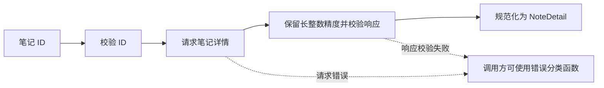
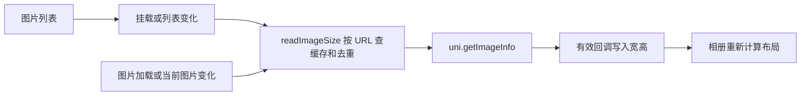
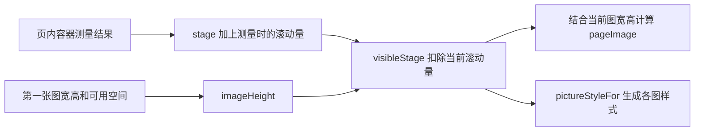
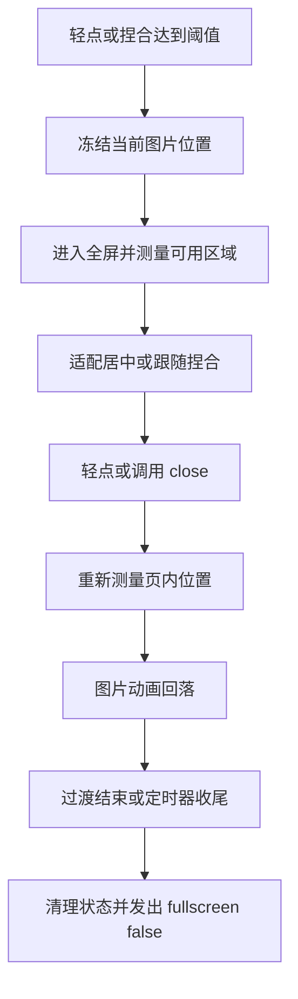

# 笔记详情目录结构与数据流向

本文按功能记录当前工作区的详情接口、作者导航和图片相册。当前 `src/pages.json` 未注册笔记详情路由，`note/index.vue` 和 `NoteVideo.vue` 已移除。下面的链路从现有 API 函数或组件入口开始，图片相册可以通过 `scripts/check-note.mjs` 独立验证。

## 1. 目录结构

```text
src/pages/note/
├── common/
│   └── NoteNavbar.vue               作者信息、导航和菜单事件
├── media/
│   ├── components/
│   │   └── NoteImageGallery.vue     图片轮播渲染、事件绑定和组件生命周期
│   ├── composables/
│   │   ├── useNoteImageGallery.ts   组合相册状态、图片尺寸和渲染数据
│   │   ├── useNoteGalleryMeasurement.ts  测量页内容器和全屏区域
│   │   ├── useNoteImageDimensions.ts     原图宽高读取和缓存
│   │   └── useNoteImageGestures.ts       手势分流、全屏进出和动画
│   ├── utils/
│   │   └── noteGalleryLayout.ts     适配倍率、居中位置和图片样式
│   └── image-gesture.ts            等比适配、捏合锚点和边界校正
├── note-failure.ts                  详情错误分类
└── docs/
```

## 2. 功能一 · 详情请求与错误分类

### 入口文件

- [api/modules/note.ts](../../../api/modules/note.ts) 中的 `getNoteDetail(noteId)`
- [utils/note-detail.ts](../../../utils/note-detail.ts) 中的 ID 和响应校验
- [note-failure.ts](../note-failure.ts) 中的 `classifyNoteFailure(error)`

### 数据流向



1. `getNoteDetail()` 校验 ID 后请求 `GET /note/{id}`。响应解析保留长整数精度，笔记 ID 和作者 ID 最终以字符串返回。
2. 响应需要包含作者、有效的笔记类型以及与请求一致的笔记 ID。通过校验后，API 统一处理空字符串、图片数组、布尔值和互动计数等字段，输出 `NoteDetail`。
3. 请求关闭通用错误提示。调用方可以用 `classifyNoteFailure()` 区分网络或超时、登录失效、明确的笔记失效、通用 403/404 和其他错误。`invalid` 是类型中预留给调用方的状态，ID 校验失败本身会抛出 `Error`。

## 3. 功能二 · 作者导航与菜单

### 数据流向

```text
调用方传入 author 和 active
→ NoteNavbar 渲染作者信息与菜单，按 self 和 followed 决定可见项及样式
→ 返回、作者、分享和删除点击发出 back、author、share、remove
→ 调用方接收事件并决定后续操作
```

[NoteNavbar.vue](../common/NoteNavbar.vue) 负责菜单开关。作者或 `active` 变化时收起菜单，对外暴露 `close()`，供调用方在处理返回操作前关闭菜单。关注按钮根据 `followed` 显示状态，目前只有点击事件的传播控制。

## 4. 功能三 · 图片地址、原图尺寸与列表同步

### 入口文件

- [NoteImageGallery.vue](../media/components/NoteImageGallery.vue) 接收 `images`、`active` 和 `scrollTop`。
- [useNoteImageDimensions.ts](../media/composables/useNoteImageDimensions.ts) 读取和维护原图宽高。

### 数据流向



1. 挂载时读取列表中的图片尺寸。图片加载完成或当前图片变化也可以触发读取。已缓存或同一轮正在读取的 URL 会直接复用，不同 URL 可以并行。
2. `syncImages()` 保留新列表中仍存在的尺寸，修正越界的 `index`，再读取缺少的尺寸。当前索引指向的 URL 变了时，组件先重置手势状态。
3. 列表变化或卸载后，旧回调通过版本检查失效。旧回调也无法清除新一轮同 URL 的请求记录。原图尺寸尚不可用时按 `1:1` 计算占位。

## 5. 功能四 · 容器测量与页内布局

### 数据流向



1. [useNoteGalleryMeasurement.ts](../media/composables/useNoteGalleryMeasurement.ts) 在组件渲染后查询容器。页内和全屏分别记录测量版本。结果有效且属于最新一轮时才提交，卸载后的回调会被忽略。
2. [useNoteImageGallery.ts](../media/composables/useNoteImageGallery.ts) 在页内容器尚未实测时使用窗口宽度。第一张图决定相册高度，上限是窗口高度的三分之二。切换到其他图片时，图片按自身比例适配同一个容器，正文位置保持稳定。
3. [noteGalleryLayout.ts](../media/utils/noteGalleryLayout.ts) 将图片尺寸、位移和缩放换算成相对容器的样式。横向翻页的偏移由外层轨道计算。

## 6. 功能五 · 全屏、翻页与捏合

### 入口文件

- [useNoteImageGestures.ts](../media/composables/useNoteImageGestures.ts) 处理触摸、全屏和动画。
- [useSwipePager.ts](../../../composables/useSwipePager.ts) 处理横向跟手、吸附和索引提交。
- [image-gesture.ts](../media/image-gesture.ts) 计算捏合锚点和拖动边界。

### 进入与退出全屏



1. 进入全屏时沿用当前图片节点，冻结当前图的页内矩形，并发出 `fullscreen(true)`。先用窗口大小作为全屏区域，等全屏容器渲染后再实测。窗口尺寸变化会使之前的全屏测量失效。
2. 页内单指横滑交给分页器。全屏时，图片处于适配倍率且有相邻图可切换时也能翻页，放大后单指用于拖动。双指捏合按初始指距和中点计算变换，双指变单指时从当前位置接续，松手后修正倍率下限和拖动边界。
3. 全屏翻页后，`index` 更新并清除上一张图冻结的位置。退出前重新测量页内容器，让动画回到当前图片。过渡结束后清理全屏状态，过渡事件缺失时由定时器完成清理。
4. `active` 变为 `false`、窗口变化或组件卸载时清理全屏和手势状态。窗口变化还会更新窗口尺寸并重新测量页内容器。`fullscreen` 事件供调用方同步外部状态，例如页面滚动控制。

## 7. 修改入口速查

| 想修改的功能 | 优先查看 |
| --- | --- |
| 详情请求、响应字段、长整数 ID | [api/modules/note.ts](../../../api/modules/note.ts)、[types/note-detail.ts](../../../types/note-detail.ts) |
| 详情错误分类 | [note-failure.ts](../note-failure.ts) |
| 作者区、菜单、导航事件 | [NoteNavbar.vue](../common/NoteNavbar.vue) |
| 图片渲染、事件绑定、相册对外接口 | [NoteImageGallery.vue](../media/components/NoteImageGallery.vue) |
| 原图尺寸缓存、去重、旧回调失效 | [useNoteImageDimensions.ts](../media/composables/useNoteImageDimensions.ts) |
| 页内与全屏坐标实测、窗口尺寸 | [useNoteGalleryMeasurement.ts](../media/composables/useNoteGalleryMeasurement.ts) |
| 图片列表同步、页内高度、渲染状态 | [useNoteImageGallery.ts](../media/composables/useNoteImageGallery.ts) |
| 手势分流、全屏进出、退出动画 | [useNoteImageGestures.ts](../media/composables/useNoteImageGestures.ts) |
| 全屏居中、缩放样式、手势几何计算 | [noteGalleryLayout.ts](../media/utils/noteGalleryLayout.ts)、[image-gesture.ts](../media/image-gesture.ts) |

在仓库根目录运行 `node scripts/check-note.mjs`，可以验证详情 API、错误分类以及相册的全屏切图、捏合拖动和退出清理。
