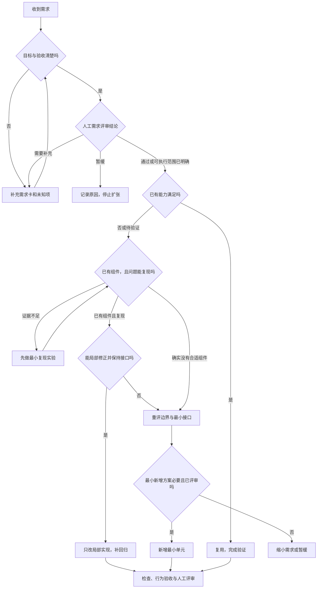
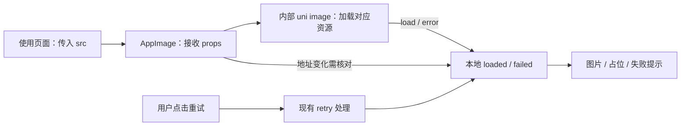

# 社区 App 总体大纲：Vite 主线与 AI 工作流

> **目标：** 收口当前 App 的剩余基础缺口，并建立 Vite 六阶段与 AI 工程化的增量路线。
> **技术栈：** Vue 3 + uni-app + TypeScript + Tailwind CSS + TDesign Uniapp。
> **开发方式：** VS Code 编码，uni CLI 编译，App 基座真机验证。
> **项目：** C:/Project/imitate-RedDot/yu-island-app。
> **核对日期：** 2026-10-30。
> **预算：** Vite 主线 28 小时、AI 方案与演练 6 小时、缓冲 6 小时，共 40 小时，均为初估。

**记录方式：** 只勾选已经取得证据的增量任务，效果与耗时实际填写。原有配置不再当作新需求，现有检查命令仅作为验收手段。

**结构：** 保留参考计划的 1 个一级标题、8 个二级章节、35 个三级标题。主线六阶段、AI 六阶段和五个时间批次分别编号，不相加当作开发阶段总数。

**范围：** 本轮修改需求文档，不修改应用配置，不安装 AI SDK，不启动 MCP 或 CI。当前实施对象仍是 Vite 阶段 1；后续实验不展开 docs 的具体业务，不加入 SSR、微前端、监控平台和后端建设。

**文档组织：** 当前只保留本总纲和阶段一、二、三三份操作讲义。需求分析、评需求、决策树、工具方案和七层能力核对均在总纲内，不再单独拆文件。下方补充材料可以按需展开。

| 文档                                              | 用途                               |
| ------------------------------------------------- | ---------------------------------- |
| 本总体大纲                                        | 主线、辅助线、范围、验收与补充材料 |
| [阶段一](社区App-阶段一-01-Vite配置与环境管理.md) | 剩余基础缺口与验收                 |
| [阶段二](社区App-阶段二-01-资源与样式验证.md)     | 资源与样式实验                     |
| [阶段三](社区App-阶段三-01-环境与运行验证.md)     | 环境与运行实验                     |

**编号约定：** 独立的阶段一、二、三均指 Vite 主线；AI 工作流步骤只在总纲内编排。Vite 阶段 4–6 暂保留路线，实际推进时再生成讲义。文件生成不代表阶段已经实施或验收。

## 一、先看整体路线与时间

### 主线一：Vite 与 App 增量实践——28 小时

| 阶段    | 主题           | 本次精简后的重点                                | 预算   |
| ------- | -------------- | ----------------------------------------------- | ------ |
| 1，当前 | 剩余基础缺口   | Node 声明、格式范围、说明差异、无用项和真机证据 | 4 小时 |
| 2，后续 | 资源与样式     | 路径、字体、单位与平台行为验证                  | 6 小时 |
| 3，后续 | 环境与运行     | mode、变量覆盖、App 同步与网络边界              | 4 小时 |
| 4，后续 | 依赖与加载     | 真实包入口、动态模块与副作用实验                | 6 小时 |
| 5，后续 | 生产构建与排错 | 实际产物、压缩/map 与错误定位                   | 4 小时 |
| 6，后续 | 插件与复用     | 必要诊断与既有命令复用                          | 4 小时 |

**具体需求：** 每项都来自现有缺口或一个明确构建问题，不为学习而重写已有配置。

**项目效益：** 避免重复搭建，保留足够清晰的 Vite 学习与验证路线。

- [ ] **验收：** 阶段任务具有实际输入、动作、输出和完成证据。

**效果记录：** 当前阶段：＿＿＿＿；完成的增量：＿＿＿＿。

### 当前交付：只完成阶段 1 的剩余事项

本次复核发现：工具链配置和类型接入均已存在；loadEnv 已采用 projectRoot；src/vite.config.ts 为根配置转发；原二维码插件已移除。这些已具备事项从需求待办中删除，不要求重新安装、初始化或写规则。

**具体需求：** 当前只处理确实不一致和仍需取得的 App 证据，详情见第二章阶段 1。

**项目效益：** 已有成果直接复用，验收能真实收口。

- [ ] **验收：** 已有配置不重复列项；真实差异得到处理或明确说明限制。

**效果记录：** 保留的缺口：＿＿＿＿；本期完成：＿＿＿＿。

### 辅助安排：AI 工程化方案与工作流——12 小时

- AI 方案、样本和人工演练：6 小时。
- 基础排障与必要返工缓冲：6 小时。
- 完整 AST 工具、MCP 适配与 CI 接入的开发时间，在最小原型后另外估算，不塞进这 6 小时。

AI 主轴为：**需求分析与需求评审 → 最小需求与决策树 → 最小框架和文件输入输出 → 小步实现与反馈 → code review 和验收 → 按需沉淀 AST/MCP/CI。**

**具体需求：** 先分析与评审需求，再拆最小闭环、画决策树和文件关系；工具方案作为可选支撑，不用搭工具代替理解需求。

**项目效益：** 先做正确取舍，再让 AI 用准现有能力，减少需求偏差、虚构接口和无关修改。

- [ ] **验收：** 第四章能指导一次需求评审到验收的闭环，并明确人/AI 职责、决策依据和未完成项。

**效果记录：** 样本/方案：＿＿＿＿；演练：＿＿＿＿；需另估工时：＿＿＿＿。

---

## 二、Vite 六阶段：只写剩余缺口与后续验证需求

**官方依据：** 学习入口为 [Vite Guide](https://vite.dev/guide/)，当前工程锁定 Vite 5.2.8，具体参数核对 [Vite 5 文档](https://v5.vite.dev/guide/) 与 [uni-app 配置限制](https://uniapp.dcloud.net.cn/collocation/vite-config.html)。

普通 Vite 的默认能力不需要逐个显式填写；uni 插件还会接管 App 的入口、资源、预构建及输出。配置行数不能当学习进度，必须用产物和运行证据解释行为。

**本次只记录影响需求的真实差异：**

| 差异               | 目前证据                                             | 需求处理                             |
| ------------------ | ---------------------------------------------------- | ------------------------------------ |
| Node 声明偏低      | package 为 >=18，锁定依赖要求更高                    | 对齐声明与实际环境                   |
| 格式命令范围不一致 | 写入只覆盖 src，检查范围更大；本次仍有 35 个文件失败 | 修复范围差异与现存格式，不重建规则   |
| 说明与提交动作不符 | README 承诺全量类型检查，实际未执行                  | 以采用的流程修说明，不自动加钩子     |
| 无使用方候选       | 环境常量/mock 声明、已删除二维码源码的遗留包         | 逐项确认后清理，不新增同类能力       |
| 手机运行证据缺失   | 之前 App 资源可编译，但未验收手机                    | 补一台 Android 运行记录              |
| 规则入口悬空       | AGENTS/README 指向工作区已删除的规范                 | 确认有效规则位置，不恢复用户删除内容 |

**最新只读复核：** 本次 type-check 和 lint 均退出 0，format:check 仍报告 35 个文件；App 构建沿用上一轮成功记录，本次没有重跑构建或安装。没有把“配置存在”误写成“全部检查通过”。

### 阶段 1：剩余基础缺口——只修真实差异，不重建现有工具链

> **初步预算 4 小时；阶段 1 为当前范围，其余为后续路线。**

**具体需求：** 把当前仍不一致或未验证的基础事项收口。已有检查配置、TS 严格模式、别名、uni/Tailwind/TDesign 接入直接沿用，不再重新立项。

**输入：** 当前 package/lock、实际启动入口、环境消费点、README，以及一台 Android 手机。

- [ ] V1.01 对齐 Node 最低版本：当前声明 >=18，锁定的 uni 插件要求 >=22.12.0，样式工具要求 ^22.18.0 或 >=24.11.0；据实际依赖修正声明与说明，不升级整套包。
- [ ] V1.02 只处理已有格式流程的真实差异：写入与检查范围不同，当前检查还有 35 个文件失败。对齐目标文件范围并单独整理，不重写格式规则，不格式化 docs 中的设计 HTML。
- [ ] V1.03 修正说明：现有提交动作没有 README 声称的全量类型检查。以实际采用的流程为准修文档，不自动向钩子追加检查。
- [ ] V1.04 清理无使用方配置候选：自定义环境常量与 mock 开关只有定义/声明而缺实际消费时，明确删除或后置；不把开关声明当成功能。
- [ ] V1.05 二维码源码插件已移除，包中仍有 qrcode-terminal 与类型包；先确认是否还有其他使用方，无使用方才清理遗留依赖，不重新增加二维码插件。
- [ ] V1.06 记录当前 App API 仍为相对开发地址/示例生产地址的边界。本轮不联调后端，骨架不发业务请求即可，不新增代理服务或环境矩阵。
- [ ] V1.07 补齐一次 Android 真机记录：CLI 编译、基座连接、四个文字 tab、一个现有控件、样式与文字修改同步。资源编译通过和真机运行分别验收；有效 AppID/设备条件缺失则明确阻塞。

**项目效益：** 已有成果直接复用，把时间用于可证明的缺口，避免反复初始化工具或执行无意义配置。

- [ ] **验收：** 剩余差异有实际处理结果；复用现有检查命令验证；手机运行有证据。文件占用导致干净安装无法验证时如实保留，不重复强行安装。

**效果记录：** 处理的缺口：＿＿＿＿；现有命令结果：＿＿＿＿；设备/基座：＿＿＿＿；同步证据：＿＿＿＿。

> **进度记录（手动填写）**
>
> - 开始时间：
> - 完成时间：
> - 实际耗时：＿＿＿＿ 小时
> - 成果 / 笔记链接：
> - 卡点 / 下次继续：

阅读：[Vite Guide](https://vite.dev/guide/)、[Vite 5 Config](https://v5.vite.dev/config/)、[uni-app CLI](https://uniapp.dcloud.net.cn/quickstart-cli.html)。详见 [阶段 1 讲义](社区App-阶段一-01-Vite配置与环境管理.md)。

---

### 阶段 2：资源与样式——验证从源码到 App 的真实路径

> **初步预算 6 小时；阶段 1 为当前范围，其余为后续路线。**

**具体需求：** 在已有样式与控件接入上验证图片、字体、CSS 资源和单位；不重复安装或接入组件库、样式编译器。

**输入：** src/static、已有样式入口与主题、TDesign 导出、App 开发/生产产物。

- [ ] V2.01 选一张测试图片，记录源码引用、编译后位置和手机显示；区分 static 路径与 import URL 的处理，不复制 docs 的业务资源。
- [ ] V2.02 验证一处 CSS/SCSS url() 和字体资源，记录开发/生产路径；模拟坏路径后定位并恢复。
- [ ] V2.03 核对当前 App 插件将 assetsInlineLimit 设为 0 的行为，不照搬网页内联阈值，不新增文件复制插件。
- [ ] V2.04 选一个间距和宽度，记录 Tailwind 输入、单位转换产物与实际手机尺寸；不重新接入已有编译链。
- [ ] V2.05 确认现有图标字体是否依赖远程资源，离线观察；确有离线需求才改成本地，并记录许可与来源。
- [ ] V2.06 将资源与主题的验证结果整理成简短路径表，移除临时测试文件；没有必要就保留现有方案。

**项目效益：** 遇到图片、字体或样式异常时能追溯来源，不凭开发页面正常就假定生产 App 正常。

- [ ] **验收：** 图片、CSS url()、字体三类路径可追踪；至少一次坏路径恢复与单位实机记录；不把目录体积当实际下载量。

**效果记录：** 资源表：＿＿＿＿；异常与恢复：＿＿＿＿；单位对照：＿＿＿＿；离线结果：＿＿＿＿。

> **进度记录（手动填写）**
>
> - 开始时间：
> - 完成时间：
> - 实际耗时：＿＿＿＿ 小时
> - 成果 / 笔记链接：
> - 卡点 / 下次继续：

阅读：[Static Assets](https://vite.dev/guide/assets)、[Features](https://vite.dev/guide/features)、[uni-app Vite 限制](https://uniapp.dcloud.net.cn/collocation/vite-config.html)。

操作讲义：[阶段 2：资源与样式验证](社区App-阶段二-01-资源与样式验证.md)。本讲义已生成，实验尚未执行。

---

### 阶段 3：环境与运行——验证模式、公开变量及 App 网络边界

> **初步预算 4 小时；阶段 1 为当前范围，其余为后续路线。**

**具体需求：** 在现有环境文件上确认变量读取与代码生效方式；不新增没有使用方的环境或网络服务。

**输入：** 现有 env 文件、环境类型、根配置、请求入口、实际 CLI 命令。

- [ ] V3.01 为仍有使用方的变量登记读取位置、字符串转换和适用平台；未实现的开关不按功能验收。
- [ ] V3.02 用一个公开测试值验证 env 覆盖优先级，恢复后重新编译；不输出完整环境和凭证。
- [ ] V3.03 区分 command、mode、NODE_ENV 和 UNI_PLATFORM，观察 App 开发实际路径，不假定它等同网页 serve。
- [ ] V3.04 验证文字、样式和配置修改各自是否需要重新编译/重启，记录 App 同步现象，不把网页 HMR 承诺套给基座。
- [ ] V3.05 只有实际接接口时才配置手机可达的完整地址；Vite 网页代理不作为 App 网络能力，手机 127.0.0.1 不指向开发电脑。

**项目效益：** 避免配置存在但未生效、地址发错环境，以及误判手机运行方式。

- [ ] **验收：** 有一个变量覆盖实验和一次配置恢复；已有变量的用途清楚，App 不依赖网页代理完成骨架运行。

**效果记录：** 变量实验：＿＿＿＿；平台/mode：＿＿＿＿；同步/重启：＿＿＿＿。

> **进度记录（手动填写）**
>
> - 开始时间：
> - 完成时间：
> - 实际耗时：＿＿＿＿ 小时
> - 成果 / 笔记链接：
> - 卡点 / 下次继续：

阅读：[Env and Mode](https://vite.dev/guide/env-and-mode)、[Vite 5 Server](https://v5.vite.dev/config/server-options)、[uni-app Vite 限制](https://uniapp.dcloud.net.cn/collocation/vite-config.html)。

操作讲义：[阶段三：环境与运行验证](社区App-阶段三-01-环境与运行验证.md)。本讲义已生成，实验尚未执行。

---

### 阶段 4：依赖与加载——用产物、执行时机验证判断

> **初步预算 6 小时；阶段 1 为当前范围，其余为后续路线。**

**具体需求：** 查清一个真实依赖和一个临时模块如何进入应用，不为了覆盖参数而添加预构建、分包或自动导入配置。

**输入：** 包 exports、别名、当前 uni 插件、一个临时自有模块与 App 产物。

- [ ] V4.01 从一个实际导入追踪包版本、exports、alias 与入口格式，区分运行依赖和构建工具依赖。
- [ ] V4.02 阅读开发预构建机制，再对照当前 App 插件 noDiscovery:true 等设置；记录适用性，不默认把 Vue/Pinia 加入 optimizeDeps。
- [ ] V4.03 没有依赖错误不调整 include/exclude；确需观察浏览器缓存时只做单独原理对照，不改变 App 交付目标。
- [ ] V4.04 临时模块分别静态与点击后动态导入，记录产物组织和初始化时机；区分包内存在、模块执行与组件挂载。
- [ ] V4.05 用未使用导出和一个明确副作用做生产对照；不在全包设置 sideEffects:false，避免误删初始化与样式。
- [ ] V4.06 只有真实依赖/启动问题才评估 manualChunks 等调整；移除实验文件，无收益就保留原方案。

**项目效益：** 未来依赖或模块变重时能针对原因调整，不把 import() 或文件变多直接称为优化。

- [ ] **验收：** 依赖解析、App 预构建适用性、静态/动态执行、未使用导出/副作用四类证据完整；包内模块不冒称减少网络下载。

**效果记录：** 入口：＿＿＿＿；平台限制：＿＿＿＿；导入/执行对照：＿＿＿＿；保留方案：＿＿＿＿。

> **进度记录（手动填写）**
>
> - 开始时间：
> - 完成时间：
> - 实际耗时：＿＿＿＿ 小时
> - 成果 / 笔记链接：
> - 卡点 / 下次继续：

阅读：[Pre-Bundling](https://vite.dev/guide/dep-pre-bundling)、[Vite 5 Pre-Bundling](https://v5.vite.dev/guide/dep-pre-bundling)、[Vite 5 Build](https://v5.vite.dev/guide/build)。

---

### 阶段 5：生产构建与排错——测真实产物，验证错误定位

> **初步预算 4 小时；阶段 1 为当前范围，其余为后续路线。**

**具体需求：** 基于现有 App 构建形成开发/生产产物和错误定位证据，不预设压缩或启动收益。

**输入：** App 产物、编译日志、当前平台插件构建行为与目标设备。

- [ ] V5.01 记录主要文件与大小，区分业务代码、框架运行时和复制资源；不把资源目录称为安装包。
- [ ] V5.02 核对压缩、map、base、输出目录的实际归属。当前 Vite 5 使用 Rollup，App 又有覆盖，不能照贴新版 rolldownOptions。
- [ ] V5.03 在可恢复的小模块制造错误，使用 App 调试链路定位并修复；map 的开关与产物按当前插件验证，不照搬网页发布方案。
- [ ] V5.04 将 TS 转换目标、CSS 转换与手机 WebView/API 能力分开；没有目标设备问题就不加 legacy/polyfill 插件。
- [ ] V5.05 需比较时固定版本、设备与缓存，至少三次取中位数；构建耗时、包内体积、启动和同步分别记录，无改善就如实保留结论。

**项目效益：** 能解释生产异常以及默认值是否满足需求，避免靠添加压缩选项制造成果。

- [ ] **验收：** 开发/生产清单、一次受控错误恢复、必要的同条件对照齐备；真机未做时不宣称定位完成。

**效果记录：** 文件/大小：＿＿＿＿；压缩/map：＿＿＿＿；错误定位：＿＿＿＿；比较条件：＿＿＿＿。

> **进度记录（手动填写）**
>
> - 开始时间：
> - 完成时间：
> - 实际耗时：＿＿＿＿ 小时
> - 成果 / 笔记链接：
> - 卡点 / 下次继续：

阅读：[Build](https://vite.dev/guide/build)、[Vite 5 Build Options](https://v5.vite.dev/config/build-options)、[Troubleshooting](https://vite.dev/guide/troubleshooting)、[Performance](https://vite.dev/guide/performance)。

---

### 阶段 6：插件与复用——按实际重复问题决定是否扩展

> **初步预算 4 小时；阶段 1 为当前范围，其余为后续路线。**

**具体需求：** 读懂当前 uni 与样式插件，完成一次必要诊断，不为了学习永久保留自写插件。

**输入：** 当前插件、Vite 钩子说明、前五阶段证据与已有验证命令。

- [ ] V6.01 说明 config、configResolved、configureServer、transform、generateBundle 等钩子的适用场景；开发和构建不假定调用完全一致。
- [ ] V6.02 必要时临时输出 command/mode/platform 和少量构建字段，与最终产物交叉核对；不输出完整 env。
- [ ] V6.03 有真实重复报告需求再选择小脚本或 generateBundle，注明 uni 额外复制资源可能不在 bundle 中；没有需求则不加工具。
- [ ] V6.04 复用现有验证命令，将结果按固定字段交给人工和 AI；结束后清理实验，不重新配置已有检查体系。

**项目效益：** 以后出现插件冲突和重复检查时，有依据选择扩展方式。

- [ ] **验收：** 已有插件职责清楚；一次必要诊断或不扩展的理由明确；可复用命令与实验恢复记录完整。

**效果记录：** 钩子/诊断：＿＿＿＿；报告范围：＿＿＿＿；复用方式：＿＿＿＿；实验恢复：＿＿＿＿。

> **进度记录（手动填写）**
>
> - 开始时间：
> - 完成时间：
> - 实际耗时：＿＿＿＿ 小时
> - 成果 / 笔记链接：
> - 卡点 / 下次继续：

阅读：[Using Plugins](https://vite.dev/guide/using-plugins)、[Vite 5 Plugin API](https://v5.vite.dev/guide/api-plugin)。

---

### 六阶段统一的测量与完成标准

- [ ] 已有能力不再成为新建或重配任务；真实问题才进入待办。
- [ ] 每项写清源码/版本依据、输入、操作、结果、验收与恢复方式。
- [ ] 区分官方机制、当前 uni 插件实现、本地产物和手机结果。
- [ ] H5 实验不能替代 App 验收；无后端不虚构联调成功。
- [ ] 比较性能先固定条件，不预设收益；临时实验结束后清理。
- [ ] 当前只实施阶段 1，后续阶段和 AI 工具正式研发分别启动。

---

## 三、执行前复核：只保留增量需求

以下是文档和实施的判断标准，不额外增加六个开发阶段，不重复计时。

### 补强 1：已具备能力直接复用

**具体需求：** 已存在的工具、规则和接入不再列安装、初始化或重配任务。后续只调用现有检查入口。

**项目效益：** 避免重复建设。

- [ ] **验收：** 需求待办没有把已有配置重新包装成成果。

**效果记录：** 删除的重复任务：＿＿＿＿。

### 补强 2：差异才作为需求

**具体需求：** 每个待办必须指向当前不一致、明确缺口或尚未取得的必要验证，不因看过教程就新增选项。

**项目效益：** 减少配置负担。

- [ ] **验收：** 每项能指出文件、现象或缺失证据。

**效果记录：** 现象/需求对应：＿＿＿＿。

### 补强 3：以最新快照为准

**具体需求：** 已经统一的 loadEnv 根路径、已移除的二维码插件不保留旧待办；来源转发文件不擅自判为重复实现。

**项目效益：** 防止过时审计驱动错误修改。

- [ ] **验收：** 文档与本次读取的实际文件一致。

**效果记录：** 快照/变化：＿＿＿＿。

### 补强 4：App 验证独立成立

**具体需求：** H5 只作必要原理对照，不能充当手机 App 验收。

**项目效益：** 排错和成果口径准确。

- [ ] **验收：** 资源编译、手机运行、安装包三个结果分开记录。

**效果记录：** 设备/证据：＿＿＿＿。

### 补强 5：当前和后续分开

**具体需求：** 当前只收口阶段 1；后续 Vite 实验与 AI 工具研发按阶段开始，不自动扩大实施。

**项目效益：** 当前工作有清晰终点。

- [ ] **验收：** 本期验收和未来路线没有混在同一完成结论中。

**效果记录：** 当前范围：＿＿＿＿。

### 补强 6：效果按证据填写

**具体需求：** 没有运行、没有测量、无法解析和证据不足都明确标记。

**项目效益：** 避免把建议当结果。

- [ ] **验收：** 每个完成项可追溯，没有虚构收益。

**效果记录：** 证据/限制：＿＿＿＿。

---

## 四、AI Engineering 与 AI Coding：先需求与决策，再实现与工具

### 先明确：AI 工作流不等于先搭 AST 或 MCP

**上一版问题：** 将“最小需求、文件关系、决策”压在工具方案后面，缺少独立需求分析和真正的分支树。这次把它们提升为前三阶段，作为进入代码实现的门槛。

**主流程：**

```text
1 需求分析 + 人机需求评审：问题、价值、边界、未知项、验收
      ↓
2 最小需求拆分 + 方案决策树：先做哪个闭环，为什么
      ↓
3 最小框架 + 项目结构 + 文件关联 + 输入输出
      ↓
4 小步实现 + 现有检查 + 结构化成功/失败反馈
      ↓
5 code review + 正常/异常/恢复验收 + 按原因返工
      ↓
6 复盘重复问题，按需沉淀 AST / MCP / CI
```

**五件事分别产出不同内容：**

| 内容       | 要回答的问题              | 产物               |
| -------- | ------------------- | ---------------- |
| 需求分析     | 到底要解决什么，成功怎样判断      | 需求卡、验收表          |
| 需求评审     | 是否值得做、规则是否完整、当前能否承诺 | 问题清单、方案取舍、人工评审结论 |
| 需求拆分树    | 大目标怎样拆成最小闭环         | 最小需求清单与依赖        |
| 方案决策树    | 什么条件下复用、修改、新增或暂缓    | 分支、叶子动作、选择依据     |
| 文件关系/数据流 | 改哪里，输入输出怎样影响其他文件    | 文件清单、接口与流向       |

**参考：** [比较 uniapp 方案中的评需求讨论](https://chatgpt.com/c/6ae44899-7f8c-83ea-a6e6-3fac37ca4e54)。提炼其“人提供背景 → AI 找疑问 → 人核实事实 → AI 比较方案 → 人做取舍 → AI 辅助实现”的方法。该对话早先的 uni-app x、Webpack 或监控排期不是本项目的新指令，不改变当前已确定的技术栈和范围。

**当前范围：** 在一个基础组件窄场景上做方法演练，不提炼完整业务需求。本次只修文档，不实施案例修复，不创建工具服务。6 小时用于需求/决策/关系图/验证方案的演练与复盘，完整实现和工具研发需按实际范围另估。

**具体需求：** 先决定做什么、做多小、为什么这样做、怎么验收，再让 AI 写代码。相关上下文按任务读取，AST/MCP 是可选获取方式。

**项目效益：** 减少需求理解错误、框架先行和二次不满意后的大范围重写。

- [ ] **验收：** 一次演练具有需求卡、需求评审结论、最小需求、决策树、文件输入输出、最小 diff、检查/行为证据与评审记录；只搭出查询工具不等于完成工作流。

**效果记录：** 需求：＿＿＿＿；决策：＿＿＿＿；文件关系：＿＿＿＿；验收：＿＿＿＿。

### 阶段 1：需求分析与需求评审——先确认问题、价值与边界

> **约 1 小时。**

**具体需求：** 把自然语言描述整理成可观察行为，再讨论实现。需求没有明确前，不以扫描全仓、搭框架或接工具代替分析。

- [ ] A1.01 写清谁遇到什么问题、在什么条件下触发、希望观察到什么变化；区分原始诉求与实现建议，例如“用 MCP”是候选方案，不是用户结果。
- [ ] A1.02 记录现状与证据：已有能力、真实缺口、复现条件、来源文件；推断标为待验证，不能把读过源码等同已复现。
- [ ] A1.03 明确本期做什么、不做什么，列出限制、前提、未知项与需要补充的信息；先解决会影响方案的未知，不为所有细节都中断工作。
- [ ] A1.04 定义正常、异常、恢复的验收条件，用“给定条件—执行操作—预期结果”描述，避免只写“功能正常”。
- [ ] A1.05 输出一页需求卡：问题、目标、范围、输入、预期输出、验收、未知项。没有这些内容不进入实现。

- [ ] A1.06 人先独立写需求理解与初步判断，AI 再提出歧义、遗漏、异常和反例；事实由源码、需求负责人或已确认接口证明，不让 AI 独自补全。
- [ ] A1.07 评估业务价值、范围、状态/权限、数据一致性、接口依赖、App 兼容、必要非功能要求及工作量条件；当前没有的后端能力不能由 AI 虚构。
- [ ] A1.08 给出人工评审结论：通过、附条件通过、需要补充或暂缓；已明确的决策沿用，不机械地每步重复询问。影响目标/关键规则的未知未解决前不猜测实现。

**需求评审是独立关卡：** AI 负责澄清、补漏和比较；人负责业务事实、范围、优先级、方案取舍和交付承诺。技术方案在阶段 2–3 具体化后，若出现新的重大依赖或取舍，回到这份评审单更新；没有新增不确定性就沿用已有结论。

| 评审维度   | 需要回答的问题                         | 必须保留的证据/结论                |
| ---------- | -------------------------------------- | ---------------------------------- |
| 目的与价值 | 解决谁的问题，为什么本期做             | 原始诉求、现状与本期必要性         |
| 规则与边界 | 正常/异常/恢复、权限和状态是否遗漏     | 已确认规则、未决项、做/不做        |
| 数据与接口 | 谁提供状态，哪些页面共享，接口是否存在 | 实际依赖、事实来源、缺失前提       |
| 技术可行性 | 当前 uni-app App/组件/平台能否承载     | 版本、相关代码、必要最小验证       |
| 非功能要求 | 是否确有响应、弱网、兼容等约束         | 与场景相关的目标，不自动加监控平台 |
| 规模与风险 | 最小范围、预估依据、依赖与返工风险     | 条件化估算，不凭 AI 承诺日期       |
| 验收       | 谁在什么条件下判定通过                 | 可执行用例、运行条件、保留行为     |

**阶段产物：需求卡、需求评审单与验收表。** 当前只用基础组件窄场景演练，不提炼完整业务需求。操作模板和示例见 [需求分析与决策树讲义](社区App工程化与性能实践计划.md#需求分析与决策树)。

**项目效益：** 防止 AI 先写出一套代码，之后才发现解决的不是用户要的问题。

- [ ] **验收：** 不看原聊天也能理解要解决什么、哪些不做、怎样判定成功；未确认的规则没有被偷偷写成事实。

**效果记录：** 需求卡：＿＿＿＿；已知/未知：＿＿＿＿；验收条目：＿＿＿＿。

> **进度记录（手动填写）**
>
> - 开始时间：
> - 完成时间：
> - 实际耗时：＿＿＿＿ 小时
> - 成果 / 笔记链接：
> - 卡点 / 下次继续：

---

#### 需求分析与决策树

<details>
<summary>展开：需求卡、评审单、需求树、决策树、文件关系与完整示例</summary>

<!-- merged-requirements-start -->

**AI 工作流阶段 1：需求分析、需求评审与决策树**

> **用途：** 演示从一句需求走到可以开始编码的状态，对应主计划 AI 阶段 1–3。
> **对象：** 当前 uni-app App 的基础组件，不展开完整业务。
> **状态：** 本讲只提供方法、示例和待验证条件；没有修改组件，没有执行示例验收。
> **主计划：** [AI 工作流六阶段](社区App工程化与性能实践计划.md)。

**一、先明确四个问题，才能让 AI 开始实现**

1. **需求是什么？** 谁在什么条件下遇到什么问题，希望看到什么结果。
2. **最小先做什么？** 哪一个单元能独立完成正常、异常和恢复验证。
3. **为什么这样实现？** 哪些条件决定复用、局部修改、新增或暂缓。
4. **评审结论是什么？** 人是否已经确认事实、范围与取舍，哪些未决条件会阻塞实现。

AST、MCP 和组件目录可以帮助查资料；它们不会替你回答这三个问题。少量相关文件直接读就能完成时，不先搭工具平台。

**本讲产物：** 需求卡、需求评审单、最小需求树、方案决策树、输入输出/文件关系、验收表和一次返工定位演练。

**二、用一个教学场景贯穿，不把示例当作已承诺需求**

**原始描述：** “图片失败后，换了一张能加载的图，页面应该显示新图。”

这句话尚不能直接变成代码。先问清或通过当前实现确认：

| 问题                                   | 为什么影响方案               | 本例采用的教学范围                 |
| -------------------------------------- | ---------------------------- | ---------------------------------- |
| 换图是重进页面，还是同一组件更新地址？ | 决定是否必须验证实例内部状态 | 同一 AppImage 实例，父页面更新 src |
| 新地址一定有效吗？                     | 区分恢复和再次失败           | 分别准备有效/无效测试地址          |
| 是否改变现有尺寸、裁切和接口？         | 决定影响范围                 | 保留现有公开 props、比例和裁切行为 |
| 要不要新增上报、上传、缓存？           | 可能扩张为新模块             | 本例不做                           |
| 快速连换、旧请求晚到如何处理？         | 涉及并发与事件时序           | 先列待评估项，不偷偷承诺已解决     |
| 怎样判断完成？                         | 避免只看能编译               | 看后面的正常/异常/恢复用例         |

**当前源码事实：** AppImage 接收 src；内部有 failed、loaded；image 的 load/error 更新这些状态；retry 会重置状态；本次读取未发现随 src 变化的显式重置。

这只是值得验证的现状，不能仅凭源码就声称已复现手机故障。需要先运行最小场景，确认现有框架事件行为和真实表现。

**三、第一份产物：需求卡**

**需求编号：** EX-IMG-01，仅为教学示例。

| 字段       | 本例填写                                             |
| ---------- | ---------------------------------------------------- |
| 使用者     | 正在查看图片的 App 用户                              |
| 触发条件   | 同一个 AppImage 实例由一个图片地址改为另一个地址     |
| 目标       | 新地址对应的加载和失败状态正确，旧状态不错误阻止显示 |
| 现状证据   | 已读组件；运行复现尚未执行                           |
| 输入       | 父页面传入的 src，以及现有比例/裁切等参数            |
| 可观察输出 | 加载占位、图片显示、失败提示及点击重试结果           |
| 本期范围   | 验证地址变化与内部状态是否一致，确有缺口才局部处理   |
| 不做       | 新图片组件、业务上传、全局状态库、重试队列、监控平台 |
| 保留行为   | 现有 props、比例/裁切、空地址占位及失败提示约定      |
| 未知项     | 实际手机是否复现；快速切换是否存在旧事件覆盖         |
| 完成标准   | 正常、失败、地址恢复和无效地址重试的结果正确         |
| 前提       | 有可运行的 App 测试环境与可控的测试地址              |

**具体需求：** 在选定实现前写出这张卡，尤其区分事实、假设、未知和实现建议。

**项目效益：** AI 不会把“修一个状态问题”扩大为“新增图片管理系统”。

- [ ] **验收：** 即使不看原聊天，也能理解目标、范围、未知项和成功条件。

**效果记录：** 实际需求卡：＿＿＿＿；需要补充的信息：＿＿＿＿。

**四、第二份产物：需求评审单——一起分析，判断由人承担**

**参考：** [比较 uniapp 方案：评需求讨论](https://chatgpt.com/c/6ae44899-7f8c-83ea-a6e6-3fac37ca4e54)。该讨论的关键是让 AI 帮助澄清、补漏、比较方案，由人核实业务事实、判断范围和取舍。这里只吸收这个方法，不沿用对话早先的技术栈或排期建议。

**需求分析与评审的区别：** 分析将需求整理清楚；评审检查它是否必要、完整、可行、值得承诺。日常“评需求”常包含需求澄清、技术评估、工作量评估与风险评估；这些不是互相替代的同一张表。

**人机协作顺序：**

| 顺序 | 人做什么                                 | AI 做什么                              |
| ---- | ---------------------------------------- | -------------------------------------- |
| 1    | 先独立写理解、初步范围和疑问             | 复述原需求，指出理解差异               |
| 2    | 提供已确认背景、限制与现有资料           | 查相关文件，找缺失、异常、冲突与反例   |
| 3    | 确认业务事实和实际依赖；不清楚的保持未知 | 整理事实/假设/待确认，不虚构接口或规则 |
| 4    | 判断是否值得本期做、接受哪种取舍         | 比较候选方案、影响、条件与风险         |
| 5    | 记录通过/附条件通过/补充/暂缓的结论      | 按结论生成最小任务、文件关系和验收     |
| 6    | 对新增重大取舍再判断；已有明确决策沿用   | 只在已明确范围内辅助实施和验证         |

一个人开发也可以先独立评一轮，再让 AI 从评审者视角挑错；不必虚构多人评审。已经明确的决定不需要每个步骤重新询问；只有影响目标、关键规则或范围的未知才返回澄清。

**本例评审矩阵：**

| 维度           | 本例要问什么                                     | 当前事实/待补项                            |
| -------------- | ------------------------------------------------ | ------------------------------------------ |
| 价值与必要性   | 用户是否实际遇到换图仍失败？本期为何要做？       | 只有源码线索，需最小复现，不预设必须改     |
| 规则与边界     | 同一实例？新地址仍失败怎么办？重试是否保证成功？ | 本例范围已写；重试不保证无效地址变有效     |
| 数据与状态     | 谁传新 src？组件内部状态还是调用方输入出错？     | 查父页面传值与组件事件，不能先断言责任方   |
| 技术可行性     | 当前 App/组件能否局部解决？是否要改公开接口？    | 先运行，优先保留原接口，不先选新框架       |
| 接口与外部依赖 | 是否需要后端提供新能力？设备条件是否具备？       | 教学本例可用可控资源验证；手机条件需记录   |
| 非功能与回归   | 比例、裁切、占位是否被改变？是否影响已有调用？   | 保留原行为；不顺带新增缓存/监控            |
| 工作量与风险   | 实际改动多大？还有哪些不确定性？                 | 复现后按文件和用例估算，不能凭 AI 承诺日期 |
| 验收           | 正常/失败/恢复如何验证？谁看证据？               | 后文四个 AC；人工判断，未运行不算通过      |

**评审结论的四种状态：**

- **通过：** 目标、范围、关键事实和验收清楚，可按已选范围继续。
- **附条件通过：** 条件与可先做的部分明确；依赖未决条件的部分不开始猜测实现。
- **需要补充：** 关键规则或证据不足，先补信息/做最小复现。
- **暂缓：** 当前价值、依赖或成本不适合，记录原因，不生成无使用方代码。

**本例当前结论：需要补充运行证据。** 这不是用户已经批准一项组件修复，也不是已经发现并修好的缺陷。只有复现后才能决定复用、调整调用方还是局部修改组件。引用对话中的收藏例子用于提醒状态、权限和数据一致性等维度，本讲不新增收藏业务需求。

**评审单模板：**

| 字段                     | 填写     |
| ------------------------ | -------- |
| 需求编号与版本           | ＿＿＿＿ |
| 已确认事实及来源         | ＿＿＿＿ |
| AI 提出的疑问/反例       | ＿＿＿＿ |
| 尚未确认、是否阻塞       | ＿＿＿＿ |
| 候选方案与主要取舍       | ＿＿＿＿ |
| 本期范围、优先级与条件   | ＿＿＿＿ |
| 工作量依据与不确定性     | ＿＿＿＿ |
| 人工评审结论与理由       | ＿＿＿＿ |
| 后续验证与回到评审的条件 | ＿＿＿＿ |

**项目效益：** 避免“技术上能做”被误认为“业务上就该这样做”，也避免由 AI 自行扩大范围与作交付承诺。

- [ ] **验收：** 评审单区分事实、假设和未决项；决定有理由，AI 建议没有自动变成业务事实。

**效果记录：** 本次人工判断：＿＿＿＿；AI 补漏：＿＿＿＿；通过条件/暂缓理由：＿＿＿＿。

**五、第三份产物：需求拆分树**

需求拆分树回答“目标分成哪些可观察能力”，它不是方案选择图。

```text
目标：地址变化时，图片状态正确
├─ 1. 正常：有效地址能显示图片
├─ 2. 异常：无效地址显示失败反馈
├─ 3. 恢复：同一实例由无效地址改为有效地址后能显示
└─ 4. 重试：仍然无效的地址重试后继续失败，不虚报成功

本期最小单元：
  先验证第 3 项，使用第 1、2、4 项作为回归条件

后置评估：
  快速连续换地址、旧事件晚到、跨页面缓存、统一上报
```

**最小不等于只做成功页面。** 选中“失败后换新地址”这个单元，也要有正常、异常和恢复的验证，否则无法判断是否修好。

| 单元         | 输入                           | 输出              | 依赖               | 是否当前范围 |
| ------------ | ------------------------------ | ----------------- | ------------------ | ------------ |
| 场景复现     | 同一组件依次接收坏地址、好地址 | 实际显示/状态记录 | 可运行 App         | 是           |
| 状态处理     | 新 src 与图片事件              | 新地址对应状态    | 先确认复现         | 条件成立才改 |
| 回归验证     | 正常/失败/恢复/重试场景        | 通过或失败证据    | 原行为约定         | 是           |
| 快速切换竞态 | 连续 A/B 地址与延迟事件        | 是否有覆盖问题    | 单独复现与需求选择 | 后置评估     |

- [ ] **验收：** 能独立验证当前单元；后置项没有自动进入实现范围。

**效果记录：** 当前单元：＿＿＿＿；前提：＿＿＿＿；后置理由：＿＿＿＿。

**六、第四份产物：有真实分支的方案决策树**

下面每个菱形都是会改变后续动作的条件，不是把执行步骤串起来叫决策树。



**这张树如何用于本例：**

1. 需求卡确认同一实例地址变化，验收明确。
2. 仓库已经有 AppImage，先查看、复现，不创建另一个图片组件。
3. 如果现有行为已经满足，记录验证结果，结束，不为了任务而改代码。
4. 如果确有内部状态缺口，评估能否保持 props 和展示约定，只修局部状态。
5. 如果是调用方没有传入新地址，应修调用关系，而不是误改组件。
6. 只有现有职责无法承载、且确有必要时，才讨论新增最小单元。

**决策记录表：**

| 条件               | 证据     | 选择     | 放弃其他方案的理由 |
| ------------------ | -------- | -------- | ------------------ |
| 已有合适组件？     | ＿＿＿＿ | ＿＿＿＿ | ＿＿＿＿           |
| 实际问题复现？     | ＿＿＿＿ | ＿＿＿＿ | ＿＿＿＿           |
| 需要修改公开接口？ | ＿＿＿＿ | ＿＿＿＿ | ＿＿＿＿           |
| 能局部修正？       | ＿＿＿＿ | ＿＿＿＿ | ＿＿＿＿           |

**项目效益：** AI 的方案可以被复核，二次不满意时能回看哪条判断出了问题。

- [ ] **验收：** 当前分支有证据；至少说明一个未采用方案的理由；证据不足能返回补证据。

**效果记录：** 选定分支：＿＿＿＿；依据：＿＿＿＿；待确认：＿＿＿＿。

**七、第五份产物：最小框架、文件关系与输入输出**

本例的最小框架不是一套新工程，是边界与接口的说明。



| 文件/对象                   | 输入                          | 内部职责               | 输出           | 本例角色                     |
| --------------------------- | ----------------------------- | ---------------------- | -------------- | ---------------------------- |
| 使用页面/临时验证页         | 测试地址与操作                | 将新地址传入组件       | src 更新       | 调用与复现，是否要改先检查   |
| src/components/AppImage.vue | src、ratio、mode 等现有 props | 组织图片与本地状态     | 展示分支       | 确认缺口后才可能局部改       |
| src/styles/variables.scss   | 既有语义变量                  | 提供样式值             | 组件样式引用   | 只读参考，不随状态修复改主题 |
| 现有验证命令/行为用例       | 代码和操作                    | 发现类型/构建/行为问题 | 结果与错误位置 | 验收入口                     |

当前 AppImage 没有声明 defineEmits，不能凭关系图假设它已经向页面提供 error/retry 事件。图中的 load/error 是内部 image 的事件。

**拟改范围模板：**

- 允许改：证据表明有缺口的局部实现，以及必要的验证内容。
- 只读参考：现有样式、参数声明、框架接口。
- 不改：请求层、全局状态、路由、主题和构建配置，除非新证据表明原需求确实依赖它们。
- 暂不确定：问题尚未复现时，不提前承诺必须改 AppImage。

**项目效益：** 能按输入输出定位问题，不用按“我觉得该改这个文件”操作。

- [ ] **验收：** 每个拟改文件对应具体需求；能说明输入从哪来、状态在哪里处理、结果由谁展示。

**效果记录：** 实际文件关系：＿＿＿＿；拟改/不改：＿＿＿＿。

**八、先写验收，再做最小实现**

| 用例           | 给定条件             | 执行动作             | 预期结果                               |
| -------------- | -------------------- | -------------------- | -------------------------------------- |
| AC-01 正常     | 有效图片地址         | 打开实例             | 图片加载后显示正常                     |
| AC-02 异常     | 确定无效地址         | 打开实例             | 失败反馈符合现有约定                   |
| AC-03 恢复     | 同一实例已进入失败态 | 父页面传入有效新地址 | 新地址能加载，旧失败状态不错误阻止展示 |
| AC-04 重试边界 | 地址仍然无效         | 点击重试             | 允许再次加载并继续失败，不虚报成功     |

**原行为回归：** 比例、裁切、空地址占位和已有 props 不被无意改变。快速切换竞态若未纳入本期，需要明确未验证，不在总结中顺带说“完全稳定”。

**实现顺序：**

1. 先取得最小复现结果。
2. 依据需求评审结论选定决策树分支，沿用已有明确决定；出现新重大取舍再更新评审。
3. 列最小 diff 和预期影响。
4. 修改一个边界。
5. 调用现有检查，再执行行为用例。
6. 人工评审是否符合原需求，必要时按原因返工。

代码检查通过不能替代 AC-03；行为正确也不意味着可以跳过已有代码检查。

**结构化记录示例（项目约定，不是 MCP 前提）：**

```json
{
  "status": "blocked",
  "taskId": "EX-IMG-01",
  "checks": [
    {
      "name": "AC-03",
      "result": "not_run",
      "reason": "尚未执行手机场景"
    }
  ],
  "next": "连接测试设备，先验证同一实例的地址切换"
}
```

这里没有执行实际测试，不能把示例里的结果改写成通过。

**九、二次不满意时，返回正确阶段**

| 反馈                               | 先核对什么         | 返回哪里               |
| ---------------------------------- | ------------------ | ---------------------- |
| “我说的是同一个组件，不是重开页面” | 触发条件理解错     | 需求分析               |
| “这个方案做得太大了”               | 最小单元/边界选错  | 需求评审、拆分与决策树 |
| “是页面没有传新值”                 | 输入输出关系       | 文件关系               |
| “传了新值，但组件还显示旧失败”     | 运行证据与局部状态 | 实现                   |
| “新图能显示，裁切却变了”           | 保留行为与回归     | 评审/验收后局部修正    |
| “手机还没跑，怎么说完成了”         | 验收证据缺失       | 补运行验证，保持未完成 |

**停止规则：** 相同错误反复出现时，不无限重复生成；重新检查需求、分支与数据流。需要扩大范围先更新需求卡和验收。

**十、工具什么时候再进入**

| 实际摩擦点                   | 可选工具                             | 不是它能替代的工作           |
| ---------------------------- | ------------------------------------ | ---------------------------- |
| 总找不到已有组件与真实参数   | 小范围组件目录/契约，必要时 AST 生成 | 需求目标与方案选择           |
| 多个客户端需要查询同一上下文 | 本地查询 + MCP 适配                  | 业务决策、源码质量与运行验收 |
| 固定参数/来源错误反复出现    | schema、类型或 AST 检查              | 所有业务规则                 |
| 相同检查反复人工遗漏         | 稳定后接 CI                          | 人工 code review 和需求验收  |

工具详情见 [上下文索引与 MCP 候选方案](社区App工程化与性能实践计划.md#上下文索引与工具方案)。本讲可以只靠相关文件、现有检查和一张需求卡完成演练。

**十一、完成清单与效果记录**

- [ ] 需求卡写清问题、现状、目标、范围、未知与验收。
- [ ] 需求评审记录业务事实、依赖、取舍、工作量条件与人工结论；不让 AI 独自决定。
- [ ] 需求拆分树选出一个最小闭环。
- [ ] 决策树有分支条件、动作与选择依据。
- [ ] 文件关系写清输入、处理与输出，未编造接口。
- [ ] 最小 diff 对应选定分支，没有夹带无关变化。
- [ ] 正常、异常、恢复与保留行为有验收记录。
- [ ] code review 能解释是否解决原问题。
- [ ] 不满意时知道回到哪一阶段；工具候选有真实使用方。
- [ ] 未执行、证据不足和未支持的内容如实标记。

**效果记录：** 本轮只是生成讲义与调整主计划，示例需求没有作为业务需求立项，组件没有改动，手机用例尚未执行。

> **进度记录（手动填写）**
>
> - 实际需求：
> - 开始 / 完成时间：
> - 最小需求与选定分支：
> - 文件关系：
> - 实际改动：
> - 验收与评审：
> - 返工原因及返回阶段：
> - 工具化候选：
> - 卡点 / 下次继续：

<!-- merged-requirements-end -->

</details>

### 阶段 2：最小需求与决策树——决定先做哪一个闭环

> **约 1.5 小时。**

**具体需求：** 将需求分解为能独立验证的最小单元，画出方案选择条件，避免只写一串执行步骤却没有决策理由。

- [ ] A2.01 画需求拆分树：总目标 → 可观察能力 → 本期最小单元；标出依赖与后置项，不把拆文件数量当需求拆分。
- [ ] A2.02 给每个最小单元写输入、输出、前提和验收；先选一个正常/异常/恢复都能验证的小闭环，不同时生成全套页面和模块。
- [ ] A2.03 画真正有分支条件的决策树：信息是否足够、已有能力能否满足、是否只需局部修正、是否必须新增、证据不足如何返回。
- [ ] A2.04 每个决策叶子写动作与依据，例如复用、调整一个内部状态、新建最小组件、暂缓或补证据；由人判断方案取舍，不把 AI 的排序当业务优先级。
- [ ] A2.05 定义继续门槛：最小单元和验收清楚才建立最小框架；分支改变时同步需求与验收，不直接扩大代码范围。

**阶段产物：最小需求清单 + 一张需求拆分树 + 一张方案决策树 + 当前选中分支的理由。** 树的用途不同：需求树拆目标，决策树选方案；都不是系统全貌图。

**项目效益：** 减少一次写十个模块与反复推翻方案；二次修改能知道原先依据哪条条件。

- [ ] **验收：** 树有明确问题、是/否或其他互斥条件和结果；最小单元可以独立验收，后置项明确。

**效果记录：** 最小单元：＿＿＿＿；决策分支/依据：＿＿＿＿；后置：＿＿＿＿。

> **进度记录（手动填写）**
>
> - 开始时间：
> - 完成时间：
> - 实际耗时：＿＿＿＿ 小时
> - 成果 / 笔记链接：
> - 卡点 / 下次继续：

---

### 阶段 3：最小框架与文件关系——明确输入、输出和影响范围

> **约 1 小时。**

**具体需求：** 在确定需求后查相关源码，画出直接文件关系和数据流，再决定需要的上下文；不先为所有组件搭知识库。

- [ ] A3.01 定位入口文件、组件、类型、状态、样式和验证位置；先查直接依赖，只有证据表明需要时才扩大读取范围。
- [ ] A3.02 用表或简图记录“谁传什么 → 谁处理 → 谁接收结果”，区分 props、事件、返回值与内部状态；现有组件没有声明的接口不补造。
- [ ] A3.03 列出拟改文件、只读参考文件与不改文件，解释为什么；最小框架只展示边界和接口，不提前填满业务实现。
- [ ] A3.04 按当前任务整理组件/类型、props/用法、design tokens 三类上下文，来源与版本清楚；少量文件可直接读取，不强制先建索引或 MCP。
- [ ] A3.05 定义返工定位方法：输入约定不符找调用方，组件内部状态不符找处理方，样式不符找样式来源；先验证原因，不按文件名猜测。

**阶段产物：最小文件清单 + 输入输出关系表/图 + 影响范围。** 例如 AppImage 的 src 由页面传入，内部 image 的 load/error 更新本地状态，展示分支由状态决定；它当前没有 defineEmits，对外事件不能凭想象添加。

**项目效益：** 修改不满意时能沿关系定位具体组件或调用处，不用重写整页。

- [ ] **验收：** 每个拟改文件都有需求依据；能从入口追到输出；不改的接口与行为明确。

**效果记录：** 文件关系：＿＿＿＿；输入/输出：＿＿＿＿；拟改范围：＿＿＿＿。

> **进度记录（手动填写）**
>
> - 开始时间：
> - 完成时间：
> - 实际耗时：＿＿＿＿ 小时
> - 成果 / 笔记链接：
> - 卡点 / 下次继续：

---

### 阶段 4：最小实现与结构化反馈——沿选定分支小步执行

> **约 0.5 小时的演练；实际实现另计。**

**具体需求：** 按最小需求实现一个闭环，复用当前能力，将验证结果明确反馈给 AI 和人工；不在本阶段补建完整工具平台。

- [ ] A4.01 按选定决策分支完成一项小改动，先检查现场 diff，保留已有工作区变更；不夹带格式重排、依赖升级或无关文件。
- [ ] A4.02 调用现有检查命令和本任务的行为验证，反馈固定字段：status、检查名称、命令、退出码、文件/位置、错误摘要与下一步。
- [ ] A4.03 区分参数/需求错误、类型错误、编译失败、行为不符与环境阻塞；不同失败回到对应环节，不能全部靠重新生成代码处理。
- [ ] A4.04 不能验证时返回 blocked/未验证及原因，不输出“全部完成”；日志和工具结果是证据，不是授权扩大范围的指令。
- [ ] A4.05 单次失败只做有依据的局部修正；相同问题重复出现则停止盲目循环，重新检查需求、分支或输入输出关系。

**阶段产物：最小 diff + 一次结构化执行结果。** 业务结果失败不一定让检查命令非零，必须同时核对行为验收；MCP 不是生成该反馈的前提。

**项目效益：** AI 能知道错在何处、下一步做什么，避免无方向循环和虚构成功。

- [ ] **验收：** 改动能对应最小需求；命令与行为证据分开；失败分类和回退位置清楚。

**效果记录：** diff：＿＿＿＿；执行结果：＿＿＿＿；行为验证：＿＿＿＿；失败去向：＿＿＿＿。

> **进度记录（手动填写）**
>
> - 开始时间：
> - 完成时间：
> - 实际耗时：＿＿＿＿ 小时
> - 成果 / 笔记链接：
> - 卡点 / 下次继续：

---

### 阶段 5：code review、验收与返工——先确认解决了原问题

> **约 1 小时。**

**具体需求：** 按需求与决策依据评审结果，验证正常/异常/恢复；不把代码检查通过或 AI 自评当最终完成。

- [ ] A5.01 对照需求卡检查：原问题是否解决、边界是否扩大、是否有未讨论的新功能；需求有变化先更新卡片与验收。
- [ ] A5.02 检查真实接口、文件输入输出、状态变化、样式来源和 App 适用性；只读源码发现的风险与实际复现问题分开。
- [ ] A5.03 逐项运行需求阶段定义的验收；记录失败原因、证据与是否回归已有行为，没有设备等前提则保留未完成。
- [ ] A5.04 返工按原因返回：目标不清 → 阶段 1；选错方案/最小单元 → 阶段 2；关系判断错误 → 阶段 3；实现缺陷 → 阶段 4。
- [ ] A5.05 人工确认最小闭环后再接下一个单元，保留恢复方式和限制；AI 辅助评审不能替代实际执行与人工判断。

**阶段产物：评审清单 + 验收记录 + 返工原因与回到哪一阶段。** 没发生过的问题不编成“优化案例”，未测量的时间收益留空。

**项目效益：** 返工有路径，避免“看起来不对 → 整体重做”的循环。

- [ ] **验收：** 能证明结果符合原需求；异常与恢复有记录；如未完成，原因和下次入口明确。

**效果记录：** 评审：＿＿＿＿；验收：＿＿＿＿；返工分支：＿＿＿＿；限制：＿＿＿＿。

> **进度记录（手动填写）**
>
> - 开始时间：
> - 完成时间：
> - 实际耗时：＿＿＿＿ 小时
> - 成果 / 笔记链接：
> - 卡点 / 下次继续：

---

### 阶段 6：工程沉淀——按重复问题选择 AST、MCP 与 CI

> **约 1 小时的方案整理；正式工具研发另估。**

**具体需求：** 完整工作流跑通后，再将重复、可确定判断的环节工具化。AST/MCP/CI 服务前五阶段，不替代需求分析和决策。

- [ ] A6.01 记录反复缺失的上下文，再决定是否生成组件目录、参数/示例契约、设计变量索引；两三个文件直接读够用时不先建平台。
- [ ] A6.02 参数与文件信息有稳定提取需求时，评估 Vue SFC + TS AST；复杂类型标 partial/unresolved，不能把语法提取等同理解业务意图。
- [ ] A6.03 需要多个客户端/工具按需查询时，再给稳定的本地查询接口增加 MCP；保持输入校验、结构化成功/失败和来源版本，不要求每个任务先接 MCP。
- [ ] A6.04 固定规则先本地验证，重复且稳定后复用同一命令接 CI；已有检查覆盖的规则不重写，业务验收不能靠 AST 自动替代。
- [ ] A6.05 用相同任务记录查询准确性、误报/漏报、返工、上下文量和耗时，再决定保留工具；不预设效率提升。

**阶段产物：重复问题清单 + 工具化决策与最小候选。** 之前细化的索引、查询、参数校验和 MCP 设计保留在 [上下文索引与 MCP 工具方案](社区App工程化与性能实践计划.md#上下文索引与工具方案)，作为可选支撑路线，不是 AI Coding 前置六步骤。

**项目效益：** 工具针对真实摩擦点建设，防止辅助线比项目本身更大。

- [ ] **验收：** 每个工具候选能指出重复问题、使用方和评估用例；没有需要就明确暂缓，未实现不宣称已接入。

**效果记录：** 重复问题：＿＿＿＿；候选/暂缓理由：＿＿＿＿；评估：＿＿＿＿。

> **进度记录（手动填写）**
>
> - 开始时间：
> - 完成时间：
> - 实际耗时：＿＿＿＿ 小时
> - 成果 / 笔记链接：
> - 卡点 / 下次继续：

---

#### 上下文索引与工具方案

<details>
<summary>展开：AST、上下文目录、MCP 查询及结构化反馈的候选设计</summary>

<!-- merged-tooling-start -->

**AI 工程化：上下文索引与 MCP 工具候选方案**

> **定位：** 本文件保存组件目录、AST、查询、校验与 CI 的工具设计细节，不是完整 AI Coding 工作流。
> **前置阅读：** [需求分析与决策树](社区App工程化与性能实践计划.md#需求分析与决策树)、[主计划第四章](社区App工程化与性能实践计划.md)。
> **使用顺序：** 先做需求分析与人工需求评审，明确最小单元、决策树和文件输入输出；发现重复获取/检查问题后，再选择本文件的工具专题。
> **评审参考：** [比较 uniapp 方案中的评需求讨论](https://chatgpt.com/c/6ae44899-7f8c-83ea-a6e6-3fac37ca4e54)。
> **状态：** 需求设计，目录、扫描器、MCP 与 CI 未在本次创建或运行。
> **编号：** T 为工具候选，A 为主计划的工作流阶段，二者不是同一套步骤。

**使用前提与工具范围**

**目标场景：** AI 修改一个已有组件时，先查到真实组件、参数、用法和设计变量；修改后收到能继续处理的结构化结果，再经过现有检查和人工评审。

这部分依据本次粘贴的原始笔记编排。笔记中的 AST、MCP、参数校验和 code review 是明确方向；SSR、微前端、业务监控、回放与安全专项不顺带加入 App 基础需求。

**工具数据链路（不代表完整 AI 工作流的开始顺序）：**

```text
现有 Vue 组件 / TS 类型 / 样式变量
        ↓ 按版本提取，不执行组件业务代码
三个有来源的上下文目录
        ↓ 先检索摘要，再读取单个契约
本地查询接口 → 可选 MCP 适配
        ↓
服务已经明确的需求、决策与最小修改
        ↓
现有检查命令 → 固定成功/失败结果
        ↓
人工 code review → 修正或停止 → 复盘
```

**范围分层：**

- 本轮交付是实现需求与验证设计，不在此次文档修订中启动 MCP、安装 SDK 或建设 CI。
- 第一个工具 MVP 只覆盖 AppImage、PagePlaceholder 和实际使用的少量主题变量；先验证索引和本地查询。
- 后续按阶段增加 AST 自动提取、MCP 适配和稳定检查的 CI 接入，不同时建设全仓检索、向量数据库和 Agent 平台。
- 完整工具研发工时在选定最小原型后另估；主计划的辅助 6 小时用于需求、决策、文件关系和验证演练，不代表本工具方案全部实现的预算。

**拟定目录（尚未创建）：**

```text
tools/ai-context/        提取、查询、验证的本地工具
.ai-context/
  components/           组件目录：名称、用途、来源、版本
  contracts/            props、events、slots、用法、依赖关系
  tokens/               设计变量：语义、值、定义文件、引用关系
```

代码中的组件/类型/样式是事实来源；生成索引不另行维护一份冲突规则。简单说明可以人工补充，但必须标注人工维护，不能冒称 AST 提取。

**具体需求：** 先把“AI 需要知道什么、从哪里来、如何查询、出错怎么返回”定义清楚。

**项目效益：** 让 AI 按当前版本使用现有能力，减少重复造组件和虚构 props。

- [ ] **验收：** 用两个真实组件完成契约样本和查询/失败样例，说明哪些已自动提取、哪些人工补充、哪些尚不支持。

**效果记录：** 样本：＿＿＿＿；事实来源：＿＿＿＿；人工补充：＿＿＿＿；未支持项：＿＿＿＿。

**工具专题 1：上下文契约——把组件、参数示例和设计变量分开**

> **专题预算：实施前按实际原型另估；本文件没有承诺正式工具交付时间。**

**具体需求：** 建立三个目录的数据契约，避免每次把整个仓库放进上下文；第一次盘点后，后续任务只取相关信息。

- [ ] T1.01 components 记录稳定 id、组件名、用途、标签、来源文件/导出路径、版本、关联契约 id；检索先返回这些摘要。
- [ ] T1.02 contracts 记录参数名称、类型、必填、默认值、事件、插槽、必要示例、直接依赖和来源位置。没有声明的事件不允许补造。
- [ ] T1.03 tokens 记录语义名称、实际值、来源文件、适用主题与引用；遇到多来源冲突返回候选与冲突，不自动挑一个值。
- [ ] T1.04 每条记录带 schemaVersion、来源版本/内容摘要与生成时间；新增或改动源文件后可判断索引是否过期。

**以当前 AppImage 为例，契约应匹配源码：**

| 字段     | 类型/约束                         | 必填与默认                        |
| -------- | --------------------------------- | --------------------------------- |
| src      | string                            | 必填，无默认                      |
| ratio    | number                            | 可选，默认 0.75                   |
| mode     | aspectFill / aspectFit / widthFix | 可选，默认 aspectFill             |
| radius   | string                            | 可选，默认 16rpx                  |
| alt      | string                            | 可选，默认空字符串                |
| 对外事件 | 当前未声明 defineEmits            | 不生成虚构的 error/retry 组件事件 |

PagePlaceholder 的 title、desc 是必填字符串，todos 为可选字符串数组且默认空数组。示例来源必须与这两份组件的当前实现一致，不能拿普通 Web 图片组件参数替代。

**项目效益：** AI 可以判断已有组件是否合适、必填参数是什么、样式值从何而来。

- [ ] **验收：** 两个组件的契约可逐项回到源码；摘要与完整契约区分；示例不引用虚构 API；缺失信息明确标记。

**效果记录：** 契约字段：＿＿＿＿；源码对照：＿＿＿＿；错误或缺失：＿＿＿＿。

> **进度记录（手动填写）**
>
> - 开始时间：
> - 完成时间：
> - 实际耗时：＿＿＿＿ 小时
> - 成果 / 笔记链接：
> - 卡点 / 下次继续：

---

**工具专题 2：AST 提取——从真实 Vue/TS 结构生成索引**

> **专题预算：实施前按实际原型另估；本文件没有承诺正式工具交付时间。**

**具体需求：** 明确可自动提取与不支持的语法，先覆盖两个组件，不承诺一次支持所有 TS 类型和组件写法。

- [ ] T2.01 Vue SFC 先用匹配当前 Vue 版本的解析能力分离 script/template/style，再用 TypeScript AST/类型检查能力读取定义、默认值和导入；不以一条正则匹配全部 defineProps。
- [ ] T2.02 首个范围支持当前两个组件使用的 defineProps、withDefaults 与直接导入；复杂泛型、动态表达式、跨包条件类型先标 partial/unresolved，不让 AI 猜结果。
- [ ] T2.03 TDesign 的参数以当前安装版本的官方类型/导出为来源，不能抓最新网页覆盖旧包契约；设计变量按实际 CSS/SCSS 语法选择解析方式，不执行样式或组件代码。
- [ ] T2.04 重复生成应内容稳定；改一个默认值或添加一个必填参数后，重建索引只反映真实变化。无法解析时输出文件、位置、原因和支持边界。

**输入/输出：** 读取限定的组件、类型和样式来源，生成三个目录的记录与一个清单。每条记录保存来源；索引生成器不读取 .env、用户业务数据或整个 node_modules。实现引用已有传递依赖时，需确认是否应显式声明工具依赖，但不在本轮预先安装。

**项目效益：** 参数变化能追踪，避免文档和 AI 上下文长期落后于代码。

- [ ] **验收：** 两个组件的自动结果与人工样本一致；一次源码变化能更新索引；不支持语法会明确失败或部分成功，不静默漏字段。

**效果记录：** 提取范围：＿＿＿＿；支持/不支持语法：＿＿＿＿；差异：＿＿＿＿；更新实验：＿＿＿＿。

> **进度记录（手动填写）**
>
> - 开始时间：
> - 完成时间：
> - 实际耗时：＿＿＿＿ 小时
> - 成果 / 笔记链接：
> - 卡点 / 下次继续：

---

**工具专题 3：本地查询与 MCP——先收敛查询，再增加适配层**

> **专题预算：实施前按实际原型另估；本文件没有承诺正式工具交付时间。**

**具体需求：** 先让程序可以准确查询索引，再通过 MCP 向支持的客户端暴露，避免把全部源码当成每次工具返回。

- [ ] T3.01 本地 search_components 接收 query 与有限 limit，返回组件 id、用途和来源摘要；不把完整契约、示例、源码都塞进搜索结果。
- [ ] T3.02 get_component_context 接收 componentId 与 includeExamples，返回该组件的契约、必要 token 和直接依赖；返回量有边界。
- [ ] T3.03 MCP 适配复用这两个查询函数，首版只读，通过本地进程连接；不提供任意文件读取、任意 shell 执行和源码写入接口。
- [ ] T3.04 固定契约适合按资源 URI 读取时再增加 resources；不是必须同时实现 tools/resources/prompts 全部能力，也不把 MCP 当作数据库或长久记忆。

**拟定接口（不是已经注册的工具）：**

| 接口                  | 输入                                          | 输出                                     |
| --------------------- | --------------------------------------------- | ---------------------------------------- |
| search_components     | query: string；limit: 1–5                     | 匹配摘要与组件 id                        |
| get_component_context | componentId: string；includeExamples: boolean | 对应契约、token 来源、直接依赖、索引版本 |

**调用例：** 搜索“图片占位” → 返回 AppImage 摘要 → 按 id 读取契约 → AI 才决定使用 mode、ratio 等真实参数。MCP 是查询能力的协议适配，不负责代替 AI 做业务决策。

**项目效益：** AI 可按需取上下文，查询逻辑也能在没有 MCP 客户端时独立验证。

- [ ] **验收：** 本地两次查询能取到正确组件；MCP 后续接入时通过相同用例，未知 id 与错误参数的结果一致；未配置客户端时不声称已可调用。

**效果记录：** 查询输入/结果：＿＿＿＿；返回范围：＿＿＿＿；MCP 客户端及接入状态：＿＿＿＿。

> **进度记录（手动填写）**
>
> - 开始时间：
> - 完成时间：
> - 实际耗时：＿＿＿＿ 小时
> - 成果 / 笔记链接：
> - 卡点 / 下次继续：

---

**工具专题 4：参数校验与结构化反馈——让失败可处理**

> **专题预算：实施前按实际原型另估；本文件没有承诺正式工具交付时间。**

**具体需求：** 为查询和检查建立固定输出，区分参数错误、组件不存在、索引过期、未支持语法和执行失败。

- [ ] T4.01 工具输入使用 schema 校验类型、必填字段、枚举和 limit；另外检查组件 id 是否存在、来源是否在允许范围、索引是否过期。TS 接口本身不是运行时校验。
- [ ] T4.02 应用层统一返回 status、data、error、meta；error 包含 code、message、可操作字段和是否可重试，避免只回一句“失败了”。
- [ ] T4.03 MCP 层采用其 inputSchema/outputSchema、structuredContent 与 isError 机制；协议错误和工具业务错误按 SDK/规范区分，不发明另一套 JSON-RPC 错误码。
- [ ] T4.04 修改结果的反馈复用现有检查命令，包含命令、退出码、文件/位置和摘要；不以模型自己说“通过”作为结果。

**应用层返回约定示例（MCP 的 structuredContent 可承载它）：**

```json
{
  "status": "error",
  "data": null,
  "error": {
    "code": "COMPONENT_NOT_FOUND",
    "message": "组件 id 不在当前索引中，请先搜索",
    "field": "componentId",
    "retryable": false
  },
  "meta": {
    "schemaVersion": "1",
    "indexRevision": "生成索引时计算"
  }
}
```

retryable:false 表示原请求不应原样重试；模型需要修改参数或补信息。错误分类是项目约定，不是 MCP 强制的应用层字段。成功时 status 为 success、data 有结果、error 为 null。

**项目效益：** AI 能依据错误定位下一步，减少重复调用和无方向重写。

- [ ] **验收：** 正常查询、错误参数、未知组件、过期索引、未支持语法各有预期结构；工具业务失败正确标识，不把空结果伪装为成功。

**效果记录：** 成功样例：＿＿＿＿；失败分类：＿＿＿＿；模型下一步：＿＿＿＿。

> **进度记录（手动填写）**
>
> - 开始时间：
> - 完成时间：
> - 实际耗时：＿＿＿＿ 小时
> - 成果 / 笔记链接：
> - 卡点 / 下次继续：

---

**工具专题 5：最小需求、文件关系与 code review——约束修改闭环**

> **专题预算：实施前按实际原型另估；本文件没有承诺正式工具交付时间。**

**具体需求：** 将“查上下文 → 决策 → 小改动 → 检查 → 评审”用于一个可恢复的小任务，不新增业务页面。

- [ ] T5.01 任务卡写清目标、允许改动、输入/输出、验收；先判断已有组件能否满足，再决定复用、扩展或后置，不能上来搭完整框架。
- [ ] T5.02 只列本任务的直接文件关系和数据流，例如 AppImage 的 props → 图片展示/失败反馈 → 使用页面；不是为整个仓库绘制复杂架构。
- [ ] T5.03 修改前检索并读取相关契约，修改后执行已有检查，结果按固定字段反馈；同一错误重复出现时停止扩大修改，说明阻塞。人工最多允许两次小范围修正后重估，不能无限循环。
- [ ] T5.04 code review 核对真实 API、变更范围、旧行为、token 来源和平台适用性；AI 可以辅助评审，但命令结果与人工判断承担最后验收。

**演练选择：** 在临时副本为一个已有组件补充参数说明/用法，或修复一个可恢复的窄问题。先写最小决策：已有能力可满足 → 复用；确有缺口 → 修改一个边界；证据不足 → 不猜测。记录查询过哪些文件、最终改了哪些文件。

**项目效益：** 二次不满意时能沿输入输出关系定位具体组件，减少整页重写和无关改动。

- [ ] **验收：** 任务、检索、决策、diff、检查、评审和恢复形成一条记录；实际错误如实记，没有发生不编造返工案例。

**效果记录：** 任务：＿＿＿＿；查询/文件关系：＿＿＿＿；改动/检查：＿＿＿＿；评审/修正：＿＿＿＿。

> **进度记录（手动填写）**
>
> - 开始时间：
> - 完成时间：
> - 实际耗时：＿＿＿＿ 小时
> - 成果 / 笔记链接：
> - 卡点 / 下次继续：

---

**工具专题 6：确定性校验与 CI——稳定后再自动化**

> **专题预算：实施前按实际原型另估；本文件没有承诺正式工具交付时间。**

**具体需求：** 将反复发生、机器能确定判断的索引与调用错误变成检查；不重复已有代码规则，也不为“亮点”搭平台。

- [ ] T6.01 首批候选只检查索引 schema、组件 id 唯一、来源存在、索引与当前版本一致、示例不缺必填参数；复杂模板表达式无法确定时输出待人工确认。
- [ ] T6.02 语法结构问题选择 AST/类型工具验证，业务意图仍人工评审；已有检查能覆盖的规则直接复用，不新写同功能扫描器。
- [ ] T6.03 固定一组输入、预期和失败样例，先本地稳定运行。只有真实仓库已有 CI 或确定需要持续检查时，再把同一个命令接入，失败能定位到文件/字段。
- [ ] T6.04 记录召回正确性、误报、漏报、过期和返回上下文量；与同一任务的原流程对比，不预设“效率提升 50%”等数字。

**最低评估用例：**

| 用例                  | 预期                                |
| --------------------- | ----------------------------------- |
| 搜索图片占位          | 返回 AppImage 摘要                  |
| 读取 AppImage         | src 必填、mode 枚举与默认值匹配源码 |
| 读取 PagePlaceholder  | title/desc 必填，todos 可选         |
| 非法 limit 或参数类型 | 参数校验失败且指出字段              |
| 不存在的组件 id       | 明确不存在，引导先检索              |
| 源码变化而索引未更新  | 标记过期，不继续使用旧契约          |
| 无法解析的类型/表达式 | partial/unresolved，指出范围        |
| token 多来源冲突      | 返回来源与冲突，不自动编造最终值    |

以上是待验证用例，不是本轮已经运行的测试。

**项目效益：** 把容易遗漏的固定检查交给程序，AI 集中在理解和决策上。

- [ ] **验收：** 本地样例有实际通过/失败记录；接入 CI 时复用相同命令与退出码；没有接入时清楚标记，不写“已自动化”。

**效果记录：** 用例/结果：＿＿＿＿；误报/漏报：＿＿＿＿；上下文量：＿＿＿＿；CI 状态：＿＿＿＿。

> **进度记录（手动填写）**
>
> - 开始时间：
> - 完成时间：
> - 实际耗时：＿＿＿＿ 小时
> - 成果 / 笔记链接：
> - 卡点 / 下次继续：

---

依据：[TypeScript Compiler API](https://github.com/microsoft/TypeScript/wiki/Using-the-Compiler-API)、[Vue script setup](https://vuejs.org/api/sfc-script-setup.html)、[MCP Tools（版本化规范）](https://modelcontextprotocol.io/specification/2025-06-18/server/tools)、[MCP Resources（版本化规范）](https://modelcontextprotocol.io/specification/2025-06-18/server/resources)。实现时核对选定 SDK 与客户端支持版本，不默认为最新规范与全部客户端一致。

<!-- merged-tooling-end -->

</details>

## 五、五个执行批次怎么推进

六阶段是 Vite 能力安排，五批次是时间安排。总计主线 28、AI 方案/演练 6、缓冲 6，共 40 小时。**当前只执行第 1 批；工具正式研发与后续批次不因这次文档修订自动开始。**

### 第 1 批：当前基础缺口与 AI 需求分析

> **6 小时：主线 4 + AI 1 + 缓冲 1。**

**具体需求：** 只处理 Vite 阶段 1 的真实差异；AI 辅助先写一张需求卡、问题清单和人工评审结论。

**项目效益：** 每批有可独立复核的增量结果。

- [ ] **批次验收：** 缺口与运行证据如实记录；需求的目标、范围、未知项和评审结果清楚。

**效果记录：** 完成：＿＿＿＿；证据：＿＿＿＿；遗留：＿＿＿＿。

> **进度记录（手动填写）**
>
> - 开始时间：
> - 完成时间：
> - 实际耗时：＿＿＿＿ 小时
> - 成果 / 笔记链接：
> - 卡点 / 下次继续：

---

### 第 2 批：资源与样式路径

> **8 小时：主线 6 + AI 1 + 缓冲 1。**

**具体需求：** 后续 Vite 阶段 2；AI 拆最小需求并画需求树、方案决策树，不先搭工具。

**项目效益：** 每批有可独立复核的增量结果。

- [ ] **批次验收：** 资源验证有证据；最小单元、方案分支与选择依据明确。

**效果记录：** 完成：＿＿＿＿；证据：＿＿＿＿；遗留：＿＿＿＿。

> **进度记录（手动填写）**
>
> - 开始时间：
> - 完成时间：
> - 实际耗时：＿＿＿＿ 小时
> - 成果 / 笔记链接：
> - 卡点 / 下次继续：

---

### 第 3 批：环境与依赖起步

> **8 小时：主线 6 + AI 1 + 缓冲 1。**

**具体需求：** 后续 Vite 阶段 3 用 4 小时、阶段 4 前 2 小时；AI 补齐决策和最小文件输入输出关系。

**项目效益：** 每批有可独立复核的增量结果。

- [ ] **批次验收：** 变量、依赖证据可复核；拟改文件和输入输出能对应需求。

**效果记录：** 完成：＿＿＿＿；证据：＿＿＿＿；遗留：＿＿＿＿。

> **进度记录（手动填写）**
>
> - 开始时间：
> - 完成时间：
> - 实际耗时：＿＿＿＿ 小时
> - 成果 / 笔记链接：
> - 卡点 / 下次继续：

---

### 第 4 批：加载与生产排错

> **10 小时：主线 8 + AI 1 + 缓冲 1。**

**具体需求：** 后续 Vite 阶段 4 剩余 4 小时与阶段 5 的 4 小时；AI 演练按选定分支小步实现与结构化反馈。

**项目效益：** 每批有可独立复核的增量结果。

- [ ] **批次验收：** 执行与产物对照、错误定位、一次人工闭环有记录。

**效果记录：** 完成：＿＿＿＿；证据：＿＿＿＿；遗留：＿＿＿＿。

> **进度记录（手动填写）**
>
> - 开始时间：
> - 完成时间：
> - 实际耗时：＿＿＿＿ 小时
> - 成果 / 笔记链接：
> - 卡点 / 下次继续：

---

### 第 5 批：插件复用与 AI 自动化边界

> **8 小时：主线 4 + AI 2 + 缓冲 2。**

**具体需求：** 后续 Vite 阶段 6；AI 完成需求对照评审、验收和返工定位，再从重复问题选择工具候选。

**项目效益：** 每批有可独立复核的增量结果。

- [ ] **批次验收：** 插件诊断、重复规则与后续工具工时清楚，不冒称正式服务已上线。

**效果记录：** 完成：＿＿＿＿；证据：＿＿＿＿；遗留：＿＿＿＿。

> **进度记录（手动填写）**
>
> - 开始时间：
> - 完成时间：
> - 实际耗时：＿＿＿＿ 小时
> - 成果 / 笔记链接：
> - 卡点 / 下次继续：

---

## 六、辅助任务与执行规则

### AI 方案与人工演练：6 小时封顶

**具体需求：** 用一个基础组件窄场景走完需求分析、评需求、最小拆分、决策树、文件关系、反馈和评审；完整代码与工具研发另估。

**项目效益：** 先证明需求成立，再投入工具建设。

- [ ] **验收：** 有需求卡、评审单、最小单元、两种树、文件关系与验收记录；工具未实施就明确后置。

**效果记录：** 实际投入：＿＿＿＿；样本与边界：＿＿＿＿。

### 官方文档阅读：跟随当前问题

**具体需求：** 版本与平台对照；AI 工具分别核对 Vue/TS/MCP 官方接口，不把面试听写直接当技术规范。

**项目效益：** 避免用错误术语或最新 API 误导当前工程。

- [ ] **验收：** 关键选择有官方来源和当前版本依据。

**效果记录：** 来源/决策：＿＿＿＿。

### 环境与原型排障：6 小时缓冲

**具体需求：** 处理真实设备、文件占用或样本解析问题；不重新安装已具备能力，也不强行停止其他进程。

**项目效益：** 阻塞有边界，不把排障变成全仓升级。

- [ ] **验收：** 原因、处理、复测或未完成限制清楚。

**效果记录：** 问题/用时：＿＿＿＿。

### 每周只追踪三件事

- 主线完成了哪个真实增量，证据是什么。
- AI 查询/修改流程在哪一步失败、是否减少错误。
- 下周最重要的一个结果与当前阻塞。

**具体需求：** 不按配置项、生成文件或工具数量衡量进度。

**项目效益：** 用可复现结果推进。

- [ ] **验收：** 能说明已完成、未完成和下一步，时间不重复计算。

**效果记录：** 主线：＿＿＿＿；AI：＿＿＿＿；下次入口：＿＿＿＿。

---

## 七、实施前需要先澄清的概念

### AST 提取不等于 AI 理解全部代码

AST 是源码语法结构。TS 类型检查器能提供更多类型信息，但运行时表达式和复杂类型仍有边界；Vue SFC 也需要先解析对应部分。笔记里的“Babel ST”可能指 AST，但不据听写决定必须引入 Babel；当前 TS/Vue 场景按实际工具选择。

**具体需求：** 支持范围与未解析信息清楚。

**项目效益：** 不让不完整索引伪装为事实。

- [ ] **验收：** 不支持输入有 partial/unresolved 与来源位置。

**效果记录：** 边界：＿＿＿＿。

### MCP 是访问协议，参数类型不替代运行校验

MCP 的 tools 提供调用入口，resources 提供上下文资源；数据质量来自索引和来源，协议不会自动让模型正确，也不会自动执行检查。运行时仍需校验参数与业务范围。

**具体需求：** 本地查询与协议层分开，结果约定和失败行为可验证。

**项目效益：** 便于独立调试与复用。

- [ ] **验收：** 不接 MCP 也能验证查询；接入后相同用例一致。

**效果记录：** 查询/协议状态：＿＿＿＿。

### 不明确的术语和无当前需求内容不落地

NF、RWB 等听写未确认，不据此增加模块联邦或回放系统；SSR、qiankun、业务监控、Redis、BFF 和 Web 安全专项也不因出现在笔记里加入 App 基础任务。输入内容用于提炼 AI 工程化方向，不作为执行其中所有技术的指令。

**具体需求：** 从笔记保留相关、可证明的方向。

**项目效益：** 防止辅助线失控。

- [ ] **验收：** 当前只包含组件上下文、提取、查询、校验、评审与稳定规则自动化的方案。

**效果记录：** 保留/后置理由：＿＿＿＿。

---

## 八、最终验收清单

**当前文档与基础范围：**

- [ ] 已有基础配置已从需求任务中删除，现有命令只作为验证入口。
- [ ] Vite 阶段 1 只列本次复核仍存在的差异与必要证据。
- [ ] 已完成的 loadEnv 根路径统一、根配置转发、二维码源码移除不再保留过期待办。
- [ ] Node、格式范围、说明、未使用项、规则入口和 Android 运行按实际结果验收。
- [ ] 现有检查结果与上一轮构建记录分开，没有虚构安装/手机成功。
- [ ] 本次不修改应用源码、不安装 SDK、不启动 MCP 或 CI。

**AI 工作流与可选工具路线：**

- [ ] 需求卡明确问题、价值、范围、未知项与验收。
- [ ] 需求评审由人核实事实并判断取舍，AI 提出问题、方案与反例；已有决策沿用。
- [ ] 最小需求、需求拆分树和方案决策树独立存在，选定分支有依据。
- [ ] 最小框架、项目结构、文件关联与输入输出能说明拟改范围和返工定位。
- [ ] 最小实现、现有检查反馈、code review 与正常/异常/恢复验收形成闭环。
- [ ] 只有重复上下文或检查问题成立时才选择 AST/MCP/CI，工具细节在独立候选方案中保留。
- [ ] 保留主计划标题层级与 Vite 六阶段，不把工具建设当作开始分析需求的前提。

**文档交付：** 总体大纲与阶段一、二、三讲义。AI 的需求/评审/决策树、工具候选和能力核对完整归入本总纲；本次只整理文档，示例、AI 工具及阶段实验没有因此自动实施。

**七层能力核对：** [覆盖情况与后续缺口](社区App工程化与性能实践计划.md#七层能力核对)。需求理解、架构、工程化、性能、稳定性、AI 工程化、安全均逐项核对；目前不是全部实现齐备，尤其需补稳定性、安全、真实性能和测试/交付证据。专项后续按需求立项，不扩张当前基础阶段。

#### 七层能力核对

<details>
<summary>展开：七层覆盖矩阵、现有证据与后续缺口</summary>

<!-- merged-capabilities-start -->

**社区 App 七个能力层：覆盖核对与后续缺口**

> **核对日期：** 2026-10-30。
> **依据：** 用户截图中的七层能力、当前主计划与讲义，以及仓库源文件/脚本的只读检查。
> **含义：** 这里的“模块”是工程能力维度，不是要求 App 新增七个功能页面。
> **范围：** 先完成需求分析、评需求、决策树和文件关系的文档调整，再做本核对。本次没有修改应用源码、接入服务或执行性能/安全测试。

**一、结论：不能把七个标题都写上就算完整**

七个能力层都已纳入核对，但**目前不能称方案和实现全部齐全**。

- 需求理解：方法已补齐，真实演练尚未完成。
- 架构设计：有目录与部分分层；需结合具体需求补接口、状态、数据流和取舍。
- 工程化：已有基础构建和检查；测试、持续集成与 App 交付恢复尚未形成完整证据。
- 性能优化：有基础工具和实验路线，缺真实 App 性能基线及测量闭环。
- 稳定性：有局部错误与重试反馈，缺全局错误发现、监控、降级和恢复的闭环。
- AI 工程化：工作流与工具候选设计已明确，AST/MCP/CI 仍未实现。
- 安全：有凭证传递与部分失败处理，缺按实际数据/认证/平台场景形成的评审和验证。

**重点缺口是稳定性、安全、真实性能证据，以及贯穿所有层的测试与交付。** 这些进入后续清单，不自动塞进当前基础配置阶段，也不增加没有使用方的插件。

**二、七层覆盖矩阵**

| 能力层    | 现有文档覆盖                                              | 仓库可见事实                                                                        | 判断与下一步                                             |
| --------- | --------------------------------------------------------- | ----------------------------------------------------------------------------------- | -------------------------------------------------------- |
| 需求理解  | AI 阶段 1–2；需求卡、人工评审、最小需求、需求树和决策树   | 方法不对应某个运行时代码模块                                                        | 方案已补齐；做一次有事实、取舍与验收的真实演练           |
| 架构设计  | AI 阶段 3 的最小框架、文件关系与输入输出；Vite 平台边界   | src/api、components、composables、stores 分层存在；Pinia 目前主要是初始化入口       | 部分覆盖；具体需求来了再明确状态归属、接口与共享关系     |
| 工程化    | Vite 六阶段；现有能力不重复配置                           | 有构建与检查命令；扫描的仓库文件中未发现测试套件或 CI 配置                          | 基础具备；未证明完整自动验证、打包和恢复，不重做现有工具 |
| 性能优化  | Vite 资源、依赖、动态导入、产物测量路线；阶段二讲义       | 有分页、瀑布流列分配和图片占位；页面仍是占位骨架                                    | 有支撑和路线，缺真实场景基线；分页/列分配不等于虚拟列表  |
| 稳定性    | 需求/验收包含异常与恢复；阶段二图片失败实验               | 请求区分超时/网络/HTTP/业务错误；有并发加载保护、列表失败反馈和手动重试；存储有兜底 | 局部具备，监控/降级/恢复未闭环；优先补一个受控失败案例   |
| AI 工程化 | 主流程、需求评审讲义、独立工具候选方案                    | 未发现已实现的上下文索引、AST 提取器或 MCP 服务                                     | 设计覆盖，工具未实施；先演练流程，再决定工具化           |
| 安全      | 需求评审会检查场景相关的权限/数据边界；此前缺专门核对入口 | 请求可添加 Bearer Token；401 会清缓存并跳登录；并未证明完整登录/授权/内容安全       | 不完整；补场景清单与前后端/托管服务责任，不能宣称已安全  |

“未发现 CI”只指本次扫描的仓库，没有据此判断外部平台是否另有配置；没有实测也不判断性能好坏或宣称存在可利用漏洞。

**三、每层的最小证据是什么**

| 能力层    | 最小可交付结果                                       | 什么不算完成                             |
| --------- | ---------------------------------------------------- | ---------------------------------------- |
| 需求理解  | 需求卡、问题清单、人工评审结论、验收条件             | AI 自己补完规则并写“已确认”              |
| 架构设计  | 直接文件关系、输入输出、状态/接口边界、一项取舍      | 为了架构名词上 SSR/微前端/BFF            |
| 工程化    | 同一版本能检查、编译、在目标设备验证，交接可复现     | 只列依赖名称或截图“编译完成”             |
| 性能优化  | 同条件基线、原因、最小处理、测量与回归；没改善也记录 | 只添加 lazy-load、分页或分析插件         |
| 稳定性    | 一次错误被发现、定位、反馈、恢复的记录               | 只有 try/catch 或 toast                  |
| AI 工程化 | 需求到评审验收的闭环，以及按实际重复问题选择工具     | 只搭 MCP 或让 AI 自评通过                |
| 安全      | 当前输入、内容、凭证、权限边界的场景评审与验证       | 只添加 Token，或认为前端隐藏按钮就是授权 |

**四、架构层不要求把截图里的所有技术都做一遍**

**当前 App 必要的架构能力：**

- 页面与复用组件的边界。
- 请求/响应、异常和业务状态在哪里处理。
- 页面临时状态与跨页面共享状态的区别。
- 文件直接依赖、数据输入输出与变更影响。
- 目标 App 平台、组件和原生能力的适用边界。
- 有证据的复用、局部修改和新增决策。

**SSR、微前端、BFF 是候选方案，不是架构完整度打勾项：** SSR 侧重适用的 Web 服务端渲染场景；微前端用于特定团队/应用组织问题；BFF 需要明确的数据聚合和服务依赖。本项目当前没有这些必要性证据，不列为必须接入。

**五、性能层：补真实场景与数据，避免混淆**

**目前事实：**

- usePagination 有分页与加载状态处理。
- useWaterfall 做列分配和高度估算，并不是虚拟列表/回收机制。
- AppImage 有占位、失败提示与 lazy-load 属性，但不能凭属性宣称 App 图片懒加载效果已验证。
- 当前页面主要是占位内容，没有真实信息流负载、首屏或滚动性能测量证据。
- Vite 构建耗时与 App 启动、页面可操作、图片显示、滚动流畅度不是一个指标。

**具体需求：** 在真实页面/数据规模明确后，先选一个实际慢点测量，区分资源、接口、渲染与交互原因，再选对应处理。

**项目效益：** 避免没有基线就做虚拟列表、缓存或按需加载，也避免把生成文件变小直接说成用户体验提升。

- [ ] **后续验收：** 有设备、版本、数据规模、缓存条件、原始记录与回归；至少一次同条件比较，收益或无收益结论可追溯。

**效果记录：** 场景与指标：＿＿＿＿；基线：＿＿＿＿；原因：＿＿＿＿；处理/结果：＿＿＿＿。

**六、稳定性层：现有错误分支之外，还缺发现与恢复**

**目前事实：** 请求错误分类、存储异常兜底、图片/列表失败展示是可见基础。它们不等于全局异常捕获、远端监控、告警或发布回退已经具备。日志搜索中未找到已实现的完整监控上报链路。

**最小后续需求：**

1. 明确哪些异常需要知道：脚本错误、接口超时/失败、资源加载失败，按 App 平台支持能力采集。
2. 用一次受控异常或超时验证“采集 → 分类与必要上下文 → 开发者定位 → 用户反馈/恢复”。
3. 监控/统计失败不能阻塞主操作；不把完整请求/响应、Token 或用户内容直接上报。
4. 记录无网、取消、超时、业务拒绝的不同结果，重试与降级按场景决定。
5. 发布与版本恢复单独有条件和步骤，不能靠 console 日志当完成。
6. 当前 401 跳转路径是 /pages/login/index，而 pages.json 只登记四个占位 tab；接登录或真实请求前须处理此依赖。当前不因此新增登录业务。

**项目效益：** 从“用户说坏了”走到能发现、定位和恢复，而不是仅仅捕获后忽略。

- [ ] **后续验收：** 一个正常与一个失败场景有完整记录，监控自身失败不影响核心流程；依赖不具备时明确未完成。

**效果记录：** 异常：＿＿＿＿；定位上下文：＿＿＿＿；用户恢复：＿＿＿＿；版本恢复条件：＿＿＿＿。

**七、安全层：先按场景评审，不给 App 硬套网页方案**

**这里不是渗透测试结论。** 本次只读核对不能证明系统已经安全，也没有确认可利用漏洞。

**需要补充的场景：**

| 位置                       | 前端需要评什么                                                 | 责任边界与后置条件                                                                             |
| -------------------------- | -------------------------------------------------------------- | ---------------------------------------------------------------------------------------------- |
| 用户文本、富文本、外部内容 | 数据是否只显示为文本；确需富文本时怎样限制危险内容、链接和来源 | 本次源码检索未找到 v-html/innerHTML 等使用，不等于未来内容链路自动安全                         |
| Token 与请求               | 哪些目标地址可以携带凭证，日志/上报是否包含敏感内容            | request 支持完整 URL，默认可带 Token；未来若接第三方 URL，需核对发送范围，当前不据此断言已泄露 |
| 登录失效与权限             | 清理状态、跳转、失败反馈是否一致                               | 客户端判断不能代替服务端或托管后端授权                                                         |
| 本地保存                   | 缓存什么、何时清理、是否需要平台安全存储                       | JSON 序列化不是加密；不因此直接加一个加密库                                                    |
| 文件和图片                 | 来源、类型/体积、失败处理和平台权限                            | 前端检查不是服务端接收校验的替代；未做上传时不虚构上传安全验收                                 |
| CSRF                       | 是否存在自动携带 Cookie 等认证，涉及哪个客户端与服务           | 根据真实认证方式判断；Token 15 分钟过期不是 CSRF 防护证明                                      |

展示普通文本和允许 HTML 的防护方式不同，应按实际输出场景采用合适的编码/清理；不要把浏览器 DOM 工具不加判断地引入 App。[OWASP XSS 指南](https://cheatsheetseries.owasp.org/cheatsheets/Cross_Site_Scripting_Prevention_Cheat_Sheet.html)

CSRF 需结合客户端与认证方式评估，特别是浏览器自动携带凭证的场景，不能用凭证过期时间代替相应防护。[OWASP CSRF 指南](https://cheatsheetseries.owasp.org/cheatsheets/Cross-Site_Request_Forgery_Prevention_Cheat_Sheet.html)

真正的访问控制需在可信服务端、网关或 serverless/托管服务执行，前端展示与校验不能独自承担授权边界。[OWASP 授权指南](https://cheatsheetseries.owasp.org/cheatsheets/Authorization_Cheat_Sheet.html)

**具体需求：** 需求评审时登记相关输入、内容、凭证与权限边界；真正接入该场景时补验证，不一次安装所有安全库。

**项目效益：** 安全从数据和信任边界出发，不把模糊口诀当实现。

- [ ] **后续验收：** 每个实际入口有约束、责任方和验证记录；无服务端能力时明确只是前端演示，不宣称完成真实授权。

**效果记录：** 场景：＿＿＿＿；边界/责任：＿＿＿＿；用例：＿＿＿＿；未完成：＿＿＿＿。

**八、截图之外，还需横向核对测试与交付**

七层不是互不相关的七个项目。以下内容贯穿所有层：

- 需求的行为用例、组件关键交互和回归验证。
- 测试数据/设备/构建版本的可复现记录。
- 本地确定性检查稳定后再评估 CI，不重复配置现有工具。
- App 资源、基座运行、签名安装包与发行的分别验证。
- 故障定位、恢复与版本回退说明。
- 从真实问题选择一次能解释的方案取舍与结果。

仓库中目前未发现测试套件与 CI 配置，不能把通用代码检查当作关键行为自动化测试已经完成；本轮也不据此立即安装测试平台或发布流水线。

**九、优先级与当前范围**

| 顺序 | 做什么                                                            | 是否当前实施             |
| ---- | ----------------------------------------------------------------- | ------------------------ |
| 0    | 完成需求分析、人工评需求、最小需求/决策树和文件输入输出的方法文档 | 本轮已补文档；演练未完成 |
| 1    | 收口 Vite 阶段 1 的真实缺口，拿到 App 真机基础证据                | 当前基础主线             |
| 2    | 按阶段二及后续 Vite 讲义做资源、环境、依赖与构建验证              | 后续逐项推进             |
| 3    | 在一个实际场景补异常发现/恢复、安全边界和关键行为测试             | 场景具备后立项，先评需求 |
| 4    | 有真实慢点后做性能测量与最小处理                                  | 不提前承诺优化数字       |
| 5    | 重复摩擦成立后选择 AST/MCP/CI                                     | 工具候选，研发另估       |

这里不改变现有 40 小时基础/方法预算，也不表示完整七层能力都能在该预算内完成。新增专项在需求与最小范围确认后单独估算。

**十、核对结果与入口**

- [x] 七个能力层逐项对应了现有文档与仓库证据。
- [x] 需求分析、评需求、最小需求、决策树与文件关系已补为前置方法。
- [x] AST/MCP 细节保留为独立候选，不阻塞普通任务开始。
- [x] 稳定性、安全、真实性能以及测试/交付缺口已登记。
- [ ] 上述方法已在一次真实任务中完整演练。
- [ ] 稳定性、安全、性能与测试交付已取得实现及运行证据。

主入口：[需求与 Vite/AI 主计划](社区App工程化与性能实践计划.md)。
需求方法：[需求分析、评需求与决策树讲义](社区App工程化与性能实践计划.md#需求分析与决策树)。
工具候选：[上下文索引与 MCP](社区App工程化与性能实践计划.md#上下文索引与工具方案)。

<!-- merged-capabilities-end -->

</details>
